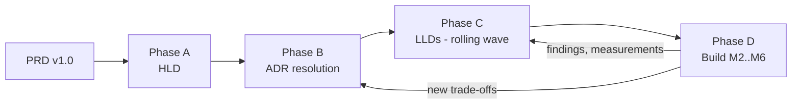

# Delivery Plan: PRD → HLD → LLD → Build

| Field | Value |
| --- | --- |
| Status | Accepted v1.0 — M1 closed, M2 in progress |
| Applies to | PRD v1.0, milestones M1–M6 |
| Last updated | 2026-10-17 |

## 1. Approach

The PRD's principles ("functional first", "progressive complexity", "evidence-based optimization") set how the design is sequenced. Design runs **rolling-wave**:

- The full HLD and every ADR are settled up front, because they constrain everything else.
- An LLD reaches `Accepted` **one milestone before** the code it governs is built.
- Later LLDs stay `Draft` and are revised with what earlier milestones teach.

| Phase | Output | Exit criteria |
| --- | --- | --- |
| A — HLD | [hld.md](architecture/hld.md) | Context, container, trust-boundary, and data-ownership views reviewed. Assumptions (ASM) and open questions (OQ) listed. |
| B — ADRs | [adr/](adr/README.md) | Every PRD §13.1 decision is `Accepted`, or `Deferred` with a named trigger. |
| C — LLDs | [architecture/lld/](architecture/lld/) | M2 LLDs (01–04, 08 minimal, 10 baseline, 11) `Accepted` before M2 starts. M3 LLDs accepted before M3, and so on. |
| D — Build | Code, tests, reports | Milestone exit evidence (§3) attached to the milestone review. |

## 2. Document readiness by milestone

| Document | Must be `Accepted` before | Notes |
| --- | --- | --- |
| HLD, ADR-0001..0016 | M2 start | ADR-0013/0014 may be accepted provisionally and revisited in M5/M6. |
| LLD-01 Identity/BFF/Sessions | M2 | |
| LLD-02 Authorization | M2 | |
| LLD-03 Organizations | M2 | |
| LLD-04 Audit/Notifications | M2 (audit part) | Notifications part before M4. |
| LLD-08 Messaging | M2 (outbox + audit/membership events) | Retry, DLQ, and saga parts before M4. |
| LLD-10 Observability | M2 (SDK baseline) | Collector, dashboards, and alerts before M6. |
| LLD-11 Security | M2 | Threat model updated every milestone. |
| LLD-15 Frontend | M2 (shell, auth) | Storefront parts before M3. |
| LLD-05, 06, 07, 09 (DB rules) | M3 | |
| LLD-09 (cache, rate limits, experiments), LLD-13 (resilience) | M4 | |
| LLD-12 Platform/Deployment | M5 | Compose topology is needed in M2. |
| LLD-13 (DR, failure lab) | M6 | |
| LLD-14 Testing | M2, with sections added per milestone | |

## 3. Milestone work breakdown

Epics are planning units, not tickets. Each epic cites the design section that governs it.

### M1 — Requirements and architecture (this doc set)

| Epic | Scope | Design ref |
| --- | --- | --- |
| E1.1 | HLD: context, containers, trust boundaries, data ownership map | HLD |
| E1.2 | ADRs for PRD §13.1 decisions plus tenancy, service identity, session store, saga style, ingress, deployables | ADR-0002..0016 |
| E1.3 | LLDs for M2 scope; drafts for the rest | LLD-01..15 |
| E1.4 | Threat model v1 (STRIDE per trust boundary) | LLD-11 §2 |
| E1.5 | ER diagrams per service schema; event catalog v0 | LLD-03/05/06/07, LLD-08 §4 |
| E1.6 | Contract inventory: list of OpenAPI documents and event schemas to be authored (names, owners) | HLD §9, LLD-08 |
| E1.7 | Answer the product owner's open questions (§5) | — |

**Exit evidence:** this doc set reviewed. ADR statuses recorded. OQ-1..OQ-4 answered, because they change data models.

**M1 closed 2026-10-17.** HLD and ADR-0001..0016 reviewed; all 16 are `Accepted` (ADR-0013 provisional until M6; ADR-0014 accepted with OQ-7's default). OQ-1..OQ-4 confirmed using the defaults recorded in §5. OQ-5, OQ-6, OQ-8, OQ-9 stay open and are resolved at the milestones they affect (§5). M2 can start.

### M2 — Identity and multi-tenancy

| Epic | Scope | Design ref |
| --- | --- | --- |
| E2.1 | Monorepo scaffold, FastAPI service template, shared libs (`sf-common`, `sf-authz`, `sf-messaging`, `sf-db`) | LLD-12 §1, HLD §11.5 |
| E2.2 | Docker Compose stack: PostgreSQL, Redis (session + cache), Keycloak, RabbitMQ, Mailpit, Jaeger (temporary trace viewer) | LLD-12 §3 |
| E2.3 | Keycloak realm as code: clients, flows, MFA, token lifetimes, audience mapper | LLD-01 §3 |
| E2.4 | BFF: login/callback/logout, sessions, CSRF, back-channel logout, step-up, refresh lock | LLD-01 §4–§9 |
| E2.5 | users-svc: JIT provisioning, lifecycle, handle uniqueness, Keycloak admin sync | LLD-01 §11 |
| E2.6 | orgs-svc: org lifecycle, memberships, invitations | LLD-03 |
| E2.7 | authz-svc + `sf-authz` enforcer library, route-coverage guard, policy watcher | LLD-02 |
| E2.8 | Outbox + relay + inbox (minimal); events: organization.*, membership.*, user.*, audit.recorded | LLD-08 §5–§6 |
| E2.9 | audit-svc: append-only store, query API | LLD-04 §2 |
| E2.10 | React shell: login, session bootstrap, org console (members, invitations, roles), platform admin (users, orgs) | LLD-15 |
| E2.11 | OTel SDK baseline in every service; structured logs with trace IDs | LLD-10 §2–§4 |
| E2.12 | Security test suites: session, CSRF, tenant-isolation matrix, privilege escalation, revocation latency | LLD-14 §4 |

**Exit evidence:** secure login with MFA through the BFF. No tokens reach the browser (automated check). Sessions work across 2 BFF replicas. Logout and admin revocation are verified. The tenant-isolation suite passes. Role-revocation latency is measured against its target (LLD-02 §8).

**Evidence so far:**
- **Role-revocation latency**, measured 2026-10-23: all three LLD-02 §8 targets met (p99: direct 0.27 s, membership-disabled 0.31 s, watcher-off 10.1 s). See the [report](reports/perf/2026-10-23-revocation-latency.md); reproduce with `make test-revocation-latency`.
- **Login, MFA, replicas, logout, admin revocation** (2026-10-24, `make test-system`, `tests/system/test_bff_login.py`). These run against the real Keycloak and two BFF replicas:
  - MFA enrollment at login for the `mfa-required` group; step-up to `acr=2` with one OTP.
  - Sessions work on both replicas, and logout on one ends them on both and in Keycloak.
  - Admin disable revokes every session within LLD-01 §8's 5 s and blocks the next login.
- **No tokens reach the browser** (same file): no token in any BFF response, and Redis holds them encrypted. The Playwright browser-storage check (LLD-14 §4) waits for the web E2E suite.
- **Tenant isolation** (2026-10-24, `make test-system`, `tests/system/test_tenant_isolation.py`): 14 org routes, 154 cells, zero 2xx. The matrix is generated from route metadata (LLD-14 §4).

> **Deviation from the PRD milestone table:** the PRD lists messaging under M4. M2 introduces RabbitMQ and the transactional outbox **only** for identity events (membership/role changes → policy, audit). Doing this in M2 avoids building a synchronous revocation path that M4 would then throw away. Retry tiers, DLQ tooling, and sagas stay in M4.

### M3 — Commerce

| Epic | Scope | Design ref |
| --- | --- | --- |
| E3.1 | catalog-svc: products, SKUs, categories, prices, promotions, images (presigned upload), optimistic locking | LLD-05 §2–§5 |

**E3.1 in progress (started 2026-10-24).** Built: categories, products (draft → active → archived, optimistic locking with `If-Match`/412/428), SKUs, promotions, the pricing quote endpoint (the pricing authority, LLD-05 §3 — unit-tested rounding, promotion windows, and cross-tenant SKU rejection), description Markdown→HTML sanitization (`nh3`), and the `store_pricing_settings` projection off `organization.*` events (verified live end to end: creating an org through orgs-svc lands a row in catalog-svc's projection via the real outbox → RabbitMQ → inbox consumer, no synchronous call to orgs-svc). Every route publishes its `Authorize`/`Internal` guard in OpenAPI (`x-sf-authz`), same as M2's services.
Also added: `GET /internal/v1/orgs/{orgId}/products:export` (`Internal("catalog:export")`), which search-svc's reindex job pages through.
Deferred (this epic's own open items): product images, promotion redemption limits, the public storefront reads (LLD-05 §6 — they need inventory-svc, which doesn't exist yet), a public/BFF-facing quote endpoint (only the internal one for orders-svc exists so far), and catalog-svc isn't yet wired into `tests/system/test_tenant_isolation.py`'s cross-service matrix (it has its own smaller one, `services/catalog-svc/tests/test_tenant_isolation.py`).

| E3.2 | search-svc: PostgreSQL FTS index fed by product events; query API; reindex job | LLD-05 §7–§9 |

**E3.2 in progress (started 2026-10-24).** Built: the `product_search_docs` table (a generated `tsvector` column — Postgres recomputes it itself, so it can't drift from `name`/`description`), the `product.*.v1` event consumer with the version-guard upsert/tombstone logic LLD-05 §7.2 specifies (unit- and mutation-tested: a removed guard was confirmed to make the out-of-order test fail), the `GET /v1/stores/{orgId}/search` query (relevance + trigram typo tolerance, category/price/in-stock filters, keyset pagination for `newest`/`price_*`, capped-offset for `relevance`), and the reindex CLI (`make search-reindex ORG_ID=...`), which reuses the exact same apply function the live consumer uses. Verified live end to end: publishing a product through catalog-svc's real API makes it searchable in search-svc within seconds, via the real outbox → RabbitMQ → inbox consumer, and the reindex CLI's own HTTP call against catalog-svc's export endpoint (with a real `sf-svc-search` Keycloak client, registered this epic) returns the right shape.
Deferred (this epic's own open items): `sku_availability`/`in_stock` (needs inventory-svc, which doesn't exist yet — `in_stock` is always `true`), category-name search weight (catalog-svc's event payload carries `category_id` only), facet counts, the `search_index_lag_seconds` freshness metric and its response header, the nightly drift check, tombstone/inbox row retention (no sweeper job, same deferral as every other service's inbox table), and reindexing *every* org in one run (`--org-id` only; "`--all`" needs a way to enumerate every org, which belongs to orgs-svc).
| E3.3 | cart-svc: persistent cart per (customer, store) | LLD-06 §2 |

**E3.3 in progress (started 2026-10-24).** Built: the lazy-created active cart (one per customer/org, a partial unique index — a race between two concurrent first requests is handled with `ON CONFLICT DO NOTHING` plus a re-select, not an advisory lock), set/remove/clear item routes (idempotent: removing an already-gone line, or every line from a cart that never existed, is still success), the 50-line cap (mutation-tested: removing the guard was confirmed to make its test fail), and the add-to-cart SKU validation against catalog-svc's new internal lookup endpoint (`Internal("catalog:read_sku")`, a real Keycloak client `sf-svc-cart` registered this epic — verified live: the real endpoint's response shape and its `available` computation both checked against a real catalog-svc). Every route's domain is the fixed string `"customer"` (LLD-02 §9 grants `role:customer` to every user on signup) — ownership (this customer's own cart, never another's) is enforced by `customer_id` filtering in the repository, not by Casbin, and is covered by its own isolation test. The nightly abandon job also shipped (`python -m app.cli abandon-expired`).
Deferred (this epic's own open items): the `order.confirmed.v1` consumer that subtracts purchased quantities after checkout (orders-svc, its publisher, doesn't exist yet) and the catalog SKU-lookup cache (LLD-09's cache is M4 scope — every add-to-cart call is a real synchronous lookup today).

| E3.4 | inventory-svc: stock, reservations, expiry sweeper, ledger | LLD-07 |

**E3.4 in progress (started 2026-10-24).** Built: `stock_items`/`reservations`/`reservation_lines`/`stock_movements` with INV-1..INV-5 as real `CHECK`/`UNIQUE` constraints (LLD-07 §2); reserve/commit/release/restock, each its own transaction opened from a `session_factory` (not a per-request session) so `sf_db.retry_on_transient` can replay the whole thing on a deadlock/serialization failure; ordered (`ASC sku_id`) pessimistic locking across every multi-SKU operation; the `inventory.availability_changed.v1` emit-only-on-flip logic; the expiry sweeper as an in-process asyncio loop (`SKIP LOCKED`, every 5s); the admin stock-adjust endpoint (optimistic `If-Match`, idempotent via the ledger's own `adjustment_id`); the `product.updated.v1` consumer that creates a zero-stock row per new SKU; and the nightly reconciliation CLI (`python -m app.cli reconcile`, INV-6, never auto-corrects). Verified live: the oversell test (stock 50, 200 concurrent reserves, exactly 50 succeed) and the multi-SKU opposite-lock-order test both pass against the real Postgres, and the expiry-vs-commit race lands in exactly one terminal state either way.
Simplified from the LLD's literal pseudocode: §4.1's 409 body (`{lines: [...]}`) doesn't fit this codebase's established problem-details convention (a short machine-readable `title`, no structured payload — confirmed by grepping every other service's routes.py), so a rejected reserve returns `title: "insufficient-stock"` with no per-line detail, same precedent as cart-svc's `sku-unavailable`.
Deferred (this epic's own open items): restock is command-consumer-only (`inventory.restock_requested.v1`); commit/release are reachable both via direct internal HTTP and the same commands (`q.inventory.commands`), but nothing publishes those commands yet since orders-svc doesn't exist; `low_stock_threshold` has no admin-facing endpoint to configure per SKU (defaults to 0); per-store reservation TTL override (LLD-07 §6 allows 300-3600s per store) isn't wired to any orgs-svc settings projection, so every store uses the one fixed default; no sweeper for this service's own `inbox` table (same deferral every other service's inbox table carries); and inventory-svc isn't wired into `tests/system/test_tenant_isolation.py`'s cross-service matrix yet (it has its own smaller one, `services/inventory-svc/tests/test_tenant_isolation.py`), same open item as catalog-svc/search-svc/cart-svc.
Also added to the realm (unassigned, same deferral as `catalog:quotes`/`cart:read`): the `inventory:reservations:write`/`inventory:reservations:read` client scopes — orders-svc, their only caller, doesn't exist yet. RabbitMQ topology gained `q.inventory.catalog` (`product.updated.v1`) and `q.inventory.commands` (`inventory.*_requested.v1`).

| E3.5 | orders-svc: checkout API with idempotency, saga state, order state machine, admin order ops | LLD-06 §3–§6 |
| E3.6 | payments-svc + mock-payment-provider: authorize/capture/void/refund, signed webhooks, scenarios | LLD-06 §7–§8 |
| E3.7 | Storefront UI: browse, search (debounced), cart, checkout, order history; commerce admin UI | LLD-15 |
| E3.8 | Concurrency tests: oversell, duplicate checkout, concurrent edits | LLD-14 §5 |

**Exit evidence:** an end-to-end commerce Playwright suite passes. A concurrency test shows zero oversell (N parallel checkouts against stock S → exactly S lines succeed). Duplicate submissions with the same idempotency key create one order. Data survives container restarts.

### M4 — Performance and distribution

| Epic | Scope | Design ref |
| --- | --- | --- |
| E4.1 | Baseline k6 workloads and environment description (before any optimization) | LLD-14 §6 |
| E4.2 | Experiments EXP-1..EXP-8 (N+1, indexing, pooling, cache, debounce, Bloom, replicas, partitioning) with before/after reports | LLD-09 §9 |
| E4.3 | Redis cache-aside for catalog/org metadata with invalidation and stampede protection | LLD-09 §6 |
| E4.4 | Distributed rate limiting (BFF) with 429 + RateLimit headers; edge per-IP limits | LLD-09 §7 |
| E4.5 | Full async saga: retry tiers, DLQ, replay tooling, reconciliation jobs | LLD-06 §5, §9; LLD-08 §7 |
| E4.6 | Resilience library hardening: deadlines, retries with jitter, circuit breakers, bulkheads, load shedding | LLD-13 §2 |
| E4.7 | notifications-svc + SSE order-status updates via BFF | LLD-04 §3, LLD-06 §10 |
| E4.8 | Failure tests in Compose with Toxiproxy (slow dependency, Redis/broker outage, duplicate events) | LLD-13 §3 |

**Exit evidence:** a before/after report for every experiment (kept or rejected, with data). Failure tests FS-1..FS-9 pass in Compose. Retry, duplicate, and DLQ behavior is demonstrated.

### M5 — Orchestration

| Epic | Scope | Design ref |
| --- | --- | --- |
| E5.1 | kind cluster bootstrap; operators (CloudNativePG, RabbitMQ Cluster Operator, Keycloak Operator); Redis Sentinel | LLD-12 §4 |
| E5.2 | Kustomize base/overlays for all services; Gateway API (Envoy Gateway) routes, TLS | LLD-12 §5–§6 |
| E5.3 | Probes, resources, HPA (CPU + custom metrics), PDBs, topology spread, graceful shutdown | LLD-12 §7–§8 |
| E5.4 | NetworkPolicies (default deny), service accounts, secrets via External Secrets/OpenBao | LLD-12 §9–§10 |
| E5.5 | CI/CD: build, scan, test, deploy to ephemeral kind, smoke tests, rollback | LLD-12 §12 |
| E5.6 | Release strategies: rolling (default), canary via HTTPRoute weights, blue-green; feature flags (OpenFeature + flagd) | LLD-12 §11 |

**Exit evidence:** a repeatable `make cluster-up && make deploy`. A rollout and rollback are recorded. Killing a pod shows traffic removed and the replacement becoming ready. Canary and blue-green demo recordings with their rollback criteria.

### M6 — Observability and reliability

| Epic | Scope | Design ref |
| --- | --- | --- |
| E6.1 | Collector agent + gateway tiers, tail sampling, redaction; Prometheus, Tempo, Loki, Grafana | LLD-10 §5, ADR-0013 |
| E6.2 | Dashboards (service health, checkout, DB, cache, messaging, Kubernetes) | LLD-10 §8 |
| E6.3 | Alerts and SLOs with error budgets, calibrated from M4 baselines | LLD-10 §9–§10 |
| E6.4 | Backups (CNPG WAL archiving to object storage), restore drills with measured RPO/RTO | LLD-13 §5 |
| E6.5 | Failure lab in-cluster (Chaos Mesh or scripted), runbooks, incident reports | LLD-13 §3–§4 |
| E6.6 | Clock-skew tests; optional experiments: serverless cold start, multi-region paper design | LLD-13 §6–§7 |

**Exit evidence:** a single trace runs browser → BFF → orders → inventory/payments → RabbitMQ → consumer. Injected failures are diagnosed from dashboards and alerts alone. A restore drill report gives the measured RPO/RTO. The release acceptance checklist (PRD §11) is complete.

## 4. Traceability

### 4.1 Functional requirements

| PRD ID | Design | Milestone | Verification (LLD-14) |
| --- | --- | --- | --- |
| FR-COM-01 Catalog | LLD-05 §2–§6 | M3 | API + E2E browse |
| FR-COM-02 Search/filters | LLD-05 §8, LLD-15 §5 | M3 | API validation, E2E, debounce EXP-5 |
| FR-COM-03 Catalog admin | LLD-05 §4, LLD-02 §4 | M3 | Authz matrix tests |
| FR-COM-04 Search correctness | LLD-05 §7, §9 | M3 | Index-lag metric, freshness test |
| FR-CHK-01 Cart | LLD-06 §2 | M3 | API + E2E |
| FR-CHK-02 Server-side totals | LLD-05 §3, LLD-06 §3 | M3 | Unit (pricing), tamper test |
| FR-CHK-03 Idempotent checkout | LLD-06 §4 | M3 | Duplicate-submit concurrency test |
| FR-CHK-04 Reservation | LLD-07 §4–§5 | M3 | Oversell concurrency test |
| FR-CHK-05 Payment boundary | LLD-06 §7–§8 | M3 | Mock scenarios: success/decline/timeout/dup callback |
| FR-CHK-06 Order tracking | LLD-06 §6, §10 | M3/M4 | Ownership tests, SSE test |
| FR-CHK-07 Cancel/refund | LLD-06 §6, §9 | M4 | Compensation + reconciliation tests |
| FR-ORG-01..03 | LLD-03 | M2 | API + E2E org admin |
| FR-ORG-04 Tenant isolation | LLD-02 §6, §10 | M2 | Cross-tenant matrix |
| FR-ORG-05 Org switching | LLD-03 §7, LLD-02 §6 | M2 | Switch-no-inheritance test |
| FR-ORG-06 Audit | LLD-04 §2 | M2 | Audit emission assertions |
| FR-ORG-07 Suspension | LLD-02 §9, LLD-03 §4 | M2 | Suspended-org/disabled-membership tests |
| FR-AUTH-01, 08 OIDC | LLD-01 §3–§4 | M2 | Integration tests vs Keycloak |
| FR-AUTH-02 BFF | LLD-01 §4–§8 | M2 | |
| FR-AUTH-03 Token isolation | LLD-01 §5, LLD-15 §3 | M2 | Response/storage scanner test |
| FR-AUTH-04 Shared sessions | LLD-01 §5, §12 | M2 | Multi-replica test |
| FR-AUTH-05 MFA | LLD-01 §9 | M2 | E2E with TOTP |
| FR-AUTH-06 Session protection | LLD-01 §5–§8 | M2 | Cookie/CSRF/rotation/expiry tests |
| FR-AUTH-07 User lifecycle | LLD-01 §11 | M2 | Disable → revocation test |
| PRD §2.3 Inventory | LLD-07 | M3 | Concurrency, expiry, reconciliation |
| PRD §2.5 Platform admin | LLD-01 §9, LLD-02 §4, LLD-04 | M2 | Step-up + audit tests |

### 4.2 Security controls

| PRD ID | Design | Verification |
| --- | --- | --- |
| SEC-01..15 | Full mapping in [LLD-11 §3](architecture/lld/11-security.md#3-control-mapping-sec-01sec-15) | LLD-14 §4 |

### 4.3 Failure scenarios (PRD §9.4)

All 12 scenarios map to FS-1..FS-12 in [LLD-13 §3](architecture/lld/13-reliability-dr.md#3-failure-scenario-catalog), each with an injection method, expected behavior, signals, and pass criteria.

### 4.4 Appendix B artifacts

| Artifact | Location | Milestone |
| --- | --- | --- |
| System context, container diagrams | HLD §3–§4 | M1 |
| OIDC sequence, session lifecycle | LLD-01 §4–§5 | M1 |
| Casbin model/policy examples, authz threat model | LLD-02 §3–§4, §10 | M1 |
| ER diagrams, data ownership map | HLD §8.2, ER sections in LLD-03/05/06/07 | M1 |
| Checkout/order/payment state machines, sequence | LLD-06 §5–§7 | M1 |
| Event catalog, versioning, retry/DLQ policy | LLD-08 §4, §8, §7 | M1 |
| ADRs | adr/ | M1, then ongoing |
| OTel plan, dashboards, alerts, SLOs | LLD-10 | M2 (plan) → M6 |
| Load-test scripts, before/after reports | `perf/` + `docs/reports/perf/` (planned) | M4 |
| Failure runbooks, incident reports | `docs/runbooks/`, `docs/reports/incidents/` (planned) | M4–M6 |
| Backup/restore runbook with measured RPO/RTO | `docs/runbooks/backup-restore.md` (planned) | M6 |
| Security test plan, CI gates | LLD-11 §8, LLD-14 §4, LLD-12 §12 | M2 → M5 |

### 4.5 Appendix A topic coverage

Each topic maps to a problem, where it is demonstrated, and how it is tested. "Exp" means it is a comparative experiment, not a production dependency.

| Topic | Problem it addresses | Where | Evidence |
| --- | --- | --- | --- |
| Rate limiting | Abuse of login/search/checkout | LLD-09 §7 | 429 tests, k6 |
| Caching, cache invalidation | Catalog read load | LLD-09 §6 | EXP-4 |
| Load balancing, reverse proxy, API gateway | Ingress, routing, health-aware LB | HLD §12, LLD-12 §6 | Pod-kill test |
| Docker, Kubernetes, service discovery | Repeatable deploy | LLD-12 | M5 evidence |
| Timeouts, retries, backoff, circuit breakers | Slow dependencies | LLD-13 §2 | FS-3 |
| Idempotency | Duplicate checkout/events | LLD-06 §4, LLD-08 §6 | FS-5, FS-8 |
| Message queues, pub/sub, EDA | Decoupled workflows | LLD-08 | Event flow tests |
| Distributed transactions, Saga | Checkout atomicity | LLD-06 §5 | Saga failure matrix |
| Dead-letter queues | Poison messages | LLD-08 §7 | DLQ test + replay |
| N+1, indexing, query optimization | Endpoint latency | LLD-09 §3, §9 | EXP-1, EXP-2 |
| Connection pooling | DB saturation | LLD-09 §2 | EXP-3 |
| Read replicas, replication | Read scale vs freshness | LLD-09 §4 | EXP-7 |
| WebSockets / long polling / SSE | Order status updates | LLD-06 §10 | SSE test; comparison note |
| CAP, eventual consistency | Partition behavior | HLD §8.4 | FS-11 |
| Optimistic / pessimistic locking | Product edits / stock | LLD-05 §4, LLD-07 §5 | Concurrency tests |
| Distributed locks | Token-refresh race | LLD-01 §6 | Refresh race test |
| Leader election | Singleton reconciliation job | LLD-06 §9 | Two-replica test |
| Partitioning | Audit/order growth | LLD-09 §5 | EXP-8 |
| Deadlocks | Multi-SKU reservations | LLD-07 §5 | Deadlock injection test |
| Feature flags, blue-green, canary, rolling | Safe release | LLD-12 §11 | M5 demos |
| Health/liveness/readiness | Traffic only to healthy pods | LLD-12 §7 | FS-6 |
| Monitoring, logging, tracing, alerts, SLOs, error budgets | Operability | LLD-10 | M6 evidence |
| JWT, OAuth/OIDC | Identity | LLD-01, ADR-0009 | Integration tests |
| SQLi, XSS, CSRF | Web attacks | LLD-11 §4 | ZAP + unit tests |
| Secrets, IAM, TLS, encryption | Data protection | LLD-11 §5–§6 | Config review, scans |
| WAF, DDoS | Edge protection | LLD-11 §7 | Verified only in target env (PRD §8) |
| Backup, DR, failover | Data loss | LLD-13 §5 | Restore drill |
| Chaos engineering | Unknown failure modes | LLD-13 §4 | Failure lab reports |
| Multi-region | Regional outage | LLD-13 §7 | Paper design (Exp) |
| Cold starts, serverless limits | Scale-to-zero trade-off | LLD-13 §8 | Exp (optional) |
| Cost optimization | Spend per workload | LLD-10 §11, LLD-14 §6 | Cost-per-workload report |
| Latency, throughput, p99 | Performance | LLD-14 §6 | k6 reports |
| Network partitions, clock skew | Distributed correctness | LLD-13 §3, §6 | FS-11, skew tests |
| Bloom filters | Expensive negative lookups | LLD-09 §8 | EXP-6 |
| Frontend debouncing | Search request volume | LLD-15 §5 | EXP-5 |

## 5. Open questions for the product owner

| ID | Question | Default used in this design | Impacts | Status |
| --- | --- | --- | --- | --- |
| OQ-1 | What is a tenant? | An **organization is a merchant store**. Catalog, inventory, orders, and staff are org-scoped. Customers are platform-level accounts (ADR-0002). | All data models | **Confirmed** 2026-10-17 |
| OQ-2 | Guest checkout? | No. Cart and checkout require login in v1. | Cart, BFF sessions | **Confirmed** 2026-10-17 |
| OQ-3 | Cart across multiple stores? | No. One cart per (customer, store); one order per store. | Cart, checkout | **Confirmed** 2026-10-17 |
| OQ-4 | Tax/shipping? | Flat per-store shipping fee and tax rate fields. No external calculation. | Pricing | **Confirmed** 2026-10-17 |
| OQ-5 | Self-registration? | Enabled in Keycloak with email verification. | Keycloak, users | **Confirmed** 2026-10-17 |
| OQ-6 | Capture timing? | Authorize at checkout, capture on order confirmation. | Payments | Open — resolve before M3 |
| OQ-7 | Staging environment target? | Local kind + ephemeral CI kind. Managed cluster optional (ADR-0014). | M5 | **Confirmed** 2026-10-17 (ADR-0014 accepted) |
| OQ-8 | Add a `platform_operator` role (DLQ replay, reconciliation, flags) below `super_user`? | Yes (LLD-02 §4). | Authz, ops console | Open — resolve before E2.7 |
| OQ-9 | Data retention for audit and orders? | Audit 400 days hot; orders indefinite (synthetic data). | Partitioning, DR | Open — resolve before M3 |

## 6. LLD review checklist

Adapted from PRD Appendix C. An LLD is `Accepted` when it:

1. States the problem and user/system impact, and lists the PRD IDs it covers.
2. Records alternatives and trade-offs (inline, or through an ADR link) and lists failure modes.
3. Defines data ownership, schemas, constraints, and invariants.
4. Defines API and event contracts at field level, or names the contract file to be authored.
5. Specifies timeouts, retries, and idempotency for every outbound interaction.
6. Specifies authorization (resource/action/domain) for every operation, plus the tenant-isolation implications.
7. Lists telemetry: metrics (with bounded labels), log events, and spans.
8. Lists automated tests, including negative and concurrency cases.
9. States operational limits, rollback, and recovery.
10. Has no unresolved `TBD` blocking the milestone. Remaining items are listed in *Open items* with an owner.

## 7. Planning risks

| Risk | Mitigation |
| --- | --- |
| Design docs drift from code | Contracts (OpenAPI, event JSON Schemas) live in the repo and are validated in CI. LLDs link to them instead of duplicating fields once they exist. |
| Thirteen deployables overwhelm a small team | ADR-0016 allows co-deploying low-traffic identity services in M2. Boundaries stay logical (separate schemas and modules). |
| M2 is front-loaded (identity + messaging + audit) | M2 messaging is minimal (outbox, relay, one exchange). Retry tiers and DLQ tooling wait for M4. |
| Experiments lack baselines | E4.1 baseline runs are a precondition for E4.2. Reports use the template in LLD-14 §6.4. |
