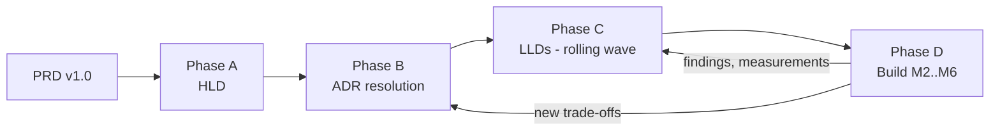

# Delivery Plan: PRD → HLD → LLD → Build

| Field | Value |
| --- | --- |
| Status | Accepted v1.0 — M1/M2 closed, M3 effectively complete (one item left, §3), M4 in progress |
| Applies to | PRD v1.0, milestones M1–M6 |
| Last updated | 2026-10-29 |

## 1. Approach

The PRD's principles ("functional first", "progressive complexity", "evidence-based optimization") set how the design is sequenced. Design runs **rolling-wave**:

- The full HLD and every ADR are settled up front, because they constrain everything else.
- An LLD reaches `Accepted` **one milestone before** the code it governs is built.
- Later LLDs stay `Draft` and are revised with what earlier milestones teach.

| Phase | Output | Exit criteria |
| --- | --- | --- |
| A — HLD | [hld.md](architecture/hld.md) | Context, container, trust-boundary, and data-ownership views reviewed. Assumptions (ASM) and open questions (OQ) listed. |
| B — ADRs | [adr/](adr/README.md) | Every PRD §13.1 decision is `Accepted`, or `Deferred` with a named trigger. |
| C — LLDs | [architecture/lld/](architecture/lld/) | M2 LLDs (01–04, 08 minimal, 10 baseline, 11) `Accepted` before M2 starts. M3 LLDs accepted before M3, and so on. |
| D — Build | Code, tests, reports | Milestone exit evidence (§3) attached to the milestone review. |

## 2. Document readiness by milestone

| Document | Must be `Accepted` before | Notes |
| --- | --- | --- |
| HLD, ADR-0001..0016 | M2 start | ADR-0013/0014 may be accepted provisionally and revisited in M5/M6. |
| LLD-01 Identity/BFF/Sessions | M2 | |
| LLD-02 Authorization | M2 | |
| LLD-03 Organizations | M2 | |
| LLD-04 Audit/Notifications | M2 (audit part) | Notifications part before M4. |
| LLD-08 Messaging | M2 (outbox + audit/membership events) | Retry, DLQ, and saga parts before M4. |
| LLD-10 Observability | M2 (SDK baseline) | Collector, dashboards, and alerts before M6. |
| LLD-11 Security | M2 | Threat model updated every milestone. |
| LLD-15 Frontend | M2 (shell, auth) | Storefront parts before M3. |
| LLD-05, 06, 07, 09 (DB rules) | M3 | |
| LLD-09 (cache, rate limits, experiments), LLD-13 (resilience) | M4 | |
| LLD-12 Platform/Deployment | M5 | Compose topology is needed in M2. |
| LLD-13 (DR, failure lab) | M6 | |
| LLD-14 Testing | M2, with sections added per milestone | |

## 3. Milestone work breakdown

Epics are planning units, not tickets. Each epic cites the design section that governs it.

### M1 — Requirements and architecture (this doc set)

| Epic | Scope | Design ref |
| --- | --- | --- |
| E1.1 | HLD: context, containers, trust boundaries, data ownership map | HLD |
| E1.2 | ADRs for PRD §13.1 decisions plus tenancy, service identity, session store, saga style, ingress, deployables | ADR-0002..0016 |
| E1.3 | LLDs for M2 scope; drafts for the rest | LLD-01..15 |
| E1.4 | Threat model v1 (STRIDE per trust boundary) | LLD-11 §2 |
| E1.5 | ER diagrams per service schema; event catalog v0 | LLD-03/05/06/07, LLD-08 §4 |
| E1.6 | Contract inventory: list of OpenAPI documents and event schemas to be authored (names, owners) | HLD §9, LLD-08 |
| E1.7 | Answer the product owner's open questions (§5) | — |

**Exit evidence:** this doc set reviewed. ADR statuses recorded. OQ-1..OQ-4 answered, because they change data models.

**M1 closed 2026-10-17.** HLD and ADR-0001..0016 reviewed; all 16 are `Accepted` (ADR-0013 provisional until M6; ADR-0014 accepted with OQ-7's default). OQ-1..OQ-4 confirmed using the defaults recorded in §5. OQ-5, OQ-6, OQ-8, OQ-9 stay open and are resolved at the milestones they affect (§5). M2 can start.

### M2 — Identity and multi-tenancy

| Epic | Scope | Design ref |
| --- | --- | --- |
| E2.1 | Monorepo scaffold, FastAPI service template, shared libs (`sf-common`, `sf-authz`, `sf-messaging`, `sf-db`) | LLD-12 §1, HLD §11.5 |
| E2.2 | Docker Compose stack: PostgreSQL, Redis (session + cache), Keycloak, RabbitMQ, Mailpit, Jaeger (temporary trace viewer) | LLD-12 §3 |
| E2.3 | Keycloak realm as code: clients, flows, MFA, token lifetimes, audience mapper | LLD-01 §3 |
| E2.4 | BFF: login/callback/logout, sessions, CSRF, back-channel logout, step-up, refresh lock | LLD-01 §4–§9 |
| E2.5 | users-svc: JIT provisioning, lifecycle, handle uniqueness, Keycloak admin sync | LLD-01 §11 |
| E2.6 | orgs-svc: org lifecycle, memberships, invitations | LLD-03 |
| E2.7 | authz-svc + `sf-authz` enforcer library, route-coverage guard, policy watcher | LLD-02 |
| E2.8 | Outbox + relay + inbox (minimal); events: organization.*, membership.*, user.*, audit.recorded | LLD-08 §5–§6 |
| E2.9 | audit-svc: append-only store, query API | LLD-04 §2 |
| E2.10 | React shell: login, session bootstrap, org console (members, invitations, roles), platform admin (users, orgs) | LLD-15 |
| E2.11 | OTel SDK baseline in every service; structured logs with trace IDs | LLD-10 §2–§4 |
| E2.12 | Security test suites: session, CSRF, tenant-isolation matrix, privilege escalation, revocation latency | LLD-14 §4 |

**Exit evidence:** secure login with MFA through the BFF. No tokens reach the browser (automated check). Sessions work across 2 BFF replicas. Logout and admin revocation are verified. The tenant-isolation suite passes. Role-revocation latency is measured against its target (LLD-02 §8).

**Evidence so far:**
- **Role-revocation latency**, measured 2026-10-23: all three LLD-02 §8 targets met (p99: direct 0.27 s, membership-disabled 0.31 s, watcher-off 10.1 s). See the [report](reports/perf/2026-10-23-revocation-latency.md); reproduce with `make test-revocation-latency`.
- **Login, MFA, replicas, logout, admin revocation** (2026-10-24, `make test-system`, `tests/system/test_bff_login.py`). These run against the real Keycloak and two BFF replicas:
  - MFA enrollment at login for the `mfa-required` group; step-up to `acr=2` with one OTP.
  - Sessions work on both replicas, and logout on one ends them on both and in Keycloak.
  - Admin disable revokes every session within LLD-01 §8's 5 s and blocks the next login.
- **No tokens reach the browser** (same file): no token in any BFF response, and Redis holds them encrypted. The Playwright browser-storage check (LLD-14 §4) waits for the web E2E suite.
- **Tenant isolation** (2026-10-24, `make test-system`, `tests/system/test_tenant_isolation.py`): 14 org routes, 154 cells, zero 2xx. The matrix is generated from route metadata (LLD-14 §4).

> **Deviation from the PRD milestone table:** the PRD lists messaging under M4. M2 introduces RabbitMQ and the transactional outbox **only** for identity events (membership/role changes → policy, audit). Doing this in M2 avoids building a synchronous revocation path that M4 would then throw away. Retry tiers, DLQ tooling, and sagas stay in M4.

### M3 — Commerce

| Epic | Scope | Design ref |
| --- | --- | --- |
| E3.1 | catalog-svc: products, SKUs, categories, prices, promotions, images (presigned upload), optimistic locking | LLD-05 §2–§5 |

**E3.1 in progress (started 2026-10-24).** Built: categories, products (draft → active → archived, optimistic locking with `If-Match`/412/428), SKUs, promotions, the pricing quote endpoint (the pricing authority, LLD-05 §3 — unit-tested rounding, promotion windows, and cross-tenant SKU rejection), description Markdown→HTML sanitization (`nh3`), and the `store_pricing_settings` projection off `organization.*` events (verified live end to end: creating an org through orgs-svc lands a row in catalog-svc's projection via the real outbox → RabbitMQ → inbox consumer, no synchronous call to orgs-svc). Every route publishes its `Authorize`/`Internal` guard in OpenAPI (`x-sf-authz`), same as M2's services.
Also added: `GET /internal/v1/orgs/{orgId}/products:export` (`Internal("catalog:export")`), which search-svc's reindex job pages through.
Deferred (this epic's own open items): product images, promotion redemption limits, the public storefront reads (LLD-05 §6 — they need inventory-svc, which doesn't exist yet), a public/BFF-facing quote endpoint (only the internal one for orders-svc exists so far), and catalog-svc isn't yet wired into `tests/system/test_tenant_isolation.py`'s cross-service matrix (it has its own smaller one, `services/catalog-svc/tests/test_tenant_isolation.py`).

| E3.2 | search-svc: PostgreSQL FTS index fed by product events; query API; reindex job | LLD-05 §7–§9 |

**E3.2 in progress (started 2026-10-24).** Built: the `product_search_docs` table (a generated `tsvector` column — Postgres recomputes it itself, so it can't drift from `name`/`description`), the `product.*.v1` event consumer with the version-guard upsert/tombstone logic LLD-05 §7.2 specifies (unit- and mutation-tested: a removed guard was confirmed to make the out-of-order test fail), the `GET /v1/stores/{orgId}/search` query (relevance + trigram typo tolerance, category/price/in-stock filters, keyset pagination for `newest`/`price_*`, capped-offset for `relevance`), and the reindex CLI (`make search-reindex ORG_ID=...`), which reuses the exact same apply function the live consumer uses. Verified live end to end: publishing a product through catalog-svc's real API makes it searchable in search-svc within seconds, via the real outbox → RabbitMQ → inbox consumer, and the reindex CLI's own HTTP call against catalog-svc's export endpoint (with a real `sf-svc-search` Keycloak client, registered this epic) returns the right shape.
Deferred (this epic's own open items): `sku_availability`/`in_stock` (needs inventory-svc, which doesn't exist yet — `in_stock` is always `true`), category-name search weight (catalog-svc's event payload carries `category_id` only), facet counts, the `search_index_lag_seconds` freshness metric and its response header, the nightly drift check, tombstone/inbox row retention (no sweeper job, same deferral as every other service's inbox table), and reindexing *every* org in one run (`--org-id` only; "`--all`" needs a way to enumerate every org, which belongs to orgs-svc).
| E3.3 | cart-svc: persistent cart per (customer, store) | LLD-06 §2 |

**E3.3 in progress (started 2026-10-24).** Built: the lazy-created active cart (one per customer/org, a partial unique index — a race between two concurrent first requests is handled with `ON CONFLICT DO NOTHING` plus a re-select, not an advisory lock), set/remove/clear item routes (idempotent: removing an already-gone line, or every line from a cart that never existed, is still success), the 50-line cap (mutation-tested: removing the guard was confirmed to make its test fail), and the add-to-cart SKU validation against catalog-svc's new internal lookup endpoint (`Internal("catalog:read_sku")`, a real Keycloak client `sf-svc-cart` registered this epic — verified live: the real endpoint's response shape and its `available` computation both checked against a real catalog-svc). Every route's domain is the fixed string `"customer"` (LLD-02 §9 grants `role:customer` to every user on signup) — ownership (this customer's own cart, never another's) is enforced by `customer_id` filtering in the repository, not by Casbin, and is covered by its own isolation test. The nightly abandon job also shipped (`python -m app.cli abandon-expired`).
Deferred (this epic's own open items): the `order.confirmed.v1` consumer that subtracts purchased quantities after checkout (orders-svc, its publisher, doesn't exist yet) and the catalog SKU-lookup cache (LLD-09's cache is M4 scope — every add-to-cart call is a real synchronous lookup today).

| E3.4 | inventory-svc: stock, reservations, expiry sweeper, ledger | LLD-07 |

**E3.4 in progress (started 2026-10-24).** Built: `stock_items`/`reservations`/`reservation_lines`/`stock_movements` with INV-1..INV-5 as real `CHECK`/`UNIQUE` constraints (LLD-07 §2); reserve/commit/release/restock, each its own transaction opened from a `session_factory` (not a per-request session) so `sf_db.retry_on_transient` can replay the whole thing on a deadlock/serialization failure; ordered (`ASC sku_id`) pessimistic locking across every multi-SKU operation; the `inventory.availability_changed.v1` emit-only-on-flip logic; the expiry sweeper as an in-process asyncio loop (`SKIP LOCKED`, every 5s); the admin stock-adjust endpoint (optimistic `If-Match`, idempotent via the ledger's own `adjustment_id`); the `product.updated.v1` consumer that creates a zero-stock row per new SKU; and the nightly reconciliation CLI (`python -m app.cli reconcile`, INV-6, never auto-corrects). Verified live: the oversell test (stock 50, 200 concurrent reserves, exactly 50 succeed) and the multi-SKU opposite-lock-order test both pass against the real Postgres, and the expiry-vs-commit race lands in exactly one terminal state either way.
Simplified from the LLD's literal pseudocode: §4.1's 409 body (`{lines: [...]}`) doesn't fit this codebase's established problem-details convention (a short machine-readable `title`, no structured payload — confirmed by grepping every other service's routes.py), so a rejected reserve returns `title: "insufficient-stock"` with no per-line detail, same precedent as cart-svc's `sku-unavailable`.
Deferred (this epic's own open items): restock is command-consumer-only (`inventory.restock_requested.v1`); commit/release are reachable both via direct internal HTTP and the same commands (`q.inventory.commands`), but nothing publishes those commands yet since orders-svc doesn't exist; `low_stock_threshold` has no admin-facing endpoint to configure per SKU (defaults to 0); per-store reservation TTL override (LLD-07 §6 allows 300-3600s per store) isn't wired to any orgs-svc settings projection, so every store uses the one fixed default; no sweeper for this service's own `inbox` table (same deferral every other service's inbox table carries); and inventory-svc isn't wired into `tests/system/test_tenant_isolation.py`'s cross-service matrix yet (it has its own smaller one, `services/inventory-svc/tests/test_tenant_isolation.py`), same open item as catalog-svc/search-svc/cart-svc.
Also added to the realm: the `inventory:reservations:write`/`inventory:reservations:read` client scopes (unassigned at the time — orders-svc, their only caller, didn't exist yet; assigned to `sf-svc-orders` once E3.5 shipped). RabbitMQ topology gained `q.inventory.catalog` (`product.updated.v1`) and `q.inventory.commands` (`inventory.*_requested.v1`).

| E3.5 | orders-svc: checkout API with idempotency, saga state, order state machine, admin order ops | LLD-06 §3–§6 |

**E3.5 in progress (started 2026-10-25).** Built: the idempotency-key algorithm (LLD-06 §4) as a reusable module (claim/attach-resource/complete), with a lease-takeover path that resumes reserve/authorize from the retried request's own body rather than re-creating the order; the checkout saga's synchronous path (snapshot → quote → order+lines+saga(RESERVING)+`outbox(order.created)` → reserve → authorize → `COMMITTING`+`inventory.commit_requested`), each guarded transition auto-stamping `next_action_at` (non-terminal states become immediately eligible for recovery, terminal ones clear it — centralized in `repository.guarded_transition` rather than left to every call site to remember); the async continuation past `COMMITTING` (`inventory.committed.v1` → `CAPTURING`+`payment.capture_requested`, real today since inventory-svc exists and publishes it); the recovery worker (`SKIP LOCKED`, every 2s, with a short claim lease so a concurrent tick can't double-claim the gap between the claim committing and `recover_one` re-locking); and the order admin ops (customer/admin list, detail, cancel, staff transition with `If-Match`, refund-request). Clients for cart-svc/catalog-svc/inventory-svc share one `sf-svc-orders` service identity/token across all three scopes.
Simplified from the LLD: §5.1's sequence diagram shows the cart snapshot and catalog quote as parallel (`par`) calls, but the quote needs the snapshot's own line items to price — there's no way to start both at once; run sequentially instead. §4.1's 409/402 bodies are `title`-only (same ADR-0015 reasoning as inventory-svc's `insufficient-stock`). §5.2's `RE_RESERVING`/`RESTOCKING`/`VOIDING` states exist in the schema's `CHECK` constraint but their full retry loops aren't built: a reservation expiring mid-`COMMITTING` cancels outright rather than re-reserving, and a failed capture is treated as permanently failed on the first failure rather than retried 5× — both documented simplifications, not gaps nobody noticed (LLD-06's own "As built" note has the detail). The recovery worker cannot retry `RESERVING`/`AUTHORIZING`/`AUTH_PENDING` itself — orders-svc never persists the raw payment token (by design), so only a client retry of the same idempotent request can resume those; the worker's own job there is strictly deadline compensation.
Verified live: booted orders-svc against the real dev stack (Postgres, RabbitMQ, Keycloak) — `/readyz` confirms the relay, both inbox consumers (`q.orders.inventory`, `q.orders.payments`), and the recovery worker all start. The synchronous checkout path (cart snapshot → catalog quote → inventory reserve) and the `inventory.committed.v1` → `CAPTURING` continuation both exercise the real cart-svc/catalog-svc/inventory-svc contracts via fakes built to those contracts' exact shapes; payments-svc doesn't exist yet (E3.6 next), so authorize/capture are necessarily fakes today — the mock provider's own magic-token scenarios (`pm_mock_success`/`pm_mock_decline`/`pm_mock_timeout`, LLD-06 §8.1) are reused as the fake's scenario keys for continuity once E3.6 lands.
Found and fixed while building this (feeds back into earlier epics, not just this one): cart-svc's internal snapshot endpoint was keyed by `cart_id`, but checkout only ever knows `(customer_id, org_id)` — added `GET /internal/v1/customers/{customerId}/carts/{orgId}:snapshot` to cart-svc, reusing its existing `cart:read` scope.
Also added to the realm: `sf-svc-orders` (the first client needing several internal scopes from different services at once — `cart:read`, `catalog:quotes`, `inventory:reservations:write`, `inventory:reservations:read` — all now assigned, closing out every "not yet assigned" deferral from E3.1–E3.4). RabbitMQ topology gained `q.orders.inventory`, `q.orders.payments`, and `q.payments.commands` (the last one declared ahead of payments-svc the same way `q.inventory.commands` was declared ahead of orders-svc — without it, `payment.capture_requested.v1`/`payment.refund_requested.v1` would NO_ROUTE-fail the outbox relay forever).
Deferred at the time (resolved once E3.6 shipped, see below): R2/R4/R5/R6 reconciliation and the `AUTH_PENDING`/capture-retry paths' real behavior all needed payments-svc to exist.
Deferred (this epic's own open items, beyond the simplifications above): R1's dedicated stuck-saga reporting/alerting (the recovery worker's own retry is built, but R1's 5-minute report isn't a separate job); R3 (orphan reservations) is buildable without payments-svc but deferred to keep scope bounded, since the recovery worker's deadline compensation already covers the common case; the idempotency table's 24h cleanup job (same deferred-retention pattern every service's `inbox` table carries); the real-time order-status long-poll (`GET /v1/orders/{id}/status?wait=`) accepts `wait` but returns immediately — the redis-cache fan-out it needs is E4.7 (SSE, M4) scope; and orders-svc isn't wired into `tests/system/test_tenant_isolation.py`'s cross-service matrix yet (own smaller one, `services/orders-svc/tests/test_tenant_isolation.py`).

| E3.6 | payments-svc + mock-payment-provider: authorize/capture/void/refund, signed webhooks, scenarios | LLD-06 §7–§8 |

**E3.6 in progress (started 2026-10-25).** Built: **mock-payment-provider**, in-memory only (no DB — a disposable sandbox, "outside the trust boundary" per ADR-0008), implementing every §8.1 scenario token (`pm_mock_success/decline/timeout/delayed_webhook/duplicate_webhook/out_of_order/capture_fail/auth_expires`), signed webhook delivery (`SF-Signature: t=...,v1=...`) via a background loop, and the `/__mock/...` control API tests use to fire a scenario's webhook on demand instead of waiting out its real delay (up to 60s). **payments-svc**: `payment_attempts`/`payment_events`/`provider_webhooks`/`refunds` with INV-5-style idempotency (a partial `UNIQUE(order_id)` backstop, a `provider_intent_id` unique constraint, and the webhook dedup table's own PK); `authorize` idempotent by `order_id` and resumable by replaying the same provider idempotency key; the `capturing→authorized` revert on a failed capture (LLD-06 §7.2); the webhook handler (§8.2's full six-step sequence, including the out-of-order sequence guard and a metadata-based correlation path for an attempt that never got a synchronous `provider_intent_id`); and R2 (unknown-payment reconciliation, resolving a stale `unknown` attempt by replaying its own authorize call rather than a bare status query, since the provider has no "look up by idempotency key" endpoint). First service with no Casbin enforcer at all — every route is `Internal(...)` or the signature-guarded webhook, never `Authorize(...)`.
Closed real gaps found while wiring this in (not simplifications, corrections): orders-svc's `PaymentsClient.authorize()` had no path for payments-svc's own "202 unknown" response (added `PaymentPending`, handled identically to a network timeout); `on_capture_failed` fired `inventory.restock_requested` but never `payment.void_requested` (added it — the authorization hold was never being released on a failed capture); and two new orders-svc consumers, `on_payment_voided`/`on_payment_refunded`, close the `payment_status` loop for both compensation paths (neither existed before — admin cancel/refund fired their commands but never recorded completion).
Verified live: booted mock-payment-provider and payments-svc together against the real dev stack and drove a real authorize call through to a real signed webhook delivery — confirmed in payments-svc's own `provider_webhooks` table (`signature_valid = true`), not asserted from a test double. The full six-service checkout (cart→catalog→inventory→orders→payments→provider) through a real Keycloak login is not yet exercised end-to-end; that needs the Storefront UI (E3.7) or a dedicated system test to drive it through a real session rather than by hand.
Simplified from the LLD (symmetric with orders-svc's own capture-retry simplification, LLD-06's "As built" note): a failed capture is treated as resolved on the first attempt (`authorized`, with `last_error_code` set), not retried 5× internally before telling orders-svc.
Also added to the realm: the `payments:authorize` client scope, assigned to `sf-svc-orders` (payments-svc itself needed no new service identity — its only outbound calls are to mock-payment-provider, which is outside the trust boundary and has no Keycloak client of its own). RabbitMQ topology gained `payment.void_requested.v1` on `q.payments.commands`, and `payment.voided.v1`/`payment.refunded.v1` on `q.orders.payments`.
Deferred (this epic's own open items): R4/R5/R6 reconciliation (money-without-an-order, confirmed-but-uncaptured, ledger checks) — all cross-service nets beyond R2's own scope; the `provider_webhooks`/`idempotency_keys`-style retention cleanup; webhook delivery retry-with-backoff on a non-2xx response (LLD-06 §8.2: "the provider retries webhooks with backoff" — this mock logs and drops instead); and payments-svc isn't wired into the cross-service tenant-isolation matrix (it has no `Authorize(...)` routes to generate one from in the first place).

| E3.7 | Storefront UI: browse, search (debounced), cart, checkout, order history; commerce admin UI | LLD-15 |

**E3.7 in progress (started 2026-10-25).** Built: the storefront (`/s/:orgId/*` — browse/search with a 300ms debounce and a 2-char minimum via `useDebouncedValue`, product detail with client-side catalog+inventory composition, cart with qty/remove and a client-computed subtotal, checkout with a per-cart idempotency key in `sessionStorage` per LLD-15 §4); the account area (`/account/*` — order history, an order status page that polls every 2s while `status === "pending"`, customer cancel); and the commerce admin console (`/console/orgs/:orgId/{catalog,inventory,orders}` — product/SKU CRUD + publish/archive, stock list + adjust, org order list + staff transition/cancel/refund). Six new `lib/api/*` client modules (`catalog`, `search`, `cart`, `inventory`, `orders`) and `error-ux.ts` gained a `conflict` kind generalizing LLD-15 §8's `out-of-stock`/`cart-changed`/`payment-declined`/`checkout-in-progress`/etc. problem titles into one lookup table instead of three hardcoded cases.
Closed real gaps found while wiring this in (not simplifications — catalog-svc's own LLD-05 §14 deferral, now actually blocking this epic): catalog-svc had **no public storefront reads at all** beyond search-svc's own `/v1/stores/{orgId}/search` — added `GET /v1/stores/{orgId}/products/{slug}` (active-only product+SKUs), `GET /v1/stores/{orgId}/categories`, and a new `GET /v1/stores/{orgId}/skus` batch lookup (the cart page's only way to show what a line item actually is, since cart-svc's own cart rows are just `sku_id`/`qty` — mirrors inventory-svc's public `availability?sku_ids=` batching). Separately, the BFF's reverse proxy (`services/bff/app/proxy.py`) only ever knew `orgs`/`authz`/`users` — every one of this epic's `/api/catalog/**`, `/api/search/**`, `/api/cart/**`, `/api/inventory/**`, `/api/orders/**` calls would have 404'd as "unknown service" without extending `_service_base_urls`; `payments` is deliberately left out of that map (every payments-svc route is `Internal(...)` or the provider webhook, nothing a browser's own access token should ever reach).
Simplified from the LLD: `/s/:storeSlug/*` (§2) is `/s/:orgId/*` instead — there's no slug→org_id resolver service, same class of gap as LLD-05's own deferred public quote endpoint. §6's "BFF-side composition" (catalog product + inventory availability, one server round trip) is done client-side instead (two parallel requests, merged in `ProductDetailPage`); "availability unknown" still degrades the same way the LLD specifies (checkout validates for real regardless). §6's `<SafeHtml>`/DOMPurify client-side re-sanitization is deferred — product descriptions render via `dangerouslySetInnerHTML` directly, relying on catalog-svc's existing server-side `nh3` allow-list sanitizer (LLD-05 §2) as the only layer for now. §5's category/price/sort filters and the categories sidebar aren't wired into `BrowsePage` yet — only `q` is. §7's SSE is M4 scope per the LLD's own milestone column; the order status page's 2s poll is the designed fallback, used as the primary mechanism for now. There is no public store directory — reaching a storefront needs a direct `/s/:orgId` link, same gap as the slug resolver above; `SignInPrompt` was adjusted so an already-authenticated shopper with no staff memberships sees "you're signed in" instead of a misleading "sign in to continue."
Verified live: the Python side is fully real — `make test` (522 tests across every service, including new integration tests against live Postgres for catalog-svc's three new routes and bff's proxy routing table), `make lint`/`make typecheck` clean workspace-wide. The frontend side is `tsc -b` clean, `vite build` succeeds with the expected per-route code splitting, and 17 Vitest + React Testing Library tests exercise real component rendering against MSW-mocked network calls (`BrowsePage`'s debounce end-to-end, `CartPage`'s catalog-enriched subtotal, the API client, the debounce hook, `error-ux`). **Not done**: a real-browser Keycloak login click-through. The registered `sf-bff` redirect URI (`http://localhost:8020/auth/callback`) lands the browser on the bff's bare origin after login, and bff has no static-file-serving route for the built SPA (`apps/web/dist`) — a pre-existing local-dev-workflow gap this epic didn't introduce and doesn't fix, not something discovered to be broken by this epic's own code.
Deferred (this epic's own open items, beyond the simplifications above): account profile/notifications pages (LLD-15 §2 lists them under `/account/*`; only orders is built); the Playwright E2E suite and axe accessibility smoke (LLD-15 §10); Web Vitals/route-timing telemetry (§9) and the OTel Web SDK; the `<SafeHtml>` component and its ESLint rule; category/price/sort search filters; and the bff static-file-serving gap noted above (belongs to whichever epic owns the production deployment topology, not this one).

| E3.8 | Concurrency tests: oversell, duplicate checkout, concurrent edits | LLD-14 §5 |

**E3.8 done (started 2026-10-25, closed 2026-10-28).** Built: `tests/system/test_commerce_concurrency.py`, the first time the full checkout saga runs end to end across six real processes (catalog/cart/inventory/orders/payments-svc + mock-payment-provider) under a real concurrent race rather than any one service's own fakes. Oversell: 50 distinct customers checking out the same SKU at once against stock 20 — exactly 20 get a synchronous 202 that settles to `confirmed`, the other 30 get a synchronous 409 `out-of-stock` (never a silent later failure), and inventory-svc's own ledger lands at `on_hand = reserved = 0` afterwards. Duplicate checkout: one cart, 20 concurrent checkout calls with 20 distinct idempotency keys — exactly one order, the other 19 rejected `cart-changed` by the real DB-level partial unique index under a genuine commit race (not a sequential call-then-call-again). Multi-SKU opposite-order reservations, the expiry-vs-commit race, and concurrent product edits are deliberately not re-proven here — they already have real `asyncio.gather` concurrency coverage at each owning service's own `test_concurrency.py` (catalog-svc, inventory-svc), and this file's own docstring says so rather than silently skipping them.
Found and fixed while stabilizing this (infra, not application logic): 50 concurrent checkouts fan out across 5 services' own DB pools at once (request-handling pool plus one engine per background worker — relay, inbox consumer(s), recovery/sweeper — LLD-09 §2's bulkhead pattern), which routinely exceeded local Postgres's image-default `max_connections` (100) once this machine's own already-running dev services' idle pools were added on top; raised to 300 in `deploy/compose/compose.yaml` (a local-Compose setting, not a production topology change) rather than shrinking the test's own customer/stock counts to something less representative. `_SETTLE_TIMEOUT_S` (30s → 90s) absorbs this host's real async-settle latency for 20 concurrently-confirming orders, which is a throughput ceiling of this laptop running 7 extra processes at once, not a stuck order — verified by grepping each service's own log for exactly one `order.confirmed.v1`/order per accepted checkout, every run.
Verified live: 3 consecutive `make test-system` runs, all 13 system tests green (55–69s total), including both concurrency tests at full scale.
Deferred at the time (resolved 2026-10-28, see the "Browser E2E done" paragraph below): the Playwright E2E commerce suite, blocked on the bff static-file-serving gap (E3.7).

**Exit evidence:** an end-to-end commerce Playwright suite passes. A concurrency test shows zero oversell (N parallel checkouts against stock S → exactly S lines succeed). Duplicate submissions with the same idempotency key create one order. Data survives container restarts.

**Browser E2E done 2026-10-28.** `tests/system/test_checkout_browser.py`: a real Chromium browser (Playwright, driven via `playwright.async_api` directly rather than the pytest-playwright plugin, to stay on tests/system's one pytest-asyncio event loop) logs in through the real Compose Keycloak, lands on a seeded product page, adds it to cart, checks out with the mock provider's success token, and sees the order reach `confirmed` — the first time the full six-service checkout has run through a rendered page and a real session rather than `keycloak.py`'s own HTTP-level `Browser` or any service's own fakes. `sf-bff`'s realm registration gained a third redirect URI/web origin (`http://localhost:18180/*`) for this specifically: a real browser really navigates to whatever `redirect_uri` it's sent, unlike the scripted client `test_bff_login.py` uses, which only needs the value to *look* right to the OIDC flow.
Found and fixed by this test, not a simplification: `services/bff/app/proxy.py`'s generic `/api/**` forward built its own downstream header set from scratch (`Authorization`/`X-Correlation-Id`/`traceparent` only) and silently dropped every other header the SPA actually sends — `Idempotency-Key` (LLD-06 §4, checkout/cancel/refund) and `If-Match` (catalog/inventory/orders/authz's own optimistic-locking routes). Checkout through the BFF had been failing on this unconditionally since E3.7 shipped; nothing had caught it because every other test either talks to a service directly (bypassing the proxy) or fakes the downstream call. Fixed with an explicit allow-list (`_FORWARDED_REQUEST_HEADERS`) and a regression test (`services/bff/tests/test_proxy.py::test_idempotency_key_and_if_match_are_forwarded_downstream`) that reverts the fix and confirms it fails without it.
Also closes LLD-15 §11's "not done" line (a real-browser Keycloak login click-through): `services/bff/app/spa.py` (new) serves `apps/web`'s built SPA with an `index.html` fallback for client-side routes, mounted last so it never shadows `/api/**`/`/auth/**`; opt-in via `SF_WEB_DIST_DIR`, unset everywhere else (every other deployment, and Kubernetes per LLD-12 §6's separate `web` gateway backend, are unaffected).
Deferred (this test's own open items): only the success path is covered (one scenario, one customer) — `pm_mock_decline`/concurrent-browser scenarios aren't; orgs-svc/authz-svc aren't started (role:customer is granted directly over SQL + a redis-cache `authz:policy` publish, standing in for authz-svc's own `user.created` consumer, module docstring has the detail); and "data survives container restarts" (this exit evidence's own third sentence) still isn't built.

### M4 — Performance and distribution

| Epic | Scope | Design ref |
| --- | --- | --- |
| E4.1 | Baseline k6 workloads and environment description (before any optimization) | LLD-14 §6 |
| E4.2 | Experiments EXP-1..EXP-8 (N+1, indexing, pooling, cache, debounce, Bloom, replicas, partitioning) with before/after reports | LLD-09 §9 |
| E4.3 | Redis cache-aside for catalog/org metadata with invalidation and stampede protection | LLD-09 §6 |

**E4.3 in progress (started 2026-10-29).** Built `sf_common.CacheClient` (LLD-09 §6, in `sf-common` alongside the LLD-13 resilience library it reuses — its own `Bulkhead` for the §6.4 per-pod cache-miss-load semaphore, its own `CircuitBreaker` for the §6.4 cache-client breaker, same "build once in sf-common, wire into one real caller" pattern as E4.6): versioned values with a Lua "set if newer or absent" script (§6.2, guards against a slow loader clobbering a fresher write); TTL ± jitter with a soft-TTL stale-while-revalidate split (§6.3.1-2, serves the stale value immediately and refreshes in the background rather than making the request wait); a cross-pod refresh lock plus a bounded (150ms) poll for a hard-miss peer's write (§6.3.3); per-pod single-flight so concurrent callers for the same key in one process share one load (§6.3.4); and the three §6.5 metrics. 10 unit tests (version-guard rejection, soft-stale background refresh, cross-pod lock/wait, per-pod single-flight, breaker-opens-on-repeated-failure, bulkhead-saturated propagates rather than being swallowed).
Wired into catalog-svc's storefront product read (§6.1's own named example, `cat:v1:prod:{org}:{slug}`, 300s TTL) — the one cache this LLD row names a concrete key/TTL for. Invalidated from `update_product`/`publish_product`/`archive_product` via `BackgroundTasks`, not inline: `get_session`'s own docstring forbids awaiting an outbound call (Redis included) while its `session.begin()` holds a pooled connection open, and a background task only runs once the response — and that dependency's commit — is already done. `BulkheadFullError` from a saturated load semaphore maps to the LLD's own 503 `Retry-After: 1`.
Verified live: 2 new integration tests (`test_storefront_product_read_reflects_an_archive_immediately`, `...an_update_immediately`) against the real local Postgres and redis-cache (not fakes) — pre-existing `test_storefront_product_read_only_sees_published_products` already exercised the basic cache-populate-on-first-read path, now confirmed by name. Full workspace suite (133 lib tests, every service's own suite) and `make test-system` (14/14) both green afterward.
Deferred (this epic's own open items): the negative-lookup cache (`cat:v1:prod404:*`, §6.1's own other row) isn't built — a 404 slug always costs a real DB query; category tree and store-profile caching (§6.1's other two named rows, orgs-svc/catalog-svc) aren't wired, only product detail is; a SKU-only edit (price, stock) doesn't invalidate the product cache, bounded by its own 300s TTL; the "double delete" half of §6.1's own invalidation rule (a consumer of catalog-svc's own `product.updated` event, for the narrow race a single delete-after-commit doesn't close) isn't built — catalog-svc has no self-consumption queue, and building one for this alone was more scope than this pass's bar.

| E4.4 | Distributed rate limiting (BFF) with 429 + RateLimit headers; edge per-IP limits | LLD-09 §7 |

**E4.4 in progress (started 2026-10-29).** Built `services/bff/app/ratelimit.py`: GCRA (generic cell rate algorithm) over a Redis Lua script shared across replicas (§7.1 — the same algorithm go-redis/redis_rate uses, adapted with millisecond-scaled integer outputs since Redis truncates a Lua number reply to an integer), an in-process fallback that divides the limit by replica count when redis-cache is unreachable (stricter still, ÷2 more, for `auth`/`enumeration` per §7.2), and the `ratelimit_decisions_total`/`ratelimit_fallback_active` metrics. 5 of §7.2's 7 rate-based classes are wired in: `auth` on `/auth/login`, `/auth/step-up`, `/auth/callback` (keyed by client IP, read from `X-Forwarded-For` at the configured trusted hop count, never trusted beyond that); `search`/`checkout`/`public`/`mutation` on the generic `/api/**` proxy, keyed by the session's own user id. `sse` (this module's own `RateLimitClass`) is never wired to anything — correctly: the SSE endpoint E4.7 later built enforces its own "3 concurrent streams" cap as a concurrency limiter (`sse.PerUserStreamLimiter`), not a GCRA rate, matching §7.2's own "concurrency counter, not a rate" note; `enumeration`/`admin_expensive` aren't distinguished from `public`/`mutation` by the classifier (`ratelimit.classify`) — it infers a class from (service, path, method) rather than per-route metadata (the more faithful approach, matching authz-svc's own `x-sf-authz` OpenAPI tagging, is future work), and neither of those two classes' own routes (handle availability, invitation accept, exports, reindex triggers) are pattern-matched specifically. Burst values the LLD doesn't state explicitly (every class but `public`/`search`) default to `burst == limit`, documented as this pass's own choice, not an LLD number. 16 unit tests (GCRA math including the ms-truncation boundary, fallback stricter-divisor behavior, the classifier) plus a route-level test proving a rejected request never reaches the mocked downstream service.
Found while verifying against the real stack, not a simplification: `make test-system` broke `test_bff_login.py` immediately (3 tests), because that suite drives far more logins in a row than any single real IP would in production (`auth`: 20/min), and every browser in it shared the harness's own one real source IP. Fixed in the harness itself, not by weakening the limit: `tests/system/keycloak.py`'s `Browser` now takes an optional synthetic `client_ip` sent as `X-Forwarded-For`, and `test_bff_login.py`'s `Stack.browser()` assigns each browser a distinct one — arguably a more faithful simulation of distinct real users than sharing one IP ever was.
Verified live: `make test-system` green, full 14/14, twice in a row, after that fix.
Deferred (this epic's own open items): `sse`'s concurrency-counter class, `enumeration`/`admin_expensive`'s own classification, edge (Envoy Gateway) per-IP limits (§7.1's other placement row — no gateway exists yet, M5), and real load calibration of every limit value (§7.2 itself says "calibrated in M4" — not done, no k6 baseline exists yet, E4.1).

| E4.5 | Full async saga: retry tiers, DLQ, replay tooling, reconciliation jobs | LLD-06 §5, §9; LLD-08 §7 |

**E4.5 in progress (started 2026-10-29) — retry tiers only.** Built `sf_messaging.retry` (LLD-08 §7): `is_transient` classifies a handler's exception (an explicit `TransientError` a handler raises for a business-level case this module has no type for; `httpx`'s own transport/timeout errors and 502/503/504; a `DBAPIError` whose SQLSTATE matches the same two codes `sf_db.retry_on_transient` already treats as transient, deadlock/serialization-failure); `route_failure` publishes a retry copy (with `x-sf-attempt` incremented) to the right dedicated tier queue, or — once tiers are exhausted, or the error is permanent — publishes straight to the DLQ with the full `x-sf-error-class`/`x-sf-error`/`x-sf-attempts`/`x-sf-first-failed-at`/`x-sf-consumer`/`x-sf-original-routing-key` metadata set (a plain `nack` can't attach custom headers, so this is an explicit publish-then-ack, not RabbitMQ's own automatic dead-lettering). `InboxConsumer(..., enable_retry_tiers=True)`: **opt-in**, off by default — every one of the ~15 existing consumers across the workspace keeps today's exact nack-straight-to-DLQ behavior unless it turns this on, since changing the shared base class's default behavior for all of them at once was more risk than this pass should take for a mechanism only one consumer has actually turned on so far.
Each opted-in queue needs its own dedicated `<queue>.retry.1`..`.retry.4` (fixed TTL, dead-letters straight back to the original queue — NOT shared across consumers, since a retry queue's own `x-dead-letter-routing-key` is a queue argument, not a per-message one, so a shared tier queue could only ever point back to one original queue). New `queue_with_dlq_and_retries` helper in `topology.sh`, used for exactly one queue so far: `q.inventory.catalog` (inventory-svc's zero-stock-row projection — a concurrent insert can deadlock, the same class of failure `sf_db.retry_on_transient` already retries locally, just past that budget).
14 unit tests (classification per exception type, tier advancement, exhaustion-to-DLQ, header correctness) plus a **live RabbitMQ integration test** (`test_consumer_retries_a_transient_failure_via_the_retry_tier`, extending sf-messaging's own existing real-RabbitMQ test file): a handler that raises `TransientError` on attempt 1, a real tier-1 queue with a shortened TTL (600ms, not production's 5s, so the test doesn't take minutes — the mechanism under test, dead-letter back to the original queue, doesn't depend on the actual duration), and the message is genuinely redelivered and succeeds on attempt 2 — not simulated. Stable across 3 consecutive runs. Full workspace suite (148 lib tests) and every service's own suite green afterward.
Deferred (this epic's own open items, all still untouched): DLQ inspect/replay/discard endpoints (LLD-08 §7.1's `Internal(dlq:*)` routes) aren't built at all — no peek, no replay, no discard, no audit trail for either; every other consumer besides `q.inventory.catalog` still uses plain `queue_with_dlq` (no retry tiers); and LLD-06 §9's reconciliation jobs (R3 orphan reservations, R4 money-without-order, R5 confirmed-but-uncaptured, R6 ledger checks — all already named as deferred in E3.5/E3.6's own notes) are a completely separate, still-untouched half of this epic's title.

| E4.6 | Resilience library hardening: deadlines, retries with jitter, circuit breakers, bulkheads, load shedding | LLD-13 §2 |

**E4.6 in progress (started 2026-10-29).** Built in `sf-common` (LLD-13 §2's own named owner): `deadlines.py` (absolute epoch-ms deadline, `remaining_ms`/`require_remaining_ms` with a 50ms safety margin, `X-Request-Deadline` header helpers), `retry.py` (`RetryBudget` — a ratio token bucket, "retries ≤ 10% of requests over 10s" — and `send_with_retries`, full-jitter backoff, `Retry-After` honored on 429), `circuit_breaker.py` (per-(service, dependency) `CircuitBreaker`: rolling window, failure-rate/slow-call-rate thresholds, half-open with sequential probes, an observable `circuit_breaker_state` gauge matching `sf_messaging.metrics`'s own registry-callback pattern), and `bulkhead.py` (`Bulkhead`, a generalization of bff's own `ConcurrencyGate` — non-blocking acquire, fails fast rather than queueing). 51 unit tests (deadline math, budget ratio/pruning, breaker state transitions including half-open reopen-on-any-failure, retry/budget/backoff interactions).
Wired into orders-svc's real outbound clients (`services/orders-svc/app/clients.py`) — the one dependency this LLD names concrete numbers for ("orders → payments: 50; orders → inventory: 100"; cart/catalog get 100 too, not named explicitly). Every call goes through a bulkhead + circuit breaker; only the two side-effect-free calls (cart snapshot GET, catalog quote — a pure computation despite being a POST) also retry. The state-mutating calls (reserve/commit/release/authorize) are deliberately *not* retried here: each already has its own idempotency story at the saga/recovery-worker layer (LLD-06 §5.2), and retrying them again at the transport layer risks interacting with that in ways this pass didn't verify. A 5xx response is turned into a breaker-visible failure without changing what the caller sees (`_DependencyFailure`, an internal-only exception `_one_attempt` always converts back to the original response) — the breaker itself only sees exceptions (`CircuitBreaker.call`), but httpx doesn't raise on a bad status code by itself. Verified live: 3 consecutive `make test-system` runs green, including both full-scale concurrency tests and the browser E2E checkout, so the real reserve/commit/authorize path still works end to end with every call now bulkhead+breaker-guarded.
Deferred (this epic's own open items): `X-Request-Deadline` propagation from the BFF through to these clients isn't wired (the deadline module exists and is tested, but nothing mints or reads the header yet); every other service's own outbound calls (cart-svc→catalog-svc, inventory-svc's own callers, the BFF's own `/api/**` proxy) aren't using any of this yet — only orders-svc is; and `circuit_breaker_state`'s gauge has never been observed against a real Collector/Prometheus (OTel's own export path, not this library, same as every other metric in this codebase — untested end-to-end until M6's observability stack exists).

| E4.7 | notifications-svc + SSE order-status updates via BFF | LLD-04 §3, LLD-06 §10 |

**E4.7 in progress (started 2026-10-29) — SSE half only.** Built `services/bff/app/sse.py`: `GET /api/events` (`text/event-stream`), a 15s heartbeat comment while no event arrives, and `PerUserStreamLimiter` enforcing §10's "at most 3 streams per user" (a dict of `sf_common.Bulkhead`s, one lazily created per uid — that primitive is one fixed counter per instance, not one per dynamic key, so this wraps a dict of them rather than forcing that shape on). Fan-out: `SseFanoutConsumer` (own file, not `sf_messaging.InboxConsumer` — same reason as `event_consumer.py`'s own docstring, the BFF deliberately has no database for that class's Postgres-backed dedup) consumes `order.status_changed.v1` off a new shared queue (`q.bff.sse`, any replica) and republishes to a redis-cache pub/sub channel per user (`sse:user:{customer_id}`) — orders-svc already published this event for other reasons (`_emit_status_changed`, LLD-06's own saga code, unchanged), so no orders-svc work was needed to produce it. 20 unit tests (consumer dedup/routing, the per-user limiter, the stream generator's own formatting and cleanup-on-close).
Scoped down from the epic's full title, not a simplification inside what's built: **notifications-svc itself isn't built.** `notification.in_app.v1` (§10 step 1's other fan-out source) has no producer and isn't consumed; email sending, the `notifications`/`deliveries` tables, and the `GET`/`POST /v1/me/notifications` API (LLD-04 §3) don't exist. Order-status SSE is independently useful and already the harder half of what a real browser-facing real-time feature needs (the fan-out plumbing, the per-user cap, the heartbeat) — building the notification service itself, with real SMTP delivery and template rendering, is a separable, still-open unit of work closer in size to payments-svc's own epic than to a slice of this one.
Also deferred from §10 itself: the Last-Event-ID "return the current order status snapshot" resume behavior (a reconnect just resumes the live stream, no snapshot); the edge gateway's own stream-timeout/no-buffering route policy (no gateway exists yet, M5); and the SPA's own long-poll fallback (`<SafeHtml>`-adjacent apps/web work, not this epic) was already built in E3.7 as the *primary* mechanism, ahead of SSE rather than as its fallback — switching the order-status page over to this new stream, with polling as the true fallback, isn't done.
Verified live: `tests/system/test_sse.py` — a real BFF process, real RabbitMQ, real redis-cache, a session seeded directly into Redis (no login needed for this test's own concern), a real `order.status_changed.v1` published onto `sf.events`, received over a genuine open SSE connection via a real streaming httpx client. Stable across 3 consecutive runs. Full workspace suite (133 lib tests, every service's own suite) and `make test-system` (15/15) both green afterward.

| E4.8 | Failure tests in Compose with Toxiproxy (slow dependency, Redis/broker outage, duplicate events) | LLD-13 §3 |

**Exit evidence:** a before/after report for every experiment (kept or rejected, with data). Failure tests FS-1..FS-9 pass in Compose. Retry, duplicate, and DLQ behavior is demonstrated.

### M5 — Orchestration

| Epic | Scope | Design ref |
| --- | --- | --- |
| E5.1 | kind cluster bootstrap; operators (CloudNativePG, RabbitMQ Cluster Operator, Keycloak Operator); Redis Sentinel | LLD-12 §4 |
| E5.2 | Kustomize base/overlays for all services; Gateway API (Envoy Gateway) routes, TLS | LLD-12 §5–§6 |
| E5.3 | Probes, resources, HPA (CPU + custom metrics), PDBs, topology spread, graceful shutdown | LLD-12 §7–§8 |
| E5.4 | NetworkPolicies (default deny), service accounts, secrets via External Secrets/OpenBao | LLD-12 §9–§10 |
| E5.5 | CI/CD: build, scan, test, deploy to ephemeral kind, smoke tests, rollback | LLD-12 §12 |
| E5.6 | Release strategies: rolling (default), canary via HTTPRoute weights, blue-green; feature flags (OpenFeature + flagd) | LLD-12 §11 |

**Exit evidence:** a repeatable `make cluster-up && make deploy`. A rollout and rollback are recorded. Killing a pod shows traffic removed and the replacement becoming ready. Canary and blue-green demo recordings with their rollback criteria.

### M6 — Observability and reliability

| Epic | Scope | Design ref |
| --- | --- | --- |
| E6.1 | Collector agent + gateway tiers, tail sampling, redaction; Prometheus, Tempo, Loki, Grafana | LLD-10 §5, ADR-0013 |
| E6.2 | Dashboards (service health, checkout, DB, cache, messaging, Kubernetes) | LLD-10 §8 |
| E6.3 | Alerts and SLOs with error budgets, calibrated from M4 baselines | LLD-10 §9–§10 |
| E6.4 | Backups (CNPG WAL archiving to object storage), restore drills with measured RPO/RTO | LLD-13 §5 |
| E6.5 | Failure lab in-cluster (Chaos Mesh or scripted), runbooks, incident reports | LLD-13 §3–§4 |
| E6.6 | Clock-skew tests; optional experiments: serverless cold start, multi-region paper design | LLD-13 §6–§7 |

**Exit evidence:** a single trace runs browser → BFF → orders → inventory/payments → RabbitMQ → consumer. Injected failures are diagnosed from dashboards and alerts alone. A restore drill report gives the measured RPO/RTO. The release acceptance checklist (PRD §11) is complete.

## 4. Traceability

### 4.1 Functional requirements

| PRD ID | Design | Milestone | Verification (LLD-14) |
| --- | --- | --- | --- |
| FR-COM-01 Catalog | LLD-05 §2–§6 | M3 | API + E2E browse |
| FR-COM-02 Search/filters | LLD-05 §8, LLD-15 §5 | M3 | API validation, E2E, debounce EXP-5 |
| FR-COM-03 Catalog admin | LLD-05 §4, LLD-02 §4 | M3 | Authz matrix tests |
| FR-COM-04 Search correctness | LLD-05 §7, §9 | M3 | Index-lag metric, freshness test |
| FR-CHK-01 Cart | LLD-06 §2 | M3 | API + E2E |
| FR-CHK-02 Server-side totals | LLD-05 §3, LLD-06 §3 | M3 | Unit (pricing), tamper test |
| FR-CHK-03 Idempotent checkout | LLD-06 §4 | M3 | Duplicate-submit concurrency test |
| FR-CHK-04 Reservation | LLD-07 §4–§5 | M3 | Oversell concurrency test |
| FR-CHK-05 Payment boundary | LLD-06 §7–§8 | M3 | Mock scenarios: success/decline/timeout/dup callback |
| FR-CHK-06 Order tracking | LLD-06 §6, §10 | M3/M4 | Ownership tests, SSE test |
| FR-CHK-07 Cancel/refund | LLD-06 §6, §9 | M4 | Compensation + reconciliation tests |
| FR-ORG-01..03 | LLD-03 | M2 | API + E2E org admin |
| FR-ORG-04 Tenant isolation | LLD-02 §6, §10 | M2 | Cross-tenant matrix |
| FR-ORG-05 Org switching | LLD-03 §7, LLD-02 §6 | M2 | Switch-no-inheritance test |
| FR-ORG-06 Audit | LLD-04 §2 | M2 | Audit emission assertions |
| FR-ORG-07 Suspension | LLD-02 §9, LLD-03 §4 | M2 | Suspended-org/disabled-membership tests |
| FR-AUTH-01, 08 OIDC | LLD-01 §3–§4 | M2 | Integration tests vs Keycloak |
| FR-AUTH-02 BFF | LLD-01 §4–§8 | M2 | |
| FR-AUTH-03 Token isolation | LLD-01 §5, LLD-15 §3 | M2 | Response/storage scanner test |
| FR-AUTH-04 Shared sessions | LLD-01 §5, §12 | M2 | Multi-replica test |
| FR-AUTH-05 MFA | LLD-01 §9 | M2 | E2E with TOTP |
| FR-AUTH-06 Session protection | LLD-01 §5–§8 | M2 | Cookie/CSRF/rotation/expiry tests |
| FR-AUTH-07 User lifecycle | LLD-01 §11 | M2 | Disable → revocation test |
| PRD §2.3 Inventory | LLD-07 | M3 | Concurrency, expiry, reconciliation |
| PRD §2.5 Platform admin | LLD-01 §9, LLD-02 §4, LLD-04 | M2 | Step-up + audit tests |

### 4.2 Security controls

| PRD ID | Design | Verification |
| --- | --- | --- |
| SEC-01..15 | Full mapping in [LLD-11 §3](architecture/lld/11-security.md#3-control-mapping-sec-01sec-15) | LLD-14 §4 |

### 4.3 Failure scenarios (PRD §9.4)

All 12 scenarios map to FS-1..FS-12 in [LLD-13 §3](architecture/lld/13-reliability-dr.md#3-failure-scenario-catalog), each with an injection method, expected behavior, signals, and pass criteria.

### 4.4 Appendix B artifacts

| Artifact | Location | Milestone |
| --- | --- | --- |
| System context, container diagrams | HLD §3–§4 | M1 |
| OIDC sequence, session lifecycle | LLD-01 §4–§5 | M1 |
| Casbin model/policy examples, authz threat model | LLD-02 §3–§4, §10 | M1 |
| ER diagrams, data ownership map | HLD §8.2, ER sections in LLD-03/05/06/07 | M1 |
| Checkout/order/payment state machines, sequence | LLD-06 §5–§7 | M1 |
| Event catalog, versioning, retry/DLQ policy | LLD-08 §4, §8, §7 | M1 |
| ADRs | adr/ | M1, then ongoing |
| OTel plan, dashboards, alerts, SLOs | LLD-10 | M2 (plan) → M6 |
| Load-test scripts, before/after reports | `perf/` + `docs/reports/perf/` (planned) | M4 |
| Failure runbooks, incident reports | `docs/runbooks/`, `docs/reports/incidents/` (planned) | M4–M6 |
| Backup/restore runbook with measured RPO/RTO | `docs/runbooks/backup-restore.md` (planned) | M6 |
| Security test plan, CI gates | LLD-11 §8, LLD-14 §4, LLD-12 §12 | M2 → M5 |

### 4.5 Appendix A topic coverage

Each topic maps to a problem, where it is demonstrated, and how it is tested. "Exp" means it is a comparative experiment, not a production dependency.

| Topic | Problem it addresses | Where | Evidence |
| --- | --- | --- | --- |
| Rate limiting | Abuse of login/search/checkout | LLD-09 §7 | 429 tests, k6 |
| Caching, cache invalidation | Catalog read load | LLD-09 §6 | EXP-4 |
| Load balancing, reverse proxy, API gateway | Ingress, routing, health-aware LB | HLD §12, LLD-12 §6 | Pod-kill test |
| Docker, Kubernetes, service discovery | Repeatable deploy | LLD-12 | M5 evidence |
| Timeouts, retries, backoff, circuit breakers | Slow dependencies | LLD-13 §2 | FS-3 |
| Idempotency | Duplicate checkout/events | LLD-06 §4, LLD-08 §6 | FS-5, FS-8 |
| Message queues, pub/sub, EDA | Decoupled workflows | LLD-08 | Event flow tests |
| Distributed transactions, Saga | Checkout atomicity | LLD-06 §5 | Saga failure matrix |
| Dead-letter queues | Poison messages | LLD-08 §7 | DLQ test + replay |
| N+1, indexing, query optimization | Endpoint latency | LLD-09 §3, §9 | EXP-1, EXP-2 |
| Connection pooling | DB saturation | LLD-09 §2 | EXP-3 |
| Read replicas, replication | Read scale vs freshness | LLD-09 §4 | EXP-7 |
| WebSockets / long polling / SSE | Order status updates | LLD-06 §10 | SSE test; comparison note |
| CAP, eventual consistency | Partition behavior | HLD §8.4 | FS-11 |
| Optimistic / pessimistic locking | Product edits / stock | LLD-05 §4, LLD-07 §5 | Concurrency tests |
| Distributed locks | Token-refresh race | LLD-01 §6 | Refresh race test |
| Leader election | Singleton reconciliation job | LLD-06 §9 | Two-replica test |
| Partitioning | Audit/order growth | LLD-09 §5 | EXP-8 |
| Deadlocks | Multi-SKU reservations | LLD-07 §5 | Deadlock injection test |
| Feature flags, blue-green, canary, rolling | Safe release | LLD-12 §11 | M5 demos |
| Health/liveness/readiness | Traffic only to healthy pods | LLD-12 §7 | FS-6 |
| Monitoring, logging, tracing, alerts, SLOs, error budgets | Operability | LLD-10 | M6 evidence |
| JWT, OAuth/OIDC | Identity | LLD-01, ADR-0009 | Integration tests |
| SQLi, XSS, CSRF | Web attacks | LLD-11 §4 | ZAP + unit tests |
| Secrets, IAM, TLS, encryption | Data protection | LLD-11 §5–§6 | Config review, scans |
| WAF, DDoS | Edge protection | LLD-11 §7 | Verified only in target env (PRD §8) |
| Backup, DR, failover | Data loss | LLD-13 §5 | Restore drill |
| Chaos engineering | Unknown failure modes | LLD-13 §4 | Failure lab reports |
| Multi-region | Regional outage | LLD-13 §7 | Paper design (Exp) |
| Cold starts, serverless limits | Scale-to-zero trade-off | LLD-13 §8 | Exp (optional) |
| Cost optimization | Spend per workload | LLD-10 §11, LLD-14 §6 | Cost-per-workload report |
| Latency, throughput, p99 | Performance | LLD-14 §6 | k6 reports |
| Network partitions, clock skew | Distributed correctness | LLD-13 §3, §6 | FS-11, skew tests |
| Bloom filters | Expensive negative lookups | LLD-09 §8 | EXP-6 |
| Frontend debouncing | Search request volume | LLD-15 §5 | EXP-5 |

## 5. Open questions for the product owner

| ID | Question | Default used in this design | Impacts | Status |
| --- | --- | --- | --- | --- |
| OQ-1 | What is a tenant? | An **organization is a merchant store**. Catalog, inventory, orders, and staff are org-scoped. Customers are platform-level accounts (ADR-0002). | All data models | **Confirmed** 2026-10-17 |
| OQ-2 | Guest checkout? | No. Cart and checkout require login in v1. | Cart, BFF sessions | **Confirmed** 2026-10-17 |
| OQ-3 | Cart across multiple stores? | No. One cart per (customer, store); one order per store. | Cart, checkout | **Confirmed** 2026-10-17 |
| OQ-4 | Tax/shipping? | Flat per-store shipping fee and tax rate fields. No external calculation. | Pricing | **Confirmed** 2026-10-17 |
| OQ-5 | Self-registration? | Enabled in Keycloak with email verification. | Keycloak, users | **Confirmed** 2026-10-17 |
| OQ-6 | Capture timing? | Authorize at checkout, capture on order confirmation. | Payments | Open — resolve before M3 |
| OQ-7 | Staging environment target? | Local kind + ephemeral CI kind. Managed cluster optional (ADR-0014). | M5 | **Confirmed** 2026-10-17 (ADR-0014 accepted) |
| OQ-8 | Add a `platform_operator` role (DLQ replay, reconciliation, flags) below `super_user`? | Yes (LLD-02 §4). | Authz, ops console | Open — resolve before E2.7 |
| OQ-9 | Data retention for audit and orders? | Audit 400 days hot; orders indefinite (synthetic data). | Partitioning, DR | Open — resolve before M3 |

## 6. LLD review checklist

Adapted from PRD Appendix C. An LLD is `Accepted` when it:

1. States the problem and user/system impact, and lists the PRD IDs it covers.
2. Records alternatives and trade-offs (inline, or through an ADR link) and lists failure modes.
3. Defines data ownership, schemas, constraints, and invariants.
4. Defines API and event contracts at field level, or names the contract file to be authored.
5. Specifies timeouts, retries, and idempotency for every outbound interaction.
6. Specifies authorization (resource/action/domain) for every operation, plus the tenant-isolation implications.
7. Lists telemetry: metrics (with bounded labels), log events, and spans.
8. Lists automated tests, including negative and concurrency cases.
9. States operational limits, rollback, and recovery.
10. Has no unresolved `TBD` blocking the milestone. Remaining items are listed in *Open items* with an owner.

## 7. Planning risks

| Risk | Mitigation |
| --- | --- |
| Design docs drift from code | Contracts (OpenAPI, event JSON Schemas) live in the repo and are validated in CI. LLDs link to them instead of duplicating fields once they exist. |
| Thirteen deployables overwhelm a small team | ADR-0016 allows co-deploying low-traffic identity services in M2. Boundaries stay logical (separate schemas and modules). |
| M2 is front-loaded (identity + messaging + audit) | M2 messaging is minimal (outbox, relay, one exchange). Retry tiers and DLQ tooling wait for M4. |
| Experiments lack baselines | E4.1 baseline runs are a precondition for E4.2. Reports use the template in LLD-14 §6.4. |
