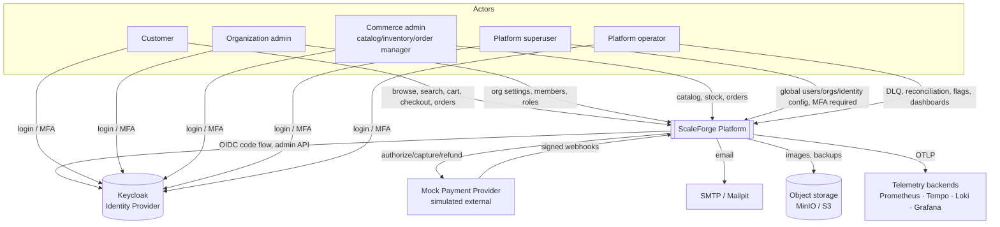
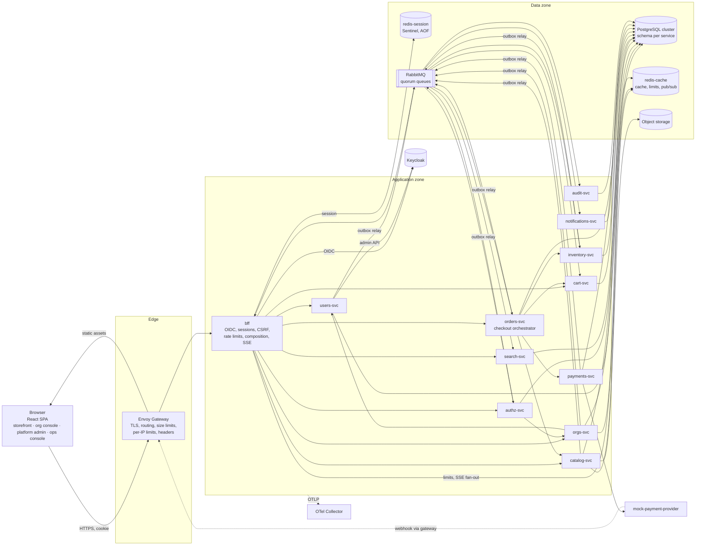
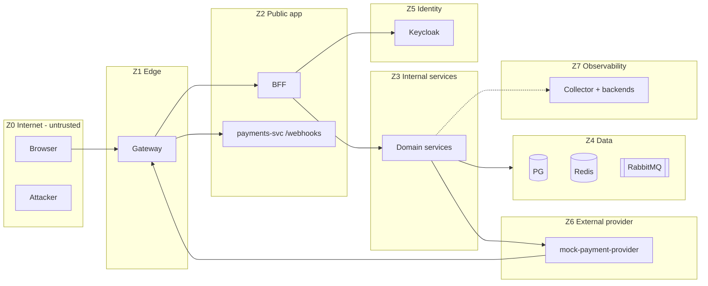
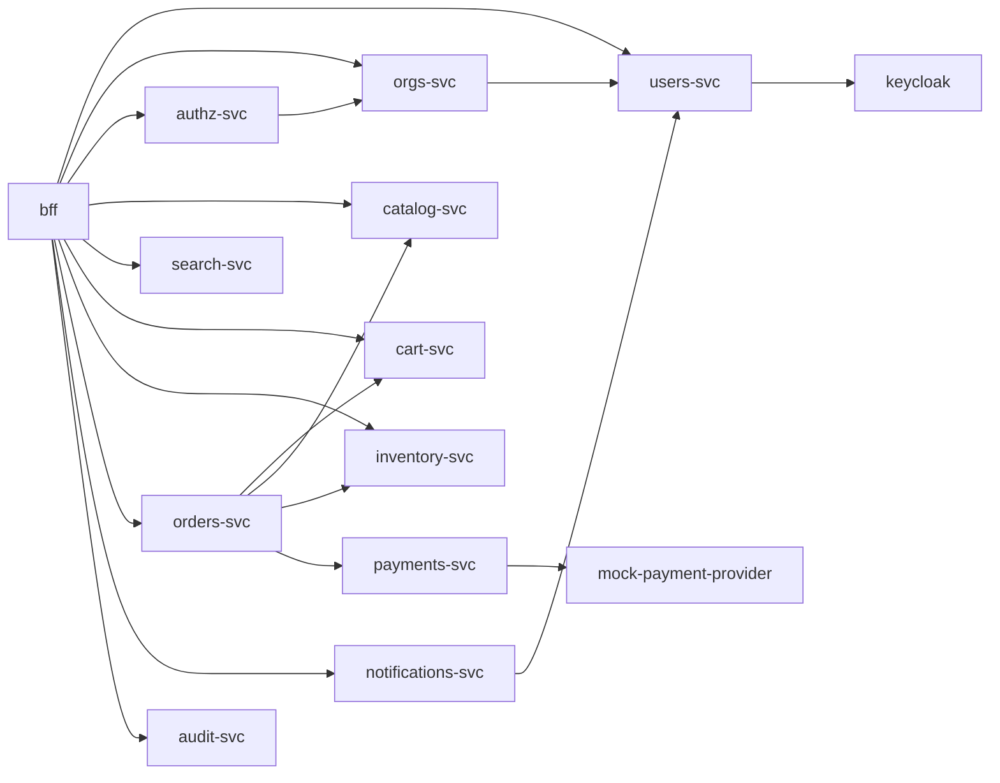
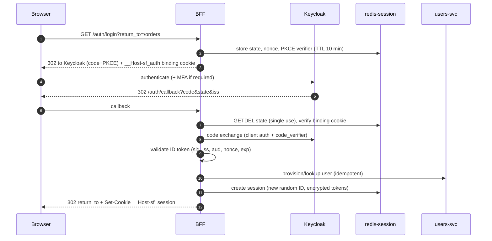
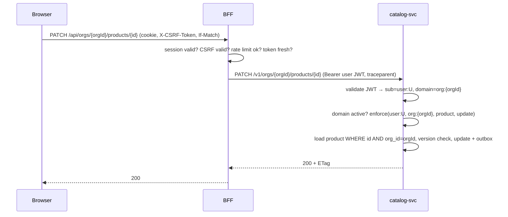
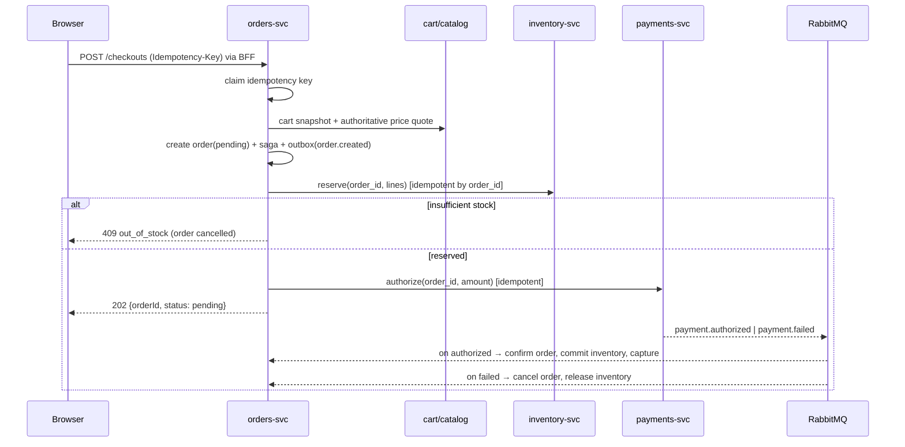
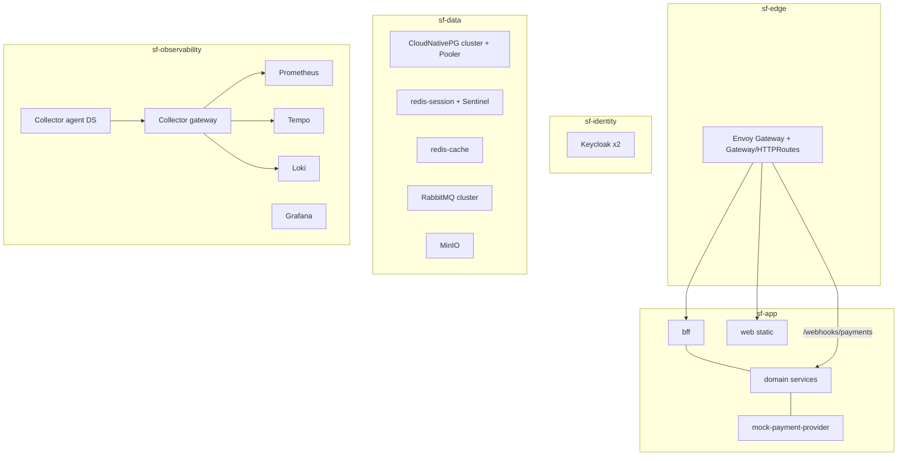

# ScaleForge — High-Level Design (HLD)

| Field | Value |
| --- | --- |
| Status | Accepted v1.0 — M1 review closed 2026-10-17 |
| PRD | v1.0 |
| Last updated | 2026-10-17 |
| Related | [Delivery plan](../00-delivery-plan.md) · [ADRs](../adr/README.md) · LLDs in [lld/](lld/) |

## 1. Purpose and scope

This HLD fixes the parts of the architecture that every later design depends on:

- the system boundary and actors;
- the deployable services, their responsibilities, and their **data ownership**;
- trust boundaries and where each control is enforced;
- synchronous and asynchronous communication rules;
- consistency guarantees per data set;
- deployment topology and the scaling approach.

Algorithms, schemas, and parameters live in the LLDs. Choices with real alternatives live in ADRs. This document does not claim achieved performance (PRD scope note).

## 2. Assumptions and constraints

| ID | Assumption | Source / decision |
| --- | --- | --- |
| ASM-1 | An **organization** is a merchant tenant that runs one store. Catalog, inventory, orders, and staff memberships are organization-scoped. | ADR-0002, OQ-1 |
| ASM-2 | **Customers** are platform-level accounts. They can buy from any active store without being members of it. | ADR-0002 |
| ASM-3 | An order belongs to exactly one organization. A cart is per (customer, organization). | OQ-3 |
| ASM-4 | Single currency per store. Shipping and tax are flat store-level settings. | OQ-4 |
| ASM-5 | Checkout requires an authenticated customer. Guest checkout is deferred. | OQ-2 |
| ASM-6 | Payments use a mock provider and synthetic data. Authorize at checkout, capture on confirmation. | PRD §13.3, ADR-0008, OQ-6 |
| ASM-7 | Single region. Multi-region is a paper design only. | PRD §1 non-goals |
| ASM-8 | Learning/portfolio context. Prefer mechanisms that can be demonstrated, and keep the number of infrastructure products small. | PRD §13.3 |

**Fixed by the PRD:** React/TypeScript/Vite, FastAPI (Python), Keycloak, Casbin, PostgreSQL, Redis, OpenTelemetry, Docker, Kubernetes, Prometheus/Grafana, Pytest/Vitest/Playwright/k6, GitHub Actions.

## 3. System context

Keycloak runs inside our deployment but is a **separate trust domain**. Its admin console is never exposed through the public gateway.

## 4. Container view

### 4.1 Tier responsibilities

| Tier | Responsibilities | Must not |
| --- | --- | --- |
| Browser | Render UI; hold the opaque session cookie (HttpOnly) and the CSRF token (in memory); debounce search. | Store or see access/refresh/ID tokens. Treat hidden UI as an access control. |
| Edge | TLS termination, host/path routing, request-size limits, coarse per-IP rate limits, security headers, static assets, WAF (target env). | Make authorization decisions. |
| BFF | OIDC confidential client, sessions, CSRF, fine-grained rate limits, token refresh, API composition, SSE fan-out. | Own business data. Expose tokens to the browser. Be the only authorization check. |
| Domain services | Own data and invariants; validate tokens; enforce Casbin + ownership; publish events through the outbox. | Write another service's tables. Trust tenant identifiers from headers. |
| Data | Authoritative storage (PostgreSQL); ephemeral/shared state (Redis); durable messaging (RabbitMQ). | Be reached from the browser or edge. |
| Observability | Collect, process, and export telemetry. | Block business traffic when backends fail. |

## 5. Service catalog

The service boundaries come from PRD §4.3. ADR-0016 explains the deployable units and the option to co-deploy the identity services in M2.

| Service | Responsibility | Owns (schema / store) | Sync callers | Publishes | Consumes | Tier |
| --- | --- | --- | --- | --- | --- | --- |
| **bff** | Browser auth, sessions, CSRF, rate limits, composition, SSE | Redis session keys | Browser | `audit.recorded` (login/logout, direct publish) | `user.disabled`, `order.status_changed`, `notification.in_app` | T0 |
| **users-svc** | Profiles, lifecycle, handle uniqueness, Keycloak user sync | `users` | bff, orgs-svc, notifications-svc | `user.created`, `user.updated`, `user.disabled`, `user.reactivated` | `user.idp_sync_requested`, `identity.mfa_group_sync_requested` (commands) | T1 |
| **orgs-svc** | Organizations, memberships, invitations, store settings | `orgs` | bff, authz-svc | `organization.*`, `membership.*`, `invitation.*` | `user.disabled` | T1 |
| **authz-svc** | Roles, permissions, role assignments, Casbin policy admin | `authz` (incl. `casbin_rule`) | bff (admin APIs) | `membership.role_changed`, policy-version notice (Redis) | `membership.*`, `organization.*`, `user.disabled` | T1 (policy *changes*); enforcement is local in every service |
| **catalog-svc** | Products, SKUs, categories, prices, promotions, quotes, images | `catalog`, object storage | bff, orders-svc | `product.updated`, `product.deleted`, `price.changed` | `organization.*` (store pricing settings projection) | T0 (quotes) |
| **search-svc** | Search API, derived index | `search` | bff | — | `product.*`, `inventory.availability_changed` | T1 |
| **cart-svc** | Carts and items | `cart` | bff, orders-svc | `cart.checked_out` | `order.confirmed` | T0 |
| **inventory-svc** | Stock, reservations, expiry, stock ledger | `inventory` | bff (admin), orders-svc | `inventory.reserved`, `inventory.released`, `inventory.committed`, `inventory.reservation_expired`, `inventory.availability_changed` | `inventory.commit_requested`, `inventory.release_requested`, `inventory.restock_requested`, `product.updated` (create stock items) | T0 |
| **orders-svc** | Checkout orchestration, order state, history, admin ops | `orders` | bff | `order.created`, `order.confirmed`, `order.cancelled`, `order.status_changed`, `notification.requested`, commands to inventory/payments | `payment.*`, `inventory.*` | T0 |
| **payments-svc** | Payment attempts, provider calls, webhooks, reconciliation | `payments` | orders-svc; provider webhooks via gateway | `payment.authorized`, `payment.succeeded`, `payment.failed`, `payment.voided`, `payment.refunded` | `payment.capture_requested`, `payment.void_requested`, `payment.refund_requested` | T0 |
| **mock-payment-provider** | Simulated external PSP with scenario controls | Own in-memory/SQLite state | payments-svc | Webhooks (HTTP) | — | Test fixture |
| **notifications-svc** | Email and in-app notification jobs, delivery state | `notifications` | bff (list in-app) | `notification.in_app` | `notification.requested`, `invitation.created` | T2 |
| **audit-svc** | Append-only audit store and query | `audit` | bff (admin queries) | — | `audit.recorded` | T2 (ingest is async; producers' outboxes protect committed events) |

**Criticality tiers:**

- **T0** is on the checkout or auth request path; an outage blocks revenue or login.
- **T1** degrades a feature.
- **T2** is asynchronous, with backlog tolerated.

## 6. Trust boundaries

| Crossing | Threats (examples) | Controls | Detail |
| --- | --- | --- | --- |
| Z0→Z1 | Volumetric abuse, oversized bodies, TLS downgrade | TLS 1.2+ (1.3 preferred), HSTS, size limits, per-IP limits, WAF in target env | LLD-11 §7, LLD-12 §6 |
| Z1→Z2 (BFF) | Session theft, CSRF, XSS-driven requests, credential stuffing | HttpOnly/Secure/SameSite cookie, CSRF token + Origin check, CSP, login/MFA limits, Keycloak brute-force detection | LLD-01, LLD-11 §4 |
| Z2→Z3 | Confused deputy, forged tenant context, token replay | User JWT (aud-restricted, 5-min TTL) forwarded server-side; org from URL path validated by Casbin domain; NetworkPolicy allows BFF→services only | ADR-0009, LLD-02 |
| Z3→Z3 | Lateral movement, over-privileged calls | Client-credential tokens per service, `/internal/*` scope checks, NetworkPolicy allow-lists | LLD-11 §5 |
| Z3→Z4 | Cross-schema writes, SQL injection | One DB role per service with grants on its own schema only; ORM/parameterized queries | ADR-0006, LLD-09 §1 |
| Z6→Z2 (webhooks) | Forged/replayed callbacks | HMAC-SHA256 signature, timestamp tolerance, event-ID dedupe, dedicated route | LLD-06 §8 |
| Z2/Z3→Z5 | Admin credential exposure | Narrowly scoped Keycloak service accounts; admin console not routed publicly | LLD-01 §3 |
| Z3→Z7 | Secret leakage in telemetry, cardinality blow-up | SDK and Collector redaction, label allow-lists, access control on backends | LLD-10 §6 |

## 7. Identity and access (summary)

| Concern | Design | Ref |
| --- | --- | --- |
| Browser authentication | Keycloak OIDC Authorization Code + PKCE (S256), state, nonce, exact redirect URIs. BFF is a confidential client. | LLD-01 §4 |
| Session | 256-bit opaque ID in a `__Host-` cookie. Redis keys hold only the ID's SHA-256 hash. Tokens are AES-GCM-encrypted at rest in Redis. Idle and absolute expiry. | LLD-01 §5, ADR-0010 |
| Service authentication | BFF forwards the user's Keycloak access token (aud `scaleforge-api`). Services validate signature, iss, aud, exp, and acr. Background work uses per-service client credentials. | ADR-0009 |
| Authorization | Casbin domain RBAC. An embedded enforcer runs in each service through `sf-authz`. Policies are owned by authz-svc in PostgreSQL. Propagation uses a Redis pub/sub watcher with polling fallback. Default deny. | ADR-0004, ADR-0005, LLD-02 |
| Tenant context | Org-scoped APIs take the org in the **path** (`/orgs/{orgId}/…`). It becomes the Casbin domain. Resources are loaded with `org_id = :orgId`. No server-side "current org" affects authorization (FR-ORG-05). | LLD-02 §6 |
| Platform authority | Separate `platform` domain. Superusers act on tenants only through audited platform endpoints, never by inheriting org roles. | LLD-02 §4 |
| MFA and step-up | Keycloak conditional MFA (required for privileged groups). Step-up uses `acr_values` + `max_age` for privileged operations. Services re-check the `acr` claim. | LLD-01 §9 |
| Revocation | Session revocation is immediate (Redis delete). Role/membership revocation targets ≤ 5 s p99 propagation (to be measured). | LLD-01 §8, LLD-02 §8 |

## 8. Data architecture

### 8.1 Stores

| Store | Role | Topology | Persistence / durability |
| --- | --- | --- | --- |
| PostgreSQL | Authoritative business data, outbox/inbox, Casbin policy, idempotency records | CloudNativePG cluster: 1 primary + 2 replicas. DB `scaleforge` with schema per service; separate DB `keycloak`. PgBouncer pooler. | WAL archiving + daily base backup to object storage (PITR) |
| redis-session | Opaque sessions, OIDC pre-auth state, refresh locks | 1 primary + 2 replicas + 3 Sentinels; `noeviction` | AOF `everysec`. Loss tolerance: sessions created in the last ~1 s may be lost on failover, and those users log in again. |
| redis-cache | Cache-aside data, rate-limit counters, policy watcher channel, SSE fan-out, optional Bloom filter | Single primary (+ replica in staging); `allkeys-lru` | None. Rebuildable. |
| RabbitMQ | Event and command delivery | 3-node cluster, quorum queues | Raft-replicated queues. The outbox is the recovery source for anything published (LLD-08 §5). |
| Object storage | Product images, backups | MinIO locally; S3-compatible in the target env | Versioned bucket for backups |

### 8.2 Ownership map

Every table belongs to exactly one service. Other services read it **only** through that service's API or its events. There are no cross-schema foreign keys; references are by ID and kept consistent through events and reconciliation.

| Schema | Key tables | Owner |
| --- | --- | --- |
| `users` | users, user_handles_reserved, outbox | users-svc |
| `orgs` | organizations, memberships, invitations, outbox, inbox | orgs-svc |
| `authz` | roles, permissions, role_permissions, role_assignments, domain_status, casbin_rule, policy_version, outbox, inbox | authz-svc |
| `catalog` | products, skus, categories, product_images, price_history, promotions, outbox | catalog-svc |
| `search` | product_search_docs, index_checkpoints, inbox | search-svc |
| `cart` | carts, cart_items, inbox | cart-svc |
| `inventory` | stock_items, reservations, reservation_lines, stock_movements, outbox, inbox | inventory-svc |
| `orders` | orders, order_lines, order_status_history, checkout_sagas, idempotency_keys, outbox, inbox | orders-svc |
| `payments` | payment_attempts, payment_events, provider_webhooks, refunds, outbox, inbox | payments-svc |
| `notifications` | notifications, deliveries, inbox | notifications-svc |
| `audit` | audit_events (append-only), inbox | audit-svc |

ER diagrams live in each domain LLD.

### 8.3 Consistency guarantees

| Data | Guarantee | Mechanism |
| --- | --- | --- |
| Stock and reservations | Strong; never negative, never over-allocated | Single-row conditional updates + CHECK constraints (LLD-07) |
| Order state | Strong within orders-svc; cross-service eventual via saga | State machine with guarded transitions (LLD-06) |
| Payment state | Strong within payments-svc; external state reconciled | Idempotency keys, webhook dedupe, reconciliation |
| Search index | Eventual. Target: p95 index lag ≤ 5 s (to validate). | Event-carried state transfer + version check |
| Catalog cache | Bounded staleness: invalidated on change, TTL ≤ 5 min as a backstop | Delete-after-commit + TTL (LLD-09 §6) |
| Authorization policy | Eventual. Target: ≤ 5 s p99 (≤ 15 s if redis-cache is down). | Watcher + version polling (LLD-02 §8) |
| Sessions | Strong (single primary). Fail closed when unknown. | Redis primary reads |
| Audit | At-least-once. No loss for events committed by producers. | Producer outbox + idempotent consumer |

### 8.4 Behavior under partition

| Component | Choice under partition | Rationale |
| --- | --- | --- |
| Inventory, orders, payments | **Consistency.** Reject or pend rather than risk oversell or double charge. | Correctness over availability for money and stock |
| Sessions | **Consistency.** Return 503 on protected operations if session validity is unknown. | PRD §3.2 "fail safely" |
| Catalog reads | **Availability.** Serve cached/stale data marked with `Age`. | Read-mostly, low harm |
| Search | **Availability.** Serve a possibly stale index. | Derived data |
| Authorization | Consistency for mutations once the stale threshold is exceeded; reads continue within the bound | LLD-02 §8 |

## 9. Communication architecture

### 9.1 Synchronous

- HTTP/JSON, versioned paths (`/v1`), one OpenAPI 3.1 document per service in `contracts/openapi/`. Conventions are in ADR-0015: RFC 9457 problem details, cursor pagination, `Idempotency-Key`, `ETag`/`If-Match`.
- **Allowed call graph (must stay acyclic):**

- **Deadlines:**
  - Each hop sets explicit connect and total timeouts.
  - The BFF sets a request deadline; services propagate the remaining budget in `X-Request-Deadline` and fail fast when it is exhausted.
  - Retries are allowed only for idempotent operations: GET, or a POST with an idempotency key. Use exponential backoff with full jitter, at most 2 retries, inside the deadline.
  - Circuit breakers sit around every dependency. Values are in LLD-13 §2.

| Path | Initial total budget |
| --- | --- |
| Edge → BFF | 30 s (SSE exempt) |
| BFF → service (default) | 3 s |
| BFF → orders `POST /checkouts` | 10 s |
| orders → cart / catalog / inventory | 1 s each |
| orders → payments (authorize) | 6 s |
| payments → provider | 5 s |
| Any → PostgreSQL statement | 2 s (`statement_timeout`); 30 s for admin batch jobs |
| Any → Redis | 50 ms (session read), 20 ms (cache) |

### 9.2 Asynchronous

- **Broker:** RabbitMQ (ADR-0003). A topic exchange carries events; each consumer has its own quorum queue; tiered retry queues lead to a DLQ.
- **Transactional outbox:** in every service that publishes after a DB commit. Delivery is at-least-once. Consumers dedupe through an inbox table in the same transaction as their side effect.
- **Events vs commands:**
  - Events are past-tense facts (`order.created`).
  - Commands are explicit requests with one intended consumer (`inventory.release_requested`). Both use the same envelope (LLD-08 §3).
- **Context:** the envelope carries the W3C `traceparent`/`tracestate`, the correlation ID, and the tenant (`org_id`).

### 9.3 Real-time updates

The BFF exposes `GET /api/events` (SSE) for order status and in-app notifications. Services publish `order.status_changed` and `notification.in_app`. The BFF consumes them and fans out across replicas through redis-cache pub/sub to the connection holding the user's stream. A long-polling fallback (`GET /api/orders/{id}/status?wait=25s`) covers clients that cannot use SSE. WebSockets are not used, because the flow is one-way (comparison in LLD-06 §10).

## 10. Key flows (high level)

### 10.1 Login

### 10.2 Authenticated, tenant-scoped request

### 10.3 Checkout (orchestrated saga, summary)

Full saga, compensation, and timeout handling are in LLD-06 §5.

### 10.4 Product update → cache and search

1. catalog-svc commits the product row and the `product.updated` outbox row in one transaction.
2. After commit, it deletes the cache keys (best effort; the TTL is the backstop).
3. The relay publishes the event. search-svc applies it only if `event.version > stored.version`.

### 10.5 Role revocation

1. An org admin removes a role: authz-svc commits the `role_assignments` change, the compiled `casbin_rule` rows, a `policy_version` increment, and the outbox (audit, `membership.role_changed`) in one transaction.
2. After commit it publishes `authz:policy {version}` on redis-cache.
3. Every enforcer reloads. Enforcers missing the notice catch up through 10 s version polling.

## 11. Cross-cutting concerns

### 11.1 Observability

- Every service uses the OTel SDK with auto-instrumentation for FastAPI, httpx, SQLAlchemy/asyncpg, redis, and aio-pika, plus manual spans for saga steps and outbox relays.
- Logs are structured JSON to stdout with `trace_id`/`span_id`.
- The Collector runs in two tiers: an agent DaemonSet (logs, load-balancing exporter) and a gateway (tail sampling, redaction).
- Backends: Prometheus (OTLP receiver), Tempo, and Loki, with Grafana on top (ADR-0013).

Detail: LLD-10.

### 11.2 Security

Defense in depth runs edge → BFF → service → database. Each layer holds its own control, and none relies on the browser. Detail and SEC mapping: LLD-11.

### 11.3 Resilience patterns

| Pattern | Where | Ref |
| --- | --- | --- |
| Timeouts + deadline propagation | Every outbound call | §9.1, LLD-13 §2 |
| Bounded retries with full jitter | Idempotent calls, consumers | LLD-13 §2, LLD-08 §7 |
| Circuit breakers | Per dependency in `sf-common` HTTP client and the Redis client | LLD-13 §2 |
| Bulkheads | Separate connection pools for request handling vs background workers; concurrency limit per dependency | LLD-13 §2 |
| Load shedding | BFF and services cap in-flight requests and return 503 + `Retry-After` beyond the cap | LLD-13 §2 |
| Idempotency | Checkout, payment, reservation, consumers | LLD-06 §4, LLD-08 §6 |
| Outbox / inbox | All event publishers and consumers | LLD-08 |
| Reconciliation | Payments ↔ orders ↔ inventory | LLD-06 §9 |
| Graceful shutdown | Readiness fails on SIGTERM; drain in-flight work; consumers stop acking new messages | LLD-12 §8 |

### 11.4 Configuration and feature flags

- Twelve-factor environment configuration, validated at startup with typed settings: fail fast on invalid config.
- Secrets come only through mounted Secrets.
- Feature flags use OpenFeature with flagd (M5). Before M5 they are environment variables.
- Flags gate risky features (for example, the cache layer and new saga steps) and support kill switches.

### 11.5 Shared libraries

| Library | Contents | Coupling rule |
| --- | --- | --- |
| `sf-common` | Settings, structured logging, OTel setup, HTTP client (timeouts, retries, breaker, deadline), problem details, health endpoints | Semver; no domain logic |
| `sf-authz` | JWT validation, Casbin enforcer, watcher, route-coverage guard, FastAPI dependencies | Semver; the policy *model* is versioned with it |
| `sf-messaging` | Envelope, outbox writer, relay, consumer base (inbox, retry, DLQ), trace propagation | Semver |
| `sf-db` | Async engine/session factory, pool metrics, keyset pagination helpers, deadlock retry decorator | Semver |

Shared libraries are a coupling risk. They hold infrastructure behavior only and are pinned per service.

## 12. Deployment topology

### 12.1 Environments

| Environment | Purpose | Platform |
| --- | --- | --- |
| `local-compose` | Developer loop, integration tests | Docker Compose (M2+) |
| `local-kind` | Kubernetes parity, failure lab | kind (M5+) |
| `ci` | Ephemeral per-PR deploy and smoke/E2E | kind in GitHub Actions |
| `staging` | Load tests, release-strategy demos, DR drills | Decision in ADR-0014 (kind on a dedicated VM by default; managed cluster optional) |

### 12.2 Kubernetes layout

**Namespace defaults:**

- Default-deny NetworkPolicies, then explicit allow-lists.
- One ServiceAccount per workload, with no API token automount unless needed.
- PodDisruptionBudgets on T0 services.
- Detail: LLD-12.

### 12.3 Scaling approach

| Component | Scales by | Constraint to watch |
| --- | --- | --- |
| BFF, stateless services | HPA on CPU, then on request concurrency (custom metric) | DB connections through PgBouncer |
| Consumers | KEDA on queue depth (or HPA on an external metric) | Ordering per aggregate (LLD-08 §9) |
| PostgreSQL | Vertical first; read replicas for eligible reads (EXP-7) | Write throughput, hot SKU rows |
| Redis | Vertical; separate instances by workload | Single-threaded hot keys |
| RabbitMQ | 3 nodes fixed; scale consumers | Queue length, publisher confirms latency |

## 13. Scalability and capacity model

1. **Workload model (initial hypothesis):**
   - Traffic mix: 60% browse/product reads, 25% search, 10% cart operations, 4% checkout, 1% admin.
   - Think time: 3–8 s.
   - Calibrate in M4 (LLD-14 §6).
2. **Sizing method:**
   - Use Little's law (`concurrency = throughput × latency`) to size worker counts and pools. Example: 200 req/s × 50 ms DB time = 10 busy connections per pool set.
   - Then confirm with step-load tests to find the knee.
3. **Expected bottlenecks, in order:**
   1. PostgreSQL connections and pool wait.
   2. Hot-SKU row locks during checkout bursts.
   3. Search query CPU.
   4. Outbox relay throughput.
   5. Redis hot keys.
4. **Rule:** no user-count claim without the documented workload, environment, duration, and results (PRD §10).

## 14. Decisions index

| ADR | Decision | Status |
| --- | --- | --- |
| [0001](../adr/0001-record-architecture-decisions.md) | Record decisions as ADRs | Accepted |
| [0002](../adr/0002-tenancy-model.md) | Organization = merchant store; customers are platform accounts | Accepted (OQ-1 confirmed) |
| [0003](../adr/0003-message-broker-rabbitmq.md) | RabbitMQ (quorum queues) + transactional outbox | Accepted |
| [0004](../adr/0004-casbin-policy-storage.md) | Casbin policies in PostgreSQL; Redis watcher + version polling | Accepted |
| [0005](../adr/0005-authorization-topology.md) | Embedded enforcer library; centralized policy administration | Accepted |
| [0006](../adr/0006-database-topology.md) | One PostgreSQL cluster, schema + role per service | Accepted |
| [0007](../adr/0007-search-backend.md) | PostgreSQL FTS first; OpenSearch only on measured need | Accepted |
| [0008](../adr/0008-payment-provider.md) | Mock provider; authorize/capture; HMAC webhooks | Accepted |
| [0009](../adr/0009-service-identity-and-token-propagation.md) | Forward user JWT; client credentials for service work | Accepted |
| [0010](../adr/0010-redis-topology.md) | Separate redis-session (Sentinel, AOF) and redis-cache | Accepted |
| [0011](../adr/0011-checkout-saga-orchestration.md) | Orchestrated checkout saga in orders-svc | Accepted |
| [0012](../adr/0012-edge-gateway.md) | Gateway API with Envoy Gateway | Accepted |
| [0013](../adr/0013-telemetry-backends.md) | Prometheus + Tempo + Loki + Grafana | Accepted (provisional until M6) |
| [0014](../adr/0014-kubernetes-environments.md) | kind (local/CI); staging on kind on a dedicated VM (OQ-7 confirmed) | Accepted |
| [0015](../adr/0015-api-conventions.md) | REST/JSON conventions | Accepted |
| [0016](../adr/0016-deployable-units-and-repo.md) | Monorepo; deployable units; M2 co-deploy option | Accepted |

## 15. Architecture risks (in addition to PRD §13.2)

| Risk | Impact | Mitigation |
| --- | --- | --- |
| Keycloak outage | No new logins; refresh fails, so existing sessions break when the 5-minute access token expires | Keycloak ×2 replicas; alert; documented degradation (FS-13 in LLD-13) |
| Policy propagation lag exceeds the revocation target | Revoked user keeps access briefly | Measure; alert on `policy_staleness_seconds`; fail closed past the threshold |
| PgBouncer transaction mode vs asyncpg prepared statements | Runtime errors under pooling | Configure the prepared-statement cache per LLD-09 §2; integration test through the pooler |
| Bitnami catalog changes (2025) make some Helm charts/images unreliable sources | Supply-chain and licensing churn | Use official images and operators (CNPG, RabbitMQ operator, Keycloak operator, official Redis image) |
| ingress-nginx is retired upstream | No security fixes | Use Gateway API + Envoy Gateway (ADR-0012) |
| Shared-library coupling | Lock-step upgrades | Infrastructure-only libs, semver, contract tests |

## 16. Open questions

See [delivery plan §5](../00-delivery-plan.md#5-open-questions-for-the-product-owner). OQ-1 to OQ-4 must be answered before the M3 LLDs are accepted.
