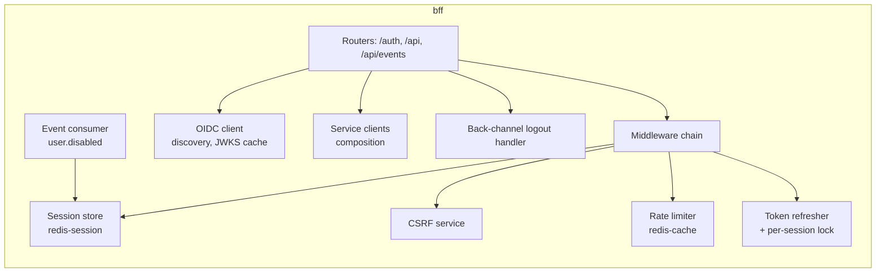
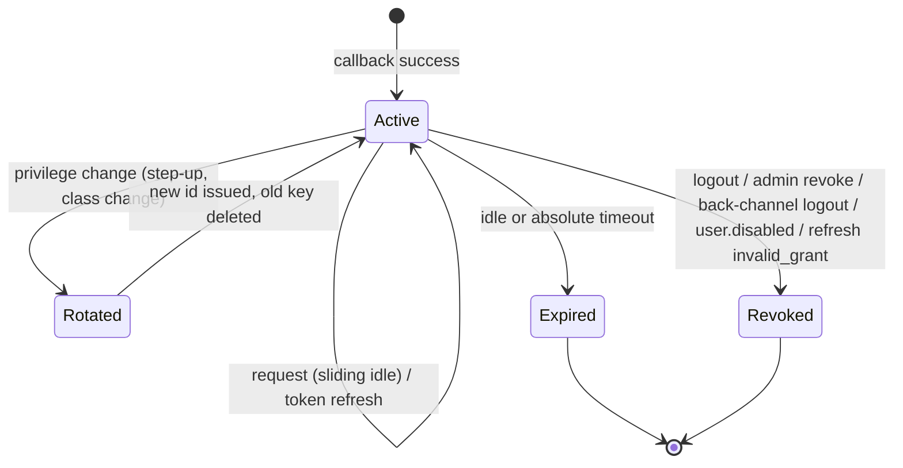
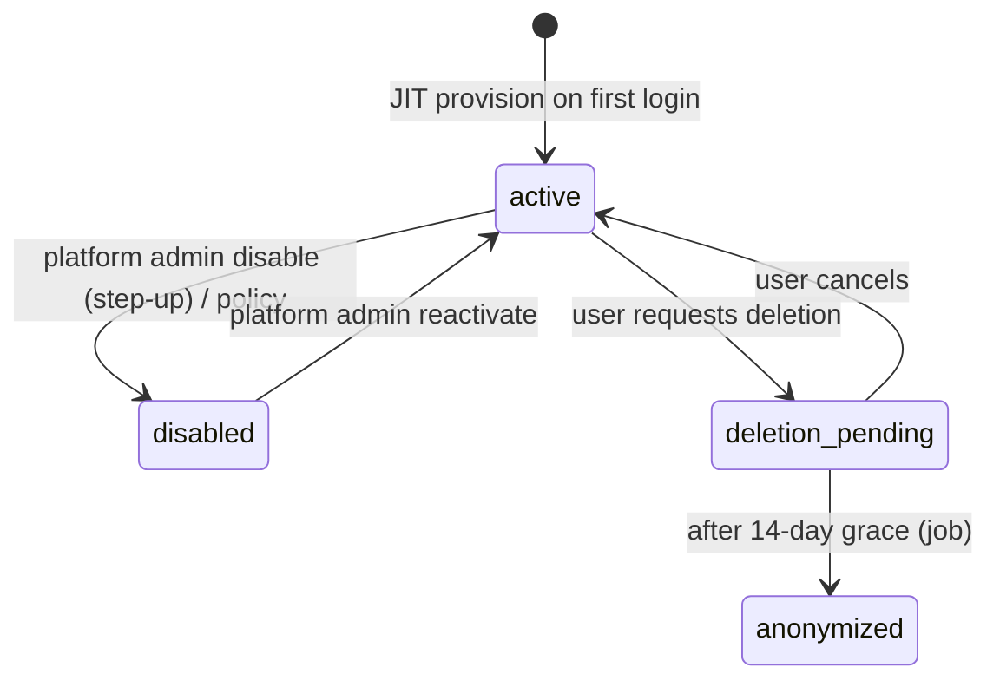

# LLD-01: Identity, Auth BFF, Sessions, and User Lifecycle

| Field | Value |
| --- | --- |
| Status | Draft v0.1 |
| Milestone | M2 |
| Services | bff, users-svc, Keycloak |
| ADRs | 0009, 0010, 0015 |

## 1. Scope

This LLD covers:

- browser authentication through the FastAPI BFF with Keycloak OIDC;
- opaque server-side sessions in Redis;
- CSRF protection;
- token refresh;
- logout and revocation;
- MFA and step-up;
- user provisioning and lifecycle.

Authorization decisions are in LLD-02.

## 2. Components



The BFF is stateless apart from Redis. Any replica serves any request (FR-AUTH-04).

## 3. Keycloak realm design

Realm `scaleforge` is managed as code: a version-controlled realm configuration applied by keycloak-config-cli or the Keycloak Operator `KeycloakRealmImport`. Secrets are not in the repo.

### 3.1 Clients

| Client | Type | Flows | Key settings |
| --- | --- | --- | --- |
| `sf-bff` | Confidential (client secret; private_key_jwt in staging) | Standard flow only | PKCE `S256` required. Exact redirect URI `https://<app-host>/auth/callback`. Exact post-logout redirect `https://<app-host>/`. Back-channel logout URL `https://bff.sf-app.svc/auth/backchannel-logout` with session required. Front-channel logout off. Implicit, direct access grants, and device flow disabled. |
| `sf-svc-<name>` (one per service) | Confidential, service account | Client credentials only | Audience `scaleforge-internal`. Client scopes per internal operation. |
| `sf-users-admin` | Confidential, service account | Client credentials | Used only by users-svc. Fine-grained admin permissions: view/manage users, manage group membership for `mfa-required`. No realm-admin. |
| `sf-authz-admin` | Confidential, service account | Client credentials | Used only by authz-svc to add/remove users from the `mfa-required` group. |

### 3.2 Tokens and claims

| Setting | Value | Rationale |
| --- | --- | --- |
| Access token lifespan | 5 min | Limits forwarded-token exposure (ADR-0009) |
| SSO session idle / max | 30 min / 10 h | Upper bound; BFF session policy is equal or stricter |
| Refresh token rotation | On; reuse count 0 | Detects refresh token replay |
| Audience mapper | `scaleforge-api` added to access tokens from `sf-bff` | Services check `aud` |
| `sf_uid` mapper | From user attribute `sf_uid` | Internal user ID (ADR-0009) |
| Claims | `sub`, `sf_uid`, `sid`, `acr`, `auth_time`, `email`, `email_verified` | No application roles in tokens |
| Signing | RS256 (ES256 optional); key rotation with overlap | JWKS cache in services |

### 3.3 Authentication flows and MFA

- **Browser flow:** username/password → **conditional OTP/WebAuthn**. MFA is required when either:
  - the user is in group `mfa-required` (all users holding any `platform` role or `org_admin`); or
  - the user has configured a second factor (opt-in for customers, FR-AUTH-05).
- **ACR / Level of Authentication mapping:** `acr=1` password; `acr=2` MFA. The BFF can request `acr_values=2` for step-up (§9).
- **Brute-force detection:** on (temporary lockout with backoff), complementing BFF rate limits.
- **Passwords:** password policy plus a breached-password check if available. Email verification required.
- **Event logging:** user events (LOGIN, LOGIN_ERROR, LOGOUT, UPDATE_TOTP, …) and admin events enabled **without representations**, so payloads with secrets are never logged.
- **Admin console:** reachable only via `kubectl port-forward` or an ops-only route with an IP allow-list. Never through the public Gateway listener.

## 4. Login flow

```mermaid
sequenceDiagram
  autonumber
  participant B as Browser
  participant BFF
  participant RS as redis-session
  participant KC as Keycloak
  participant U as users-svc
  B->>BFF: GET /auth/login?return_to=/orders
  BFF->>BFF: validate return_to (relative path, allow-listed prefix)
  BFF->>BFF: gen state(32B), nonce(32B), code_verifier(64B), binding(32B)
  BFF->>RS: SET oidc:state:{state} {nonce, verifier, return_to, H(binding), acr_req} EX 600
  BFF-->>B: 302 /realms/scaleforge/protocol/openid-connect/auth?...&code_challenge=S256(verifier)<br/>Set-Cookie: __Host-sf_auth=binding (Max-Age 600, HttpOnly, Secure, SameSite=Lax)
  B->>KC: login (+ MFA)
  KC-->>B: 302 /auth/callback?code&state&iss
  B->>BFF: GET /auth/callback (cookie __Host-sf_auth)
  BFF->>RS: GETDEL oidc:state:{state}
  BFF->>BFF: check: state found; H(cookie)==H(binding); iss == expected (RFC 9207)
  BFF->>KC: POST /token (code, code_verifier, client auth)
  KC-->>BFF: id_token, access_token, refresh_token
  BFF->>BFF: validate id_token: sig (JWKS), iss, aud=sf-bff, azp, exp/iat (60s leeway), nonce, acr ≥ acr_req
  BFF->>U: POST /internal/v1/users:provision {iss, sub, email, email_verified} (svc token, idempotent)
  U-->>BFF: {user_id, status, needs_claim_refresh}
  alt status != active
    BFF-->>B: 302 /account-disabled (no session)
  end
  opt needs_claim_refresh (first login)
    BFF->>KC: refresh_token grant (picks up sf_uid claim)
  end
  BFF->>RS: create session (new 256-bit id; tokens encrypted), SADD user_sessions:{uid}
  BFF-->>B: 302 return_to<br/>Set-Cookie: __Host-sf_session=...; Clear __Host-sf_auth
```

**Validation failures:**

- Every failure redirects to `/auth/error?code=<opaque>`. The details are logged with the correlation ID; the user sees nothing internal (FR-AUTH-08 "safe errors").
- The pre-auth state is single-use (`GETDEL`). A replayed callback fails.
- **Login CSRF / session fixation:**
  - The binding cookie ties the callback to the browser that started the login.
  - The session ID is always freshly generated after authentication. It is never carried over from pre-auth.

## 5. Session model

### 5.1 Identifiers and cookie

| Item | Value |
| --- | --- |
| Session ID | 256-bit CSPRNG, base64url (43 chars) |
| Redis key | `sess:{sha256(session_id)}`, so a Redis dump does not yield usable cookies |
| Cookie | `__Host-sf_session=<id>; Path=/; Secure; HttpOnly; SameSite=Lax` with no `Domain` (enforced by the `__Host-` prefix) and no `Max-Age` (session cookie) |
| Why `Lax` not `Strict` | Top-level navigations from external links (email links, the Keycloak redirect back) must carry the session. CSRF tokens protect unsafe methods (§7). |

### 5.2 Session record (Redis hash)

| Field | Content |
| --- | --- |
| `uid` | Internal user UUID |
| `sub`, `idp_sid` | Keycloak subject and session ID (for back-channel logout) |
| `at`, `rt`, `idt` | Access, refresh, and ID tokens, **AES-256-GCM encrypted**. Format `kid:nonce:ciphertext`; AAD = session key hash. |
| `at_exp` | Access token expiry (epoch s) |
| `acr`, `auth_time` | From the ID token. Used for step-up decisions. |
| `csrf` | 256-bit CSRF secret |
| `created`, `last_seen`, `abs_exp` | Epoch s |
| `class` | `standard` or `privileged` (any platform role or org_admin). Selects the timeout policy. |
| `ua_hash` | SHA-256 of the User-Agent family (for anomaly logging only, not binding) |
| `v` | Record schema version |

**Indexes:**

- `user_sessions:{uid}`: a SET of session key hashes, used for revoke-all.
- `idp_sid:{idp_sid}`: maps to the session key hash, used for back-channel logout.

### 5.3 Timeouts

| Class | Idle | Absolute | Step-up max age |
| --- | --- | --- | --- |
| standard | 30 min | 12 h | 15 min for sensitive customer ops (change email, add payment method) |
| privileged | 15 min | 4 h | 10 min for privileged ops |

- **Clock:** `now` is **Redis server time** (`TIME`, pipelined with the session read in one round trip). All BFF replicas then use one clock for expiry decisions (LLD-13 §6).
- **Idle sliding:** on each request, if `now - last_seen > 60 s`, update `last_seen` and `EXPIRE` the key to `min(idle, abs_exp - now)`. This limits write amplification to at most one write per minute per session.
- The absolute expiry is checked from the field on every request, independent of the key TTL.

### 5.4 Lifecycle



**Session ID rotation** happens on step-up success and on a class change. The new key is written first, then the old key is deleted, then the cookie is reissued.

### 5.5 Token encryption keys

- Keys are 32 bytes each, loaded from a mounted Secret as `{kid: key}`. The newest key encrypts; any listed key decrypts.
- **Rotation:**
  1. Add the new key.
  2. Deploy.
  3. Switch the primary key.
  4. After the absolute session lifetime (12 h), remove the old key.

## 6. Request pipeline and token refresh

The middleware runs in this order for `/api/*`:

1. **Body size limit** (1 MiB default) and **concurrency cap** (load shedding → 503).
2. **Correlation ID:** accept `X-Correlation-Id` if it is a well-formed UUID, otherwise generate one. Attach it to logs and spans.
3. **Session load:**
   - `HGETALL sess:{h}` with a 50 ms timeout.
   - Redis error or timeout → **503** `session_store_unavailable` for protected routes. Never treat it as anonymous, and never treat it as valid (PRD §3.2).
   - Public routes continue as anonymous.
4. **Expiry checks:** idle and absolute. On failure, delete the session and return 401 `session_expired`.
5. **CSRF** for unsafe methods (§7).
6. **Rate limit** (LLD-09 §7).
7. **Route requirements:** if the route requires `acr ≥ 2` or `auth_age ≤ N` and the session does not satisfy it, return 401 `step_up_required` with a `step_up_url`.
8. **Token freshness:**
   - If `at_exp - now < 60 s`, refresh (below).
   - Forward `Authorization: Bearer <at>`, `traceparent`, `X-Correlation-Id`, and `X-Request-Deadline`.

**Refresh algorithm** (a distributed lock prevents the refresh-token rotation race across replicas):

```text
lock = SET sess:lock:{h} <rand> NX PX 5000
if lock acquired:
    call Keycloak refresh grant (timeout 2 s)
    on success: write new at/rt/at_exp to session (HSET), release lock (Lua compare-and-delete)
    on invalid_grant: revoke session → 401
    on timeout/5xx: release lock; if current at still valid ≥ 5 s → proceed; else 503
else:
    poll session every 100 ms up to 1.5 s for at_exp change
    if refreshed → use new token; elif current at still valid → proceed; else 503 retryable
```

The lock only prevents duplicate refreshes. Correctness does not depend on it: Keycloak rejects a reused refresh token, and the loser re-reads the session. This is the "distributed lock with limits" example (Appendix A).

## 7. CSRF protection (SEC-04, FR-AUTH-06)

- **Synchronizer token:**
  - `csrf_token = base64url(HMAC-SHA256(session.csrf, "csrf-v1"))`, returned by `GET /auth/session`.
  - The SPA keeps it in memory and sends it as `X-CSRF-Token` on POST/PUT/PATCH/DELETE.
  - The BFF compares in constant time.
- **Origin check:** unsafe methods require `Origin` (or `Referer` if `Origin` is absent) to equal the app origin. `Sec-Fetch-Site` must be `same-origin` when present.
- **Defense in depth:** `SameSite=Lax` cookie; JSON-only content types (`application/json`), so a form-encoded body is rejected with 415.
- **Exempt routes:** `/auth/callback` (GET, protected by state + binding), `/auth/backchannel-logout` (server-to-server, verified JWT), and `/webhooks/*` (not on the BFF).

## 8. Logout and revocation

| Trigger | Mechanism | Effect |
| --- | --- | --- |
| User logout `POST /auth/logout` (CSRF) | Delete session + index entries → 303 to Keycloak `end_session_endpoint` with `id_token_hint` and the exact `post_logout_redirect_uri` | Local and IdP session ended |
| Logout everywhere `POST /auth/logout-all` | `SMEMBERS user_sessions:{uid}` → delete all; Keycloak admin logout of the user's sessions (through users-svc) | All devices |
| Back-channel logout from Keycloak | `POST /auth/backchannel-logout` with a `logout_token`: validate sig, iss, aud=`sf-bff`, iat (±60 s), `events` claim, no `nonce`, `jti` not seen (store `bcl:jti:{jti}` EX 600) → delete via `idp_sid:` index or all of `sub`'s sessions | IdP-initiated logout honored |
| Admin disables a user | users-svc → Keycloak disable + logout; publishes `user.disabled` → BFF consumer deletes all sessions | ≤ 5 s target |
| Admin revokes a specific session | Platform admin API `DELETE /api/platform/users/{id}/sessions` (step-up) | Immediate |
| Refresh `invalid_grant` | Session deleted, 401 | Detects revoked IdP session or replay |

The revocation effect is immediate on the next request after the key is deleted. Session validation always reads Redis; there is no in-process session cache.

## 9. MFA and step-up (FR-AUTH-05, SEC-15)

- **Enforced MFA:** granting any platform role or `org_admin` adds the user to the Keycloak group `mfa-required` (authz-svc → Keycloak admin API, from the outbox, idempotent).
  - Until the user has enrolled, the next login forces a required action (configure OTP/WebAuthn).
  - Privileged permissions additionally require `acr ≥ 2` at enforcement time (LLD-02 §6). This keeps the gap safe if the group sync lags.
- **Step-up:**
  1. A route declares `step_up(acr=2, max_age=600)`.
  2. When unmet, the BFF responds `401 application/problem+json` with type `…/step-up-required`.
  3. The SPA navigates to `/auth/step-up?return_to=…`.
  4. The BFF runs the login flow with `acr_values=2` and `max_age=0` (`prompt=login`).
  5. On callback, the BFF verifies `acr` and `auth_time`, updates the session, and **rotates the session ID**.
- **Services also check:** privileged endpoints in services require `acr ≥ 2` in the forwarded access token. The BFF is not the only check.

## 10. BFF API surface (auth)

| Method & path | Auth | CSRF | Rate class | Purpose |
| --- | --- | --- | --- | --- |
| GET `/auth/login` | none | — | `auth` | Start login |
| GET `/auth/callback` | binding cookie | state | `auth` | Complete login |
| POST `/auth/logout` | session | yes | — | Logout |
| POST `/auth/logout-all` | session | yes | — | Revoke all of a user's sessions |
| GET `/auth/session` | optional | — | `public` | `{authenticated, user{ id, handle, display_name }, csrf_token, memberships[{org_id, name, roles[]}], platform_roles[], acr, session_class}`. **No tokens.** Roles are for UI only. |
| GET `/auth/step-up` | session | — | `auth` | Start step-up |
| POST `/auth/backchannel-logout` | logout token | — | — | IdP-initiated logout |
| `/api/**` | session (route-dependent) | unsafe methods | per route | Proxied/composed APIs |
| GET `/api/events` | session | — | `sse` | SSE stream (LLD-06 §10) |

Responses from `/auth/session` and every `/api/**` are scanned in tests for JWT-shaped strings and known token fields (FR-AUTH-03).

## 11. User lifecycle (users-svc, FR-AUTH-07)

### 11.1 Schema `users`

| Table | Columns (key) | Constraints |
| --- | --- | --- |
| `users` | `id uuid PK`, `idp_issuer text`, `idp_subject text`, `email citext`, `email_verified bool`, `handle text NULL`, `handle_normalized text NULL`, `display_name text`, `status text`, `status_reason text`, `created_at`, `updated_at`, `disabled_at`, `version int` | `UNIQUE(idp_issuer, idp_subject)`; `UNIQUE(handle_normalized)`; `CHECK status IN ('active','disabled','deletion_pending','anonymized')` |
| `reserved_handles` | `handle_normalized PK` | Blocks `admin`, `support`, brand words |
| `outbox` | see LLD-08 | |

**Handle normalization:**

1. NFKC.
2. Casefold.
3. Strip separators `._-`.
4. Restrict the confusable set to `[a-z0-9]`, 3–30 characters.

The DB unique constraint is the authority (PRD §5.3).

### 11.2 State machine



| Transition | Side effects (one transaction + outbox) |
| --- | --- |
| provision | Insert user. Set Keycloak attribute `sf_uid` (sync admin call, idempotent; retried by the outbox command `user.idp_sync_requested` if it fails). Emit `user.created`. Authz grants `role:customer` in domain `customer` (consumer of `user.created`). |
| disable | Status update. Emit `user.disabled`. The command handler disables the Keycloak user and logs out their Keycloak sessions. BFF and authz consumers revoke sessions and suspend role assignments. |
| reactivate | Emit `user.reactivated`. Keycloak user enabled. Role assignments are **not** auto-restored; an admin re-grants them (safer default). |
| anonymize | Null out PII. Replace email with `anon-{id}@invalid`. Delete the Keycloak user. Keep the ID for order/audit referential history. |

### 11.3 APIs

| Endpoint | Caller | Authz |
| --- | --- | --- |
| POST `/internal/v1/users:provision` | bff (svc token) | scope `users:provision` |
| GET/PATCH `/v1/me` | customer | self |
| GET `/v1/me/handle-availability?handle=` | authenticated | self; rate class `enumeration` (LLD-09 §7) |
| GET `/v1/platform/users?query=&cursor=` | platform admin | `platform: users read` |
| POST `/v1/platform/users/{id}:disable` / `:reactivate` | platform admin | `platform: users manage`; step-up |
| GET `/internal/v1/users:batch?ids=` | orgs-svc, notifications-svc | scope `users:read` |

**Anti-enumeration:**

- The availability check needs a session.
- It returns `{available: bool}` only, with a fixed response time floor (~100 ms) and a rate limit.
- Directory search for org admins returns only members of their org (LLD-03).
- Platform search is audited.

## 12. Redis topology and outage behavior

- **redis-session** (ADR-0010): Sentinel-managed primary and 2 replicas. The BFF uses a Sentinel-aware async client.
  - Reads and writes go to the primary only. Replica reads are forbidden, because a session revoked on the primary could still be served from a lagging replica.
- **Failover window** (~10–30 s): protected routes return 503 + `Retry-After: 5`. The SPA shows a "reconnecting" banner and retries idempotent GETs.
- **AOF `everysec`:** a crash or failover may lose ≤ ~1 s of session writes. For new sessions and refreshes this is harmless: affected users re-login.
- **Revocations are protected against this loss.** A lost delete would resurrect a revoked session, so:
  - Every revocation (logout, admin revoke, disable) is followed by `WAIT 1 200`. The logout response returns only after at least one replica acknowledges the delete. A `WAIT` timeout is logged, counted, and retried once.
  - Event-driven revocations (`user.disabled`, back-channel logout) are acked to the broker only after `WAIT` succeeds, so they are redelivered if lost.
  - This narrows the loss window, but `WAIT` does not make Redis strongly consistent. It is tested in FS-1.
- **Keycloak outage:** existing sessions keep working until the access token expires (≤ 5 min). After that, refresh fails → 503 for protected routes. Login is unavailable (FS-13).

## 13. Configuration

| Setting | Default | Notes |
| --- | --- | --- |
| `OIDC_ISSUER` | `https://<kc-host>/realms/scaleforge` | Exact-match `iss` |
| `OIDC_CLIENT_ID/SECRET` | — | Secret mount |
| `APP_ORIGIN` | `https://app.scaleforge.local` | CSRF Origin check |
| `RETURN_TO_ALLOWED_PREFIXES` | `/`, `/s/`, `/orders`, `/console/`, `/admin/`, `/ops/` | Open-redirect protection |
| `SESSION_IDLE_*`, `SESSION_ABS_*` | §5.3 | Per class |
| `SESSION_ENC_KEYS` | — | `{kid: base64key}` JSON, Secret |
| `REDIS_SESSION_SENTINELS` | — | |
| `JWKS_CACHE_TTL` | 10 min | Refetch on unknown `kid` (max 1/min) |
| `CLOCK_LEEWAY` | 60 s (ID token), 30 s (services) | Clock skew (LLD-13 §6) |

## 14. Requirements covered

FR-AUTH-01..08; PRD §3.1, §3.2; SEC-01, SEC-04, SEC-07 (cookie Secure / TLS), SEC-13, SEC-15; FR-ORG-07 (session side of disable).

## 15. Telemetry

| Metric | Labels |
| --- | --- |
| `bff_login_total` | `result` (success, state_invalid, nonce_invalid, idp_error, disabled) |
| `bff_session_validation_total` | `result` (valid, missing, expired, store_unavailable) |
| `bff_token_refresh_total` | `result` (ok, invalid_grant, timeout, lock_wait) |
| `bff_token_refresh_lock_wait_seconds` | histogram |
| `bff_csrf_reject_total` | `reason` (missing, mismatch, origin) |
| `bff_step_up_total` | `result` |
| `bff_active_sessions` | gauge (sampled via SCAN count; approximate) |
| `redis_client_duration_seconds` | `instance`, `command` |

- **Log events:** `auth.login.succeeded|failed`, `auth.logout`, `session.revoked{reason}`, `auth.step_up`. They contain `uid` but never tokens, cookies, codes, or state values.
- **Audit:** login success and failure, logout, step-up, and session revocation go to `audit.recorded` (published directly; LLD-04 §2.4).

## 16. Tests

| Test | Type |
| --- | --- |
| Full login with a Keycloak testcontainer; the callback rejects a reused state, a wrong binding cookie, a wrong `iss`, a wrong nonce, and an expired code | Integration |
| `return_to` open-redirect cases (`//evil`, `https://evil`, `/\evil`, encoded variants) | Unit |
| Cookie attributes asserted on `Set-Cookie` | API |
| No token material in any BFF response body or header; Playwright checks `localStorage`, `sessionStorage`, `document.cookie`, and IndexedDB | API + E2E |
| Two BFF replicas behind a load balancer; requests alternate; logout on A rejects on B | Integration |
| Concurrent refresh race: 20 parallel requests near expiry → exactly one Keycloak refresh call | Integration |
| CSRF: missing or wrong token, cross-origin `Origin`, form content type → rejected | API |
| Idle and absolute expiry with a controlled clock | Unit + integration |
| Back-channel logout: valid token revokes; replayed `jti` rejected; token with `nonce` rejected | Integration |
| Step-up: privileged route without `acr=2` → 401 step_up_required; after step-up → allowed; session ID rotated | E2E |
| Disable user → all sessions revoked within the target; Keycloak login blocked | Integration |
| Redis session outage → 503 on protected routes, public reads OK | Resilience (FS-1) |
| Handle uniqueness under concurrent registration (unique-violation handling) | Concurrency |

## 17. Open items

| Item | Owner |
| --- | --- |
| private_key_jwt for `sf-bff` client authentication in staging (instead of a client secret) | Security |
| Decide whether customers can opt into WebAuthn passkeys in v1 | Product |
| Confirm Keycloak version and the LoA/step-up configuration syntax at M2 start | Identity |
