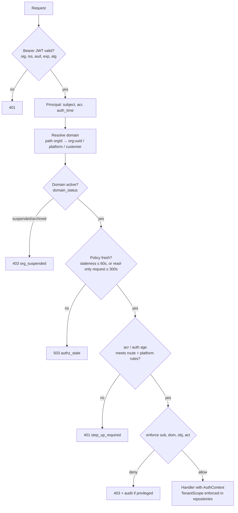

# LLD-02: Authorization with Casbin

| Field | Value |
| --- | --- |
| Status | Draft v0.1 |
| Milestone | M2 |
| Components | `sf-authz` library (all services), authz-svc |
| ADRs | 0004, 0005, 0009 |

## 1. Scope

This LLD covers:

- the Casbin domain-RBAC model;
- the role and permission catalog;
- resource-ownership rules;
- the enforcement pipeline in every service;
- policy storage, propagation, and revocation;
- integration with memberships and organization status;
- the authorization threat model.

Authentication is in LLD-01.

## 2. Concepts

| Concept | Format | Examples |
| --- | --- | --- |
| Subject | `user:<uuid>` or `svc:<service>` | `user:0192…`, `svc:orders` |
| Domain | `org:<uuid>`, `platform`, `customer` | `org:0191…` |
| Object | Resource type (lower_snake) | `product`, `stock`, `order`, `member`, `role_assignment` |
| Action | Verb | `read`, `create`, `update`, `delete`, `adjust`, `cancel`, `refund`, `invite`, `assign`, `revoke`, `replay` |
| Role | `role:<name>`, with a fixed scope (`platform`, `org`, `customer`) | `role:catalog_manager` |

Permissions are **role templates**: a role grants the same permissions in every domain where it is assigned. The assignment carries the domain.

## 3. Casbin model

```ini
[request_definition]
r = sub, dom, obj, act

[policy_definition]
p = sub, dom, obj, act, eft

[role_definition]
g = _, _, _

[policy_effect]
e = some(where (p.eft == allow)) && !some(where (p.eft == deny))

[matchers]
m = g(r.sub, p.sub, r.dom) \
    && (p.dom == r.dom || p.dom == "*") \
    && keyMatch(r.obj, p.obj) \
    && (p.act == r.act || p.act == "*")
```

- `p.dom == "*"` is used for org-role templates. Platform roles use `p.dom == "platform"`, so they can never match an org domain.
- **Default deny:** no matching allow means deny.
- Explicit `deny` rows carve out exceptions, for example `platform_operator` is denied `identity_config`.
- **Scope consistency:** a role can be assigned only in a domain of its scope, enforced by a DB constraint (§7). So an org role assigned in `platform` cannot happen.

### 3.1 Policy examples

```csv
# templates (compiled from role_permissions)
p, role:catalog_manager, *, product, *, allow
p, role:catalog_manager, *, category, *, allow
p, role:catalog_manager, *, promotion, *, allow
p, role:inventory_manager, *, stock, read, allow
p, role:inventory_manager, *, stock, adjust, allow
p, role:order_manager, *, order, read, allow
p, role:order_manager, *, order, update_status, allow
p, role:order_manager, *, order, cancel, allow
p, role:order_manager, *, refund, create, allow
p, role:org_admin, *, member, *, allow
p, role:org_admin, *, invitation, *, allow
p, role:org_admin, *, role_assignment, *, allow
p, role:org_admin, *, org_settings, *, allow
p, role:customer, customer, cart, *, allow
p, role:customer, customer, order, create, allow
p, role:customer, customer, order, read, allow
p, role:customer, customer, order, cancel, allow
p, role:super_user, platform, *, *, allow
p, role:platform_operator, platform, dlq, *, allow
p, role:platform_operator, platform, reconciliation, *, allow
p, role:platform_operator, platform, identity_config, *, deny

# assignments (compiled from role_assignments, status = active)
g, user:A, role:catalog_manager, org:O1
g, user:A, role:customer, customer
g, user:S, role:super_user, platform
```

## 4. Role and permission catalog

| Resource \ Role | org_admin | catalog_manager | inventory_manager | order_manager | customer (own) | platform_operator | super_user |
| --- | --- | --- | --- | --- | --- | --- | --- |
| org_settings | R/U | — | — | — | — | — | via platform |
| member, invitation | full | — | — | — | — | — | via platform |
| role_assignment (org roles) | R/assign/revoke (guards §11) | — | — | — | — | — | via platform |
| product, category, promotion | R | full | R | R | storefront (public) | — | R |
| stock | R | R | R/adjust | R | — | — | R |
| reservation | — | — | R/release | R | — | R | R |
| order | R | — | — | R/update_status/cancel | create/R/cancel (pending) | R | R |
| refund | — | — | — | create | — | — | R |
| audit_log (org) | R | — | — | — | — | — | R |
| platform_user, platform_org | — | — | — | — | — | R | full |
| identity_config | — | — | — | — | — | **deny** | full (step-up) |
| dlq, reconciliation, feature_flag | — | — | — | — | — | full | full |

- **Platform roles** (`super_user`; `platform_operator` per OQ-8) require `acr ≥ 2` for every platform-domain decision (§6, step 5).
- **Platform access to tenant data** goes through explicit `/v1/platform/orgs/{orgId}/…` endpoints, evaluated in the `platform` domain. They require an `X-Access-Reason` value (support ticket or free text, 10–200 characters) that is recorded in the audit event. A superuser never inherits org roles.

## 5. Ownership and resource-scope rules (outside Casbin)

Casbin answers "may this subject do this action on this resource type in this domain". **Instance-level** scope is enforced in the data layer:

| Resource | Rule |
| --- | --- |
| Any org-scoped entity | Loaded with `WHERE id = :id AND org_id = :path_org_id`. A mismatch returns **404**, not 403, so other tenants' IDs are not confirmed. |
| Nested entity (image → product, line → order) | Parent loaded with the org filter. The child is loaded via the parent. |
| Customer cart, order | `WHERE customer_id = :sf_uid`. A mismatch returns 404. |
| Customer order cancel | Allowed only when `status = pending` or `confirmed` and not yet processing (LLD-06 §6). |
| Membership operations | The target membership's `org_id` must equal the path org. |

**Repository API rule:** the repository functions for org-scoped tables take a required `TenantScope(org_id)` argument. There is no unscoped variant, except in platform repositories, which take `PlatformScope`. A lint rule plus a code-review checklist item backs this.

**Optional hardening (decide in M3):** PostgreSQL Row-Level Security on org-scoped tables, using `SET LOCAL app.org_id` per transaction. This works with PgBouncer transaction pooling because `SET LOCAL` is transaction-scoped.

## 6. Enforcement pipeline (`sf-authz`)

Every route declares exactly one of:

- `Authorize(resource, action, domain=<resolver>, min_acr=None, max_auth_age=None)`
- `Public(rate_class)`
- `Internal(scope)`

At startup the app **fails to start** if any route lacks a declaration (the route-coverage guard). CI runs the same check.



**Rules:**

- **`Internal(scope)` routes** are not evaluated by Casbin. They accept only client-credential tokens (aud `scaleforge-internal`) carrying the declared scope (ADR-0009). Service subjects never receive Casbin role assignments.
- **Domain source:** the domain comes only from the URL path or the route's fixed domain, never from headers, the body, or the session (FR-ORG-05).
- **No per-request decision cache:** Casbin's in-memory evaluation is fast enough. If a decision cache is added later, it must be keyed by `policy_version`.
- **Response codes:**
  - Authenticated but no permission in the domain → 403 with a generic problem type.
  - Resource not in the domain → 404.
  - Suspended organization → 403 with type `org-suspended`, a public, non-sensitive fact.

## 7. Policy storage (authz schema)

| Table | Key columns | Constraints / notes |
| --- | --- | --- |
| `roles` | `id text PK`, `scope`, `description`, `requires_mfa bool`, `assignable_by text[]`, `system bool` | `CHECK scope IN ('platform','org','customer')`. This and the next two tables realize the PRD §3.4 "roles and permissions" candidate. |
| `permissions` | `id text PK` (`product:update`), `resource`, `action` | |
| `role_permissions` | `role_id FK`, `permission_id FK`, `effect` | `PK(role_id, permission_id)`; `effect IN ('allow','deny')` |
| `role_assignments` (realizes the PRD `membership_roles`) | `id uuid PK`, `user_id`, `role_id FK`, `domain text`, `org_id uuid NULL`, `membership_id uuid NULL`, `status`, `granted_by`, `granted_at`, `revoked_by`, `revoked_at`, `reason`, `version` | Partial `UNIQUE(user_id, role_id, domain) WHERE status <> 'revoked'`; `CHECK (domain = 'org:' \|\| org_id) = (scope='org')`, enforced by trigger against `roles.scope`; `status IN ('active','suspended','revoked')` |
| `membership_projection` | `membership_id PK`, `org_id`, `user_id`, `status`, `source_version` | Fed by `membership.*` events. Row-locked during assignment. |
| `domain_status` | `domain PK`, `status`, `updated_at`, `source_version` | Fed by `organization.*` events |
| `casbin_rule` | `id`, `ptype`, `v0..v5` | **Compiled projection.** Written only inside the same transaction as the source change. |
| `policy_version` | `id = 1`, `version bigint`, `epoch uuid`, `updated_at` | `version` is incremented in every policy-changing transaction. `epoch` is regenerated only by the DB-restore runbook. When enforcers see a new epoch, they accept a lower version after a restore (LLD-13 §5.5). |
| `outbox`, `inbox` | LLD-08 | |

**Write path** (for example, assigning a role), all in one transaction:

1. `SELECT … FROM membership_projection WHERE membership_id = :m FOR UPDATE`. It must be `active`.
2. Escalation guards (§11).
3. Insert into `role_assignments`.
4. Insert the `g` row into `casbin_rule`.
5. `UPDATE policy_version SET version = version + 1 RETURNING version`.
6. Insert outbox rows: `membership.role_changed.v1` and `audit.recorded.v1`. If the role `requires_mfa`, also insert the command `identity.mfa_group_sync_requested.v1`.
7. Commit.
8. After commit: `PUBLISH authz:policy <version>` (best effort).

Before step 1, authz-svc also calls `GET orgs-svc /internal/v1/memberships/{id}` to confirm freshness. The projection lock serializes the assignment against a concurrent `membership.disabled` consumer.

## 8. Propagation and revocation

| Mechanism | Behavior |
| --- | --- |
| Startup | Load the full policy and `domain_status` with `authz_reader`. Readiness stays false until loaded. |
| Watcher | Subscribe to `authz:policy` on redis-cache. When `version > local_version`, reload (debounced 200 ms, single-flight). |
| Polling fallback | Every 10 s, `SELECT version FROM policy_version`. Reload if newer. |
| Reload | Build a new enforcer off to the side, then swap the reference atomically. In-flight requests keep the old one. |
| Freshness | `last_confirmed_at` is updated on a successful poll or reload. Staleness = `now - last_confirmed_at`. |
| Stale > 60 s | Deny mutating and platform-domain requests (503 `authz_stale`). Reads continue. |
| Stale > 300 s | Readiness fails, so the pod leaves the load balancer. |

**Revocation target** (to measure in M2, pass criteria in LLD-14):

| Path | Expected latency |
| --- | --- |
| Role revoked via authz-svc (direct) | commit → watcher publish → reload ≈ < 1 s; **target ≤ 5 s p99** |
| Membership disabled via orgs-svc | orgs commit → outbox relay (≤ 1 s) → broker → authz consumer → commit → watcher ≈ 2–3 s; **target ≤ 5 s p99** |
| redis-cache down | Polling bound: **≤ 15 s p99** |
| Session-level (user disabled) | Immediate via BFF session deletion (LLD-01 §8) |

Roles are not embedded in tokens (ADR-0009), so revocation never waits for access-token expiry.

## 9. Membership, user, and organization status integration

| Event consumed | authz-svc action (one transaction, idempotent via inbox) |
| --- | --- |
| `membership.created` | Upsert the projection. Grant the roles requested by the accepted invitation (if any). |
| `membership.disabled` | Projection → disabled. Active assignments for (user, org) → `suspended`. Remove `g` rows. Bump the version. |
| `membership.reactivated` | Projection → active. Assignments `suspended` **by membership disable** → `active`. Re-add `g` rows. |
| `membership.revoked` | Projection → revoked. Assignments → `revoked`. |
| `organization.suspended` / `.archived` | `domain_status` → suspended/archived. Bump the version. |
| `organization.reactivated` | `domain_status` → active |
| `user.created` | Grant `role:customer` in `customer` |
| `user.disabled` | All assignments → `suspended` (reason `user_disabled`) |
| `user.reactivated` | `role:customer` restored. Others stay suspended until re-granted. |

Out-of-order events are ignored when `event.source_version ≤ projection.source_version`.

## 10. Threat model (authorization)

| Threat | Example | Control | Test |
| --- | --- | --- | --- |
| Cross-tenant IDOR | GET `/orgs/O2/products/{id-from-O1}` | Org filter on load → 404 | Cross-tenant matrix |
| Path/domain confusion | Valid role in O1, path O2, resource from O1 | Domain from path; resource must match the path org | Matrix |
| Header spoofing | `X-Org-Id`, `X-User-Id` injected | Headers ignored; identity from the JWT only | Negative API tests |
| Privilege escalation via role assignment | org_admin assigns `super_user`, or a catalog_manager assigns itself | Scope constraint; `assignable_by`; no self-grant; platform roles need super_user + step-up | Escalation suite |
| Stale policy after revocation | Removed manager keeps editing | Watcher + polling; staleness fail-closed | Revocation latency test |
| Disabled membership still acting | Disabled user's token still valid | Session revoked (BFF) + assignments suspended | Disabled-membership test |
| Suspended org still mutating | | `domain_status` check before enforce | Suspended-org test |
| Org switching inheritance | Rights from O1 used while "in" O2 | No server-side current org; every request is domain-scoped | Switch test |
| Confused deputy | Service uses its own powerful identity to act for a user | User-context calls forward the user JWT; service tokens only for system work, with narrow scopes | Code review + contract tests |
| Missing check on a new route | Developer forgets authz | Route-coverage guard fails startup and CI | Guard unit test |
| Wildcard abuse | Policy `p, role:x, *, *, *` added by mistake | Policy linter in CI: wildcards allowed only for super_user and specific templates | Linter |
| Frontend-only hiding | Hidden button, API open | Backend enforcement; E2E calls APIs directly | Matrix |

## 11. Escalation guards (role assignment)

1. The target role's `scope` must equal the domain's scope.
2. The actor must hold, in the same domain, a role listed in the target role's `assignable_by`. For example:
   - `org_admin` can assign `{org_admin, catalog_manager, inventory_manager, order_manager}`;
   - platform roles are assignable only by `super_user`.

   `assignable_by` is compiled into Casbin as permissions on object `role_grant:<role>`, action `assign` (for example `p, role:org_admin, *, role_grant:catalog_manager, assign, allow`). Any service can then check grant rights locally. orgs-svc uses this to validate invitation roles without calling authz-svc, which keeps the sync call graph acyclic.
3. Actors cannot grant or modify **their own** assignments. Self-revoke ("leave role") is allowed.
4. **Last org_admin protection:** revoking or suspending the last active org_admin of an org is rejected (409), unless done by a platform super_user. This is checked under `SELECT … FOR UPDATE` on the org's admin assignments.
5. Platform-role grants require `acr ≥ 2` and `auth_time ≤ 10 min`, a reason, and generate an audit event with high severity.
6. **First super_user bootstrap:** a one-time Kubernetes Job runs the `authz-admin bootstrap` CLI with a dedicated, short-lived credential. It refuses to run if any super_user exists.

## 12. authz-svc APIs

| Endpoint | Authz |
| --- | --- |
| GET `/v1/orgs/{orgId}/role-assignments?user_id=` | `role_assignment:read` in org |
| POST `/v1/orgs/{orgId}/role-assignments` `{user_id, role_id}` | `role_assignment:assign` + guards |
| DELETE `/v1/orgs/{orgId}/role-assignments/{id}` (If-Match) | `role_assignment:revoke` + guards |
| GET `/v1/roles?scope=` | authenticated (catalog of role names and descriptions) |
| GET/POST/DELETE `/v1/platform/role-assignments` | super_user; step-up |
| GET `/v1/me/permissions?domain=` | self. Returns a UI-hint permission list; the UI is never trusted with it. |

## 13. Requirements covered

PRD §3.3 (all bullets); FR-ORG-03, FR-ORG-04, FR-ORG-05, FR-ORG-07; FR-COM-03; FR-CHK-06 (admin scope); SEC-02, SEC-03, SEC-15.

## 14. Telemetry

| Metric | Labels |
| --- | --- |
| `authz_decisions_total` | `decision` (allow, deny), `domain_type` (org, platform, customer), `resource` (bounded set), `service` |
| `authz_policy_version` | gauge |
| `authz_policy_staleness_seconds` | gauge |
| `authz_policy_reload_duration_seconds` | histogram |
| `authz_policy_rules` | gauge (`ptype`) |
| `authz_revocation_propagation_seconds` | histogram. Computed from `policy_version.updated_at` vs the local reload time. Clock-skew caveat: same cluster, NTP, ± ms. |

- **Spans:** `authz.enforce`, with attributes for decision, resource, and action, but **no** subject IDs as metric labels.
- **Deny audit:** sampled to at most 10 per minute per subject to avoid floods, always for platform-domain requests.

## 15. Tests

| Test | Type |
| --- | --- |
| Decision table generated from the §4 matrix: every role × resource × action × domain type | Unit (model + policies) |
| Route-coverage guard: an undeclared route fails app startup | Unit |
| Cross-tenant matrix: every org-scoped endpoint × (member of other org, non-member, customer, suspended org, disabled membership) → expected 403/404 | API (generated from OpenAPI + route metadata) |
| Escalation suite: §11 rules 1–6 | API |
| Revocation latency: revoke → poll the endpoint until 403; record the distribution over 200 trials, watcher on and off | Integration |
| Org switching: role in O1 only; actions in O2 denied; UI caches keyed by org | API + E2E |
| Policy linter: wildcard and scope rules | CI |
| Out-of-order membership events | Integration |

## 16. Open items

| Item | Owner |
| --- | --- |
| Confirm the `platform_operator` role (OQ-8) | Product |
| Decide on RLS defense-in-depth in M3 | Backend |
| Measure policy reload time at 10k / 50k / 100k rules | Backend (M2) |
