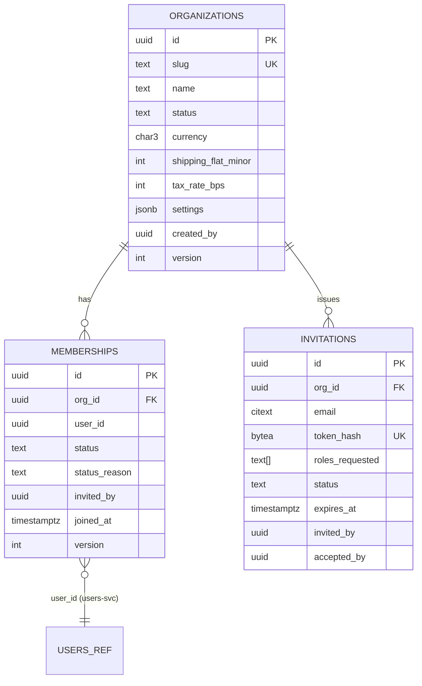
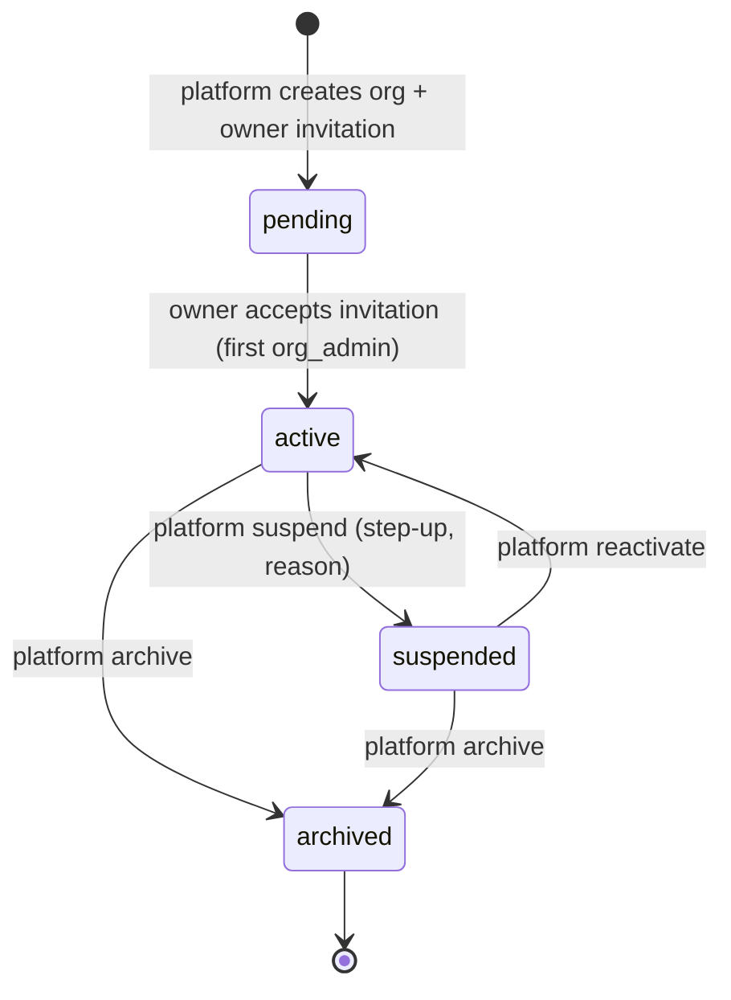
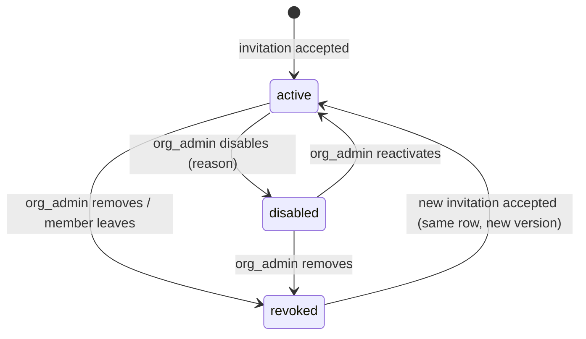

# LLD-03: Organizations, Memberships, and Invitations

| Field | Value |
| --- | --- |
| Status | Draft v0.1 |
| Milestone | M2 |
| Service | orgs-svc (schema `orgs`) |
| ADRs | 0002, 0004, 0015 |

## 1. Scope

This LLD covers:

- the organization (store) lifecycle and settings;
- staff memberships and invitations;
- organization switching semantics.

Role assignment is owned by authz-svc (LLD-02). orgs-svc owns *who is a member*; authz-svc owns *what members may do*.

## 2. ER diagram



## 3. Tables and constraints

| Table | Constraints |
| --- | --- |
| `organizations` | `UNIQUE(slug)`, where the slug is lowercase `[a-z0-9-]{3,40}` and not reserved. `CHECK status IN ('pending','active','suspended','archived')`. `currency` is immutable after the first product (enforced in catalog-svc by reading the store snapshot; documented). `CHECK tax_rate_bps BETWEEN 0 AND 10000`. |
| `memberships` | `UNIQUE(org_id, user_id)` (one row per pair; reused on re-invite). `CHECK status IN ('active','disabled','revoked')`. Index `(user_id, status)` for "my orgs". |
| `invitations` | `UNIQUE(token_hash)`. Partial `UNIQUE(org_id, email) WHERE status='pending'`. `CHECK status IN ('pending','accepted','revoked','expired')`. Index `(org_id, status, created_at)`. |
| `outbox`, `inbox` | LLD-08 |

## 4. Organization lifecycle (FR-ORG-01, FR-ORG-07)



| State | Storefront | Staff APIs | Customer checkout | Customer order history |
| --- | --- | --- | --- | --- |
| pending | hidden (404) | org_admin only (settings, invitations) | blocked | n/a |
| active | visible | per role | allowed | visible |
| suspended | hidden (404 `store-unavailable`) | **denied** (403 `org-suspended`) | **blocked** | visible (customer domain) |
| archived | hidden | denied; data read-only for platform | blocked | visible |

**Enforcement of status:**

- Organization status reaches every service as `domain_status` through the authz policy load (LLD-02 §9).
- Public storefront routes declare `Public(rate_class, require_store_active=True)`. Checkout declares the same requirement for the store in its path.
- **In-flight sagas** at suspension time continue to completion, because payment and inventory consistency matters more than a hard stop. Later staff actions are denied, and the platform can act through platform endpoints.

## 5. Membership lifecycle (FR-ORG-02)



| Transition | Guards | Events |
| --- | --- | --- |
| disable | Actor holds `member:update`. Target is not the last active org_admin (orgs-svc asks the local enforcer whether the user holds org_admin, and authz-svc re-checks in its consumer). Not self. | `membership.disabled` |
| reactivate | `member:update`; org active | `membership.reactivated` |
| revoke | `member:revoke`, or self-leave; last-admin guard | `membership.revoked` |

Effects on authorization and sessions follow LLD-02 §9: assignments are suspended or revoked within the revocation target. Sessions stay valid, because the user may belong to other orgs and is still a customer. Only org-domain decisions change.

## 6. Invitations

### 6.1 Flow

```mermaid
sequenceDiagram
  participant A as Org admin (browser)
  participant O as orgs-svc
  participant N as notifications-svc
  participant U as Invitee (browser)
  participant BFF
  A->>O: POST /v1/orgs/{orgId}/invitations {email, roles[]} (via BFF)
  O->>O: authorize member:invite; for each role check role_grant:<role> assign (local enforcer)
  O->>O: rate limit per org (50/day); token = 32B random; store sha256(token)
  O->>O: tx: insert invitation + outbox invitation.created {invitation_id, email, org_name, link_token}
  Note over O,N: token travels only in the notification command payload,<br/>which is encrypted at rest in the outbox (§6.3)
  O-->>N: invitation.created → email with link /invitations/accept#token
  U->>BFF: open link → login if needed
  U->>O: POST /v1/invitations:accept {token} (via BFF)
  O->>O: tx: SELECT invitation WHERE token_hash FOR UPDATE<br/>pending? not expired? verified JWT email == invitation email?
  O->>O: upsert membership(active) + invitation accepted + outbox membership.created {roles_requested, invited_by}
  O-->>U: 200 {org_id}
  Note over O: authz-svc consumes membership.created and grants roles,<br/>re-checking that the inviter still holds role_grant rights
```

### 6.2 Rules

- **Expiry:** 7 days. A nightly job marks pending invitations past `expires_at` as `expired`. Acceptance also checks `expires_at` against DB `now()`.
- **Resend** creates a new token and invalidates the old one (same row, new `token_hash`, new `expires_at`).
- **Revoke:** `DELETE /v1/orgs/{orgId}/invitations/{id}` marks it revoked. A token presented after revocation returns the generic 410 `invitation-invalid`. The same response covers unknown, expired, and revoked tokens, for anti-enumeration.
- **Email match:** the invitee's **verified** email (`email_verified=true` in the JWT) must match the invitation email (case-insensitive). On a mismatch the API returns 403 `invitation-email-mismatch` and tells the user to sign in with the invited address.
- The token travels in the URL **fragment** (`#token`), so it is not sent in Referer headers or server logs. The SPA posts it in the body.

### 6.3 Token handling in events

- The raw token must reach notifications-svc to build the link.
- The outbox `payload` for `invitation.created` stores the token **encrypted** with an orgs-svc key (AES-GCM). notifications-svc receives a decrypt-capable key.
- The token never appears in logs, traces, or audit metadata.

**Alternative (simpler):** notifications-svc calls `POST /internal/v1/invitations/{id}:issue-link` to get a fresh token at send time. This is deferred; the choice is made at M2 start.

## 7. Organization switching (FR-ORG-05)

- **No server-side "current organization".** Org-scoped API paths always include `{orgId}`, and every authorization decision uses the domain from the path (LLD-02 §6).
- **Frontend:**
  - The console route is `/console/orgs/:orgId/…`. Switching is a navigation.
  - The data-fetching cache keys include `orgId`. Switching clears cached data for other orgs.
  - The permission hints come from `/v1/me/permissions?domain=org:<id>` and are re-fetched per org.
- **Cross-tab safety:** two tabs on different orgs are independent and correct, because no shared server state exists.

## 8. APIs

| Endpoint | Authz (domain) | Notes |
| --- | --- | --- |
| POST `/v1/platform/orgs` | platform `platform_org:create`, step-up | Creates a `pending` org + owner invitation (`roles=[org_admin]`) |
| GET `/v1/platform/orgs?status=&q=&cursor=` | platform `platform_org:read` | |
| POST `/v1/platform/orgs/{orgId}:suspend` / `:reactivate` / `:archive` | platform `platform_org:update`, step-up, `X-Access-Reason` | |
| GET `/v1/orgs/{orgId}` | org `org_settings:read` | |
| PATCH `/v1/orgs/{orgId}` (If-Match) | org `org_settings:update` | Name, logo, contact, shipping, tax |
| GET `/v1/orgs/{orgId}/members?status=&q=&cursor=` | org `member:read` | Search within the org only |
| POST `/v1/orgs/{orgId}/members/{membershipId}:disable` / `:reactivate` | org `member:update` | |
| DELETE `/v1/orgs/{orgId}/members/{membershipId}` | org `member:revoke` | |
| POST `/v1/orgs/{orgId}/members/me:leave` | org membership (any role) | Last-admin guard |
| GET/POST `/v1/orgs/{orgId}/invitations` | org `invitation:read/create` | |
| POST `/v1/orgs/{orgId}/invitations/{id}:resend`; DELETE `…/{id}` | org `invitation:create/revoke` | |
| POST `/v1/invitations:accept` | authenticated (customer domain) | Rate class `enumeration` |
| GET `/v1/me/memberships` | self | |
| GET `/v1/stores/{orgId}/profile` | Public, store active | Cached (LLD-09 §6) |
| GET `/internal/v1/memberships/{id}` | `Internal(orgs:read)` | Used by authz-svc |

## 9. Events published

| Event | Key payload fields |
| --- | --- |
| `organization.created.v1` | `org_id`, `slug`, `name`, `status`, `version` |
| `organization.updated.v1` | `org_id`, changed public profile fields, `version` |
| `organization.suspended.v1` / `.reactivated.v1` / `.archived.v1` | `org_id`, `reason_code`, `version` |
| `membership.created.v1` | `membership_id`, `org_id`, `user_id`, `roles_requested[]`, `invited_by`, `version` |
| `membership.disabled.v1` / `.reactivated.v1` / `.revoked.v1` | `membership_id`, `org_id`, `user_id`, `actor_id`, `version` |
| `invitation.created.v1` | `invitation_id`, `org_id`, `email`, `org_name`, `expires_at`, `token_enc` |
| `invitation.accepted.v1` / `.revoked.v1` / `.expired.v1` | `invitation_id`, `org_id` |
| `audit.recorded.v1` | One per state change (LLD-04 §2) |

## 10. Requirements covered

FR-ORG-01, FR-ORG-02, FR-ORG-04 (membership side), FR-ORG-05, FR-ORG-06, FR-ORG-07; PRD §3.4 (organizations, memberships, invitations).

## 11. Telemetry

- **Metrics:**
  - `orgs_invitations_total{result}` (created, accepted, expired, revoked, mismatch, invalid);
  - `orgs_membership_transitions_total{transition}`;
  - `orgs_status{status}` (gauge of counts).
- **Logs:** never include invitation tokens. Emails appear only as `email_hash` in logs.

## 12. Tests

| Test | Type |
| --- | --- |
| Invitation accept: happy path; expired; revoked; reused; wrong email; unverified email; unknown token gives the same response as revoked | API |
| Concurrent accept of the same token by two sessions → exactly one membership | Concurrency |
| Invite with a role the inviter cannot grant → 403 | API |
| Last-admin guard on disable, revoke, and leave | API + concurrency (two admins removing each other simultaneously → one fails) |
| Suspended org: staff mutations 403, storefront 404, checkout blocked, customer history visible | API |
| Org switch: E2E navigation between two orgs with different roles; no data or permission bleed | E2E |
| Audit emitted for every transition (§9) | Integration |

## 13. Open items

| Item | Owner |
| --- | --- |
| Encrypted token in event vs fetch-on-send (§6.3) | Backend (M2 start) |
| Self-service merchant signup (org request → platform approval)? | Product |
