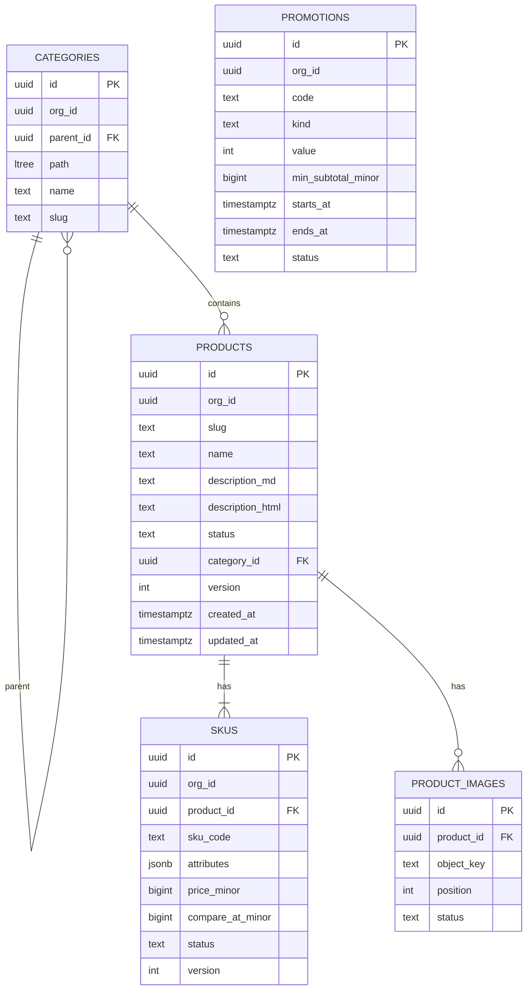

# LLD-05: Catalog, Pricing, and Search

| Field | Value |
| --- | --- |
| Status | Draft v0.1 |
| Milestone | M3 (cache and experiments: M4) |
| Services | catalog-svc (schema `catalog`, object storage), search-svc (schema `search`) |
| ADRs | 0002, 0007, 0015 |

## 1. Scope

This LLD covers:

- products, SKUs, and categories;
- prices and simple promotions;
- the authoritative price quote used by checkout;
- product images;
- storefront reads;
- the derived search index and query API.

## 2. Data model (catalog)



| Table | Key constraints / indexes |
| --- | --- |
| `products` | `UNIQUE(org_id, slug)`; `CHECK status IN ('draft','active','archived')`; index `(org_id, status, updated_at DESC, id)` |
| `skus` | `UNIQUE(org_id, sku_code)`; `CHECK price_minor >= 0`; `CHECK compare_at_minor IS NULL OR compare_at_minor >= price_minor`; index `(product_id)` |
| `categories` | `UNIQUE(org_id, parent_id, slug)`; GIST index on `path`; max depth 4 (CHECK `nlevel(path) <= 4`) |
| `product_images` | `UNIQUE(product_id, position)`; `CHECK status IN ('pending','ready','rejected')` |
| `promotions` | `UNIQUE(org_id, upper(code))`; `CHECK kind IN ('percent','fixed')`; `CHECK (kind='percent' AND value BETWEEN 1 AND 90) OR (kind='fixed' AND value > 0)` |
| `price_history` | Append-only (sku_id, old, new, actor, at), used for audit and disputes |
| `store_pricing_settings` | Projection from `organization.*` events: currency, shipping_flat_minor, tax_rate_bps, status, source_version |
| `outbox` | LLD-08 |

- **Money:** integer minor units; the currency comes from store settings (ADR-0015).
- **Description:** stored as Markdown and as server-sanitized HTML. The HTML is produced by a Markdown renderer followed by an allow-list sanitizer (`nh3`), with no raw HTML, scripts, or event handlers, and links forced to `rel="nofollow noopener"`. The frontend sanitizes again (LLD-15 §6).

## 3. Pricing and quotes (FR-CHK-02)

catalog-svc is the **pricing authority**. Clients never send prices.

`POST /internal/v1/orgs/{orgId}/quotes` (`Internal(catalog:quotes)`, called by orders-svc; the BFF calls the public variant for cart display)

```json
{ "lines": [{"sku_id": "…", "qty": 2}], "promo_code": "AUTUMN10" }
```

**Algorithm:**

1. The store must be `active` (projection). Otherwise 409 `store-unavailable`.
2. Load SKUs + products in **one query**: `WHERE sku.id = ANY(:ids) AND sku.org_id = :org`. Lines with an inactive SKU or product, or an unknown SKU, are returned as `unavailable`, and the quote is `valid=false`.
3. Per line: `line_total = unit_price_minor × qty`, with `qty` in 1–99.
4. `subtotal = Σ line_total`.
5. Promotion: active, within `[starts_at, ends_at)` by DB `now()`, and `subtotal ≥ min_subtotal`.
   - `percent` → `discount = floor(subtotal × value / 100)`.
   - `fixed` → `min(value, subtotal)`.
6. `shipping = store.shipping_flat_minor` (0 when the subtotal is 0).
7. `tax = round_half_up((subtotal − discount + shipping) × tax_rate_bps / 10000)`.
8. `total = subtotal − discount + shipping + tax`.
9. The response carries per-line `unit_price_minor`, `product_name`, `sku_version`, the totals, `currency`, `computed_at`, and `pricing_fingerprint = SHA-256(sku_ids+versions+promo+settings_version)`.

orders-svc stores the line snapshot and the fingerprint in the order (LLD-06 §3).

Promotion redemption limits (max uses) are **out of scope for v1**. They would need a reservation-style counter and an extra saga step.

## 4. Admin APIs and optimistic locking (FR-COM-03)

| Endpoint | Authz (org domain) |
| --- | --- |
| GET `/v1/orgs/{orgId}/products?status=&category=&q=&cursor=` | `product:read` |
| POST `/v1/orgs/{orgId}/products` | `product:create` |
| GET `/v1/orgs/{orgId}/products/{id}` | `product:read` (returns `ETag: "v{version}"`) |
| PATCH `/v1/orgs/{orgId}/products/{id}` + `If-Match` | `product:update` |
| POST `/v1/orgs/{orgId}/products/{id}:publish` / `:archive` | `product:update` |
| PUT/DELETE `/v1/orgs/{orgId}/products/{id}/skus/{skuId}` + `If-Match` | `product:update` |
| CRUD `/v1/orgs/{orgId}/categories` | `category:*` |
| CRUD `/v1/orgs/{orgId}/promotions` | `promotion:*` |

**Optimistic locking:**

- `UPDATE products SET …, version = version + 1 WHERE id = :id AND org_id = :org AND version = :if_match_version`.
- 0 rows → re-select. Not found → 404; found → **412** with the current ETag.
- A missing `If-Match` → 428.

This suits low-contention admin edits (PRD §5.1). Changing a SKU bumps the parent product's `version` in the same transaction, so the product snapshot event is always coherent.

**Side effects** happen in the same transaction:

- outbox `product.updated.v1` (full snapshot) and `audit.recorded.v1`;
- `price_history` rows on price change.

After commit, cache keys are deleted (LLD-09 §6).

## 5. Images

1. `POST /v1/orgs/{orgId}/products/{id}/images:upload` → `{image_id, upload: {url, fields}}`. This is an object-storage **presigned POST** with policy conditions:
   - key = `orgs/{org}/products/{id}/{image_id}`;
   - `content-length-range` 1 B – 5 MiB;
   - `Content-Type` in `image/jpeg|png|webp`;
   - expiry 5 min.
2. The browser uploads directly to object storage via the gateway route `/upload/*`, so large bodies never pass through the BFF.
3. `POST …/images/{image_id}:finalize`:
   - catalog-svc verifies the object exists and checks size and magic bytes;
   - it enqueues a re-encode job that strips metadata, defeats polyglot files, and generates 3 sizes;
   - status becomes `ready` when the job finishes, `rejected` otherwise.
4. Images are served from `/media/{key}` (public read on the derived-sizes prefix only) with `Cache-Control: public, max-age=31536000, immutable`. Keys are content-addressed per size.

## 6. Storefront reads (FR-COM-01)

| Endpoint | Source | Cache |
| --- | --- | --- |
| GET `/v1/stores/{orgId}/products/{slug}` | catalog-svc: product + SKUs + ready images + category breadcrumb, in one query plus one images query (no N+1) | redis-cache, LLD-09 §6 |
| GET `/v1/stores/{orgId}/categories` | catalog-svc: category tree | redis-cache |
| GET `/v1/stores/{orgId}/search?…` (listing and browse) | search-svc | none at first; EXP-4 decides |
| GET `/v1/stores/{orgId}/availability?sku_ids=` | inventory-svc (LLD-07 §8) | 5 s |

- **BFF composition:** product detail = catalog product + inventory availability, called in parallel with a 1 s budget each. If availability fails, the page shows "availability unknown" and checkout still validates (degraded, not failed).
- **Public route rules:** `Public(rate_class=public, require_store_active=True)`. Only `active` products are visible.

## 7. Search index (FR-COM-04)

### 7.1 Table `search.product_search_docs`

| Column | Notes |
| --- | --- |
| `org_id`, `product_id` | PK `(org_id, product_id)` |
| `slug`, `name`, `primary_image_key` | Display |
| `category_ids uuid[]` | Includes ancestors (from the category path) |
| `min_price_minor`, `max_price_minor` | Over active SKUs |
| `in_stock bool` | Any SKU available (from `sku_availability`) |
| `created_at` | For the newest sort |
| `tsv tsvector` | `setweight(to_tsvector('simple', name),'A') ‖ setweight(…category names,'B') ‖ setweight(…description text,'C')` |
| `product_version int` | Last applied catalog version |
| `indexed_at timestamptz` | |

Supporting table: `sku_availability(org_id, product_id, sku_id, in_stock, version)`, PK `(org_id, sku_id)`.

**Indexes:**

- `GIN(tsv)`;
- `GIN(name gin_trgm_ops)`;
- `GIN(category_ids)`;
- `btree(org_id, created_at DESC, product_id)`;
- `btree(org_id, min_price_minor, product_id)`.

The text-search configuration is `simple` at first because language is unknown. Per-store language configuration is an open item.

### 7.2 Applying events

| Event | Handling (inbox dedupe + version guard, one transaction) |
| --- | --- |
| `product.updated.v1` (status active) | Upsert the doc `WHERE excluded.product_version > product_search_docs.product_version` |
| `product.updated.v1` (status draft/archived), `product.deleted.v1` | Delete the doc if `event.version ≥ stored` (tombstone row kept 7 days to block stale re-inserts) |
| `inventory.availability_changed.v1` | Upsert `sku_availability` with a version guard; recompute `in_stock` for the product |

Events can arrive out of order across queues and retries. The version guard makes application **commutative for the latest state**.

### 7.3 Freshness

- `search_index_lag_seconds = indexed_at − event.occurred_at` (histogram).
- **Target:** p95 ≤ 5 s, p99 ≤ 30 s under normal operation (to validate).
- Search responses include the header `X-Search-Index-Lag-Hint` (the current p95 bucket) for debugging.
- Documented behavior: newly published products may take seconds to appear; price changes appear in search before or after the product page.

## 8. Search query semantics (FR-COM-02)

`GET /v1/stores/{orgId}/search`

| Param | Validation |
| --- | --- |
| `q` | 0–100 chars after trim; control characters stripped; parsed with `websearch_to_tsquery('simple', q)` (never string-concatenated) |
| `category` | UUID; matches `category_ids @> ARRAY[:category]` |
| `price_min`, `price_max` | Integers ≥ 0, `min ≤ max` |
| `in_stock` | bool |
| `sort` | `relevance` (default when `q` is set), `newest` (default when `q` is empty), `price_asc`, `price_desc` |
| `limit` | 1–48, default 24 |
| `cursor` | For non-relevance sorts (keyset) |
| `page` | Relevance sort only; 1–50 |

**Matching:**

- `tsv @@ query OR (length(q) ≥ 3 AND name % q)`. The trigram path gives typo and prefix tolerance with `pg_trgm.similarity_threshold = 0.3`.
- Score = `ts_rank_cd(tsv, query) + 0.5 × similarity(name, q)`.

**Pagination:**

- Keyset for `newest` and price sorts: `(created_at, product_id)` or `(min_price_minor, product_id)`, using an HMAC-signed cursor (ADR-0015).
- Relevance uses `OFFSET`, capped at page 50. This is a documented trade-off, because ranked keyset pagination is unstable.

**Facets:** category counts for the current query are computed by a separate aggregate limited to the top 20 categories, with a 300 ms timeout. If it times out, they are omitted.

**Safety:** `statement_timeout = 1 s` for search queries. The rate class is `search` (LLD-09 §7).

## 9. Reindex and correctness checks

- **Full reindex** (`search-reindex` Job, per org or all):
  1. Page through `GET /internal/v1/orgs/{orgId}/products:export?cursor=` (catalog-svc, svc token, keyset).
  2. Upsert with the same version guard.
  3. Delete docs whose product is absent from the export and whose `indexed_at` is before the job start.

  Safe to run alongside the live consumer; no table swap is needed.
- **Drift check (nightly):**
  - compare `(product_id, version)` sets between the catalog export and search;
  - metric `search_index_drift_products`;
  - auto-repair by reindexing that product.
- **Recovery after search DB loss:** a full reindex plus catalog-event replay from the outbox (LLD-08 §5).

## 10. Events published (catalog-svc)

| Event | Payload |
| --- | --- |
| `product.updated.v1` | Full product snapshot: product fields, `skus[]` (id, code, price, status, attributes), `category_path` (ids + names), `primary_image_key`, `version`, `status` |
| `product.deleted.v1` | `product_id`, `org_id`, `version` (archive and hard delete both map here) |
| `price.changed.v1` | `sku_id`, `old`, `new`, `actor_id`. For audit and analytics only; search uses `product.updated`. |

## 11. Requirements covered

FR-COM-01..04, FR-CHK-02; PRD §5.2 experiments (N+1, indexing, debounced search); SEC-05 (sanitization), SEC-06 (parameterized FTS).

## 12. Telemetry

- **Catalog:**
  - `catalog_quote_total{result}` (valid, invalid, store_unavailable);
  - `catalog_quote_duration_seconds`;
  - `catalog_optimistic_conflicts_total{entity}`;
  - `catalog_image_jobs_total{result}`.
- **Search:**
  - `search_queries_total{sort, has_q}`;
  - `search_query_duration_seconds{sort}`;
  - `search_index_lag_seconds`;
  - `search_index_drift_products`;
  - `search_events_applied_total{type, result=applied|stale}`.
- **Spans:** `catalog.quote`, `search.query` (attributes: sort, has_q, result_count bucket; never the raw query text in metrics; the query text in spans is truncated to 50 characters).

## 13. Tests

| Test | Type |
| --- | --- |
| Pricing unit tests: rounding, promotion windows, fixed > subtotal, zero subtotal, tax rounding | Unit |
| Quote rejects SKUs from another org (cross-tenant) | API |
| Client-supplied prices are ignored or rejected (schema forbids extra fields) | API |
| Optimistic locking: two concurrent PATCHes with the same ETag → one 200, one 412 | Concurrency |
| Description XSS payload corpus is neutralized server-side | Unit |
| Image finalize rejects wrong magic bytes or oversize files; upload policy refuses large files | Integration (MinIO) |
| Out-of-order product events → final doc equals the latest version | Integration |
| Search validation: overlong `q`, bad sort, `page > 50`, tampered cursor → 400 | API |
| N+1 guard: admin product list executes ≤ 3 SQL statements regardless of page size (query-count assertion) | Integration |
| Reindex concurrent with live updates converges | Integration |

## 14. Open items

| Item | Owner |
| --- | --- |
| Per-store text-search language configuration | Product |
| Facet counts at scale, measured in M4 (ADR-0007 trigger) | Backend |
| Promotion redemption limits (v2) | Product |
