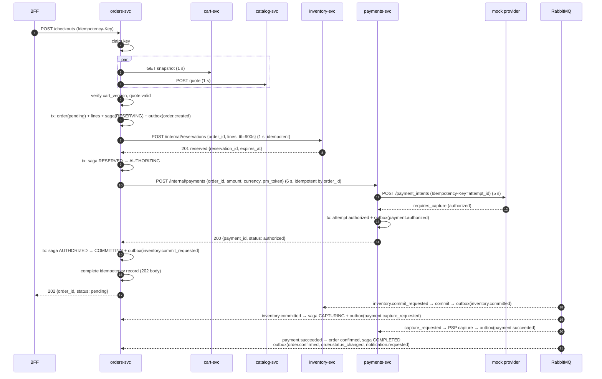
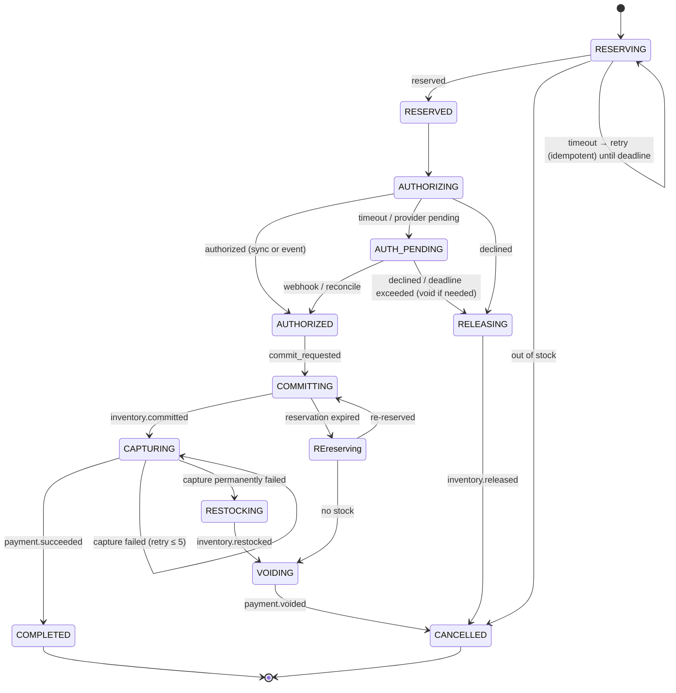
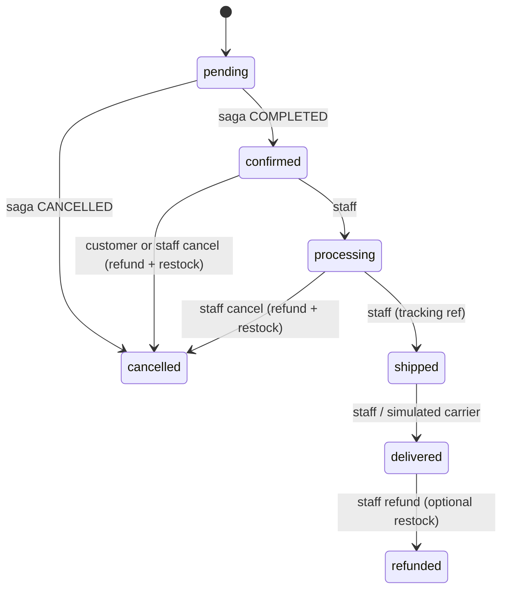
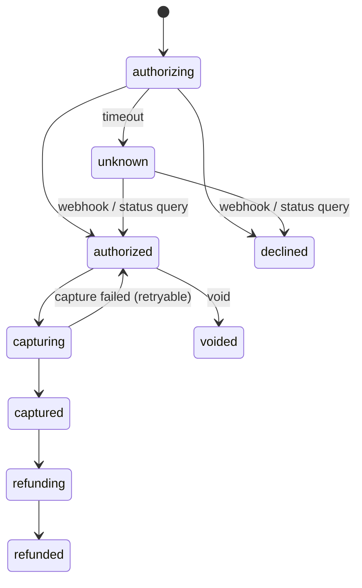

# LLD-06: Cart, Checkout Saga, Orders, and Payments

| Field | Value |
| --- | --- |
| Status | Draft v0.1 (§2, cart-svc, is built — see its "As built" note) |
| Milestone | M3 (happy path, idempotency, persisted saga) → M4 (async compensation, reconciliation, SSE) |
| Services | cart-svc, orders-svc, payments-svc, mock-payment-provider |
| ADRs | 0003, 0008, 0011, 0015 |

## 1. Scope

This LLD covers:

- the persistent cart;
- the checkout API and its idempotency;
- the orchestrated checkout saga with compensation;
- order and payment state machines;
- the mock provider and webhooks;
- reconciliation;
- cancellation and refund;
- real-time order status.

Inventory internals are in LLD-07.

## 2. Cart (cart-svc, FR-CHK-01)

| Table | Columns / constraints |
| --- | --- |
| `carts` | `id`, `customer_id`, `org_id`, `status` (`active`, `checked_out`, `abandoned`), `version`, `updated_at`, `expires_at` (30 days of inactivity). Partial `UNIQUE(customer_id, org_id) WHERE status='active'`. |
| `cart_items` | `cart_id`, `sku_id`, `product_id`, `qty CHECK (qty BETWEEN 1 AND 99)`, `added_at`. `PK(cart_id, sku_id)`. At most 50 lines per cart (checked in a transaction). |
| `inbox` | |

| Endpoint (customer domain) | Semantics |
| --- | --- |
| GET `/v1/me/carts/{orgId}` | Returns the active cart (created lazily) with `version` |
| PUT `/v1/me/carts/{orgId}/items/{skuId}` `{qty}` | **Set** quantity. Idempotent and retry-safe. Validates that the SKU belongs to `orgId` through a catalog lookup (cached). |
| DELETE `/v1/me/carts/{orgId}/items/{skuId}` | Idempotent |
| DELETE `/v1/me/carts/{orgId}/items` | Clear |
| GET `/internal/v1/carts/{cartId}:snapshot` | `Internal(cart:read)`: items + version, for orders-svc |

- **Cart page:** the BFF composes the cart, a catalog quote (display totals, labeled as estimates), and availability.
- **After purchase:** on `order.confirmed.v1`, cart-svc **subtracts the purchased quantities** from the active cart (lines that reach 0 are removed). An empty cart becomes `checked_out`. This keeps items added during checkout.
- **Abandoned carts:** a nightly job marks carts abandoned past `expires_at`.

**As built (cart-svc, 2026-10-24).**

- **No outbox, no inbox consumer.** cart-svc publishes nothing in this slice (no other service needs a cart event yet), and the `order.confirmed.v1` subtract-on-purchase rule above isn't built: orders-svc, its publisher, doesn't exist yet. There's no `outbox` table at all, unlike every other service in this build.
- **Row lock, not optimistic locking, for item mutations.** Add/remove/clear take a `SELECT ... FOR UPDATE` on the cart row rather than requiring the client to send `version`/`If-Match` on every click; `version` still bumps on every mutation, so checkout's `cart_version` snapshot check (§3) stays meaningful.
- **The 50-line cap is an application check inside that locked transaction**, not a DB constraint (Postgres has no portable way to `CHECK` a related row count).
- **The SKU-validity cache isn't built** (LLD-09's cache is M4 scope): every `PUT` item call is a real synchronous call to catalog-svc's new `GET /internal/v1/orgs/{orgId}/skus/{skuId}` (`Internal("catalog:read_sku")`).
- **Casbin domain is the fixed string `"customer"`**, the same for every customer — it only confirms the caller holds `role:customer` (granted to everyone on signup, LLD-02 §9), not that this is *their* cart. Ownership is `customer_id` filtering in the repository.

## 3. Checkout API

`POST /v1/stores/{orgId}/checkouts`. The browser calls `/api/stores/{orgId}/checkout` through the BFF. Rate class `checkout`; CSRF required.

| Header | Rule |
| --- | --- |
| `Idempotency-Key` | Required UUID. The SPA generates it once per checkout-page instance and reuses it for retries. |

```json
{
  "cart_version": 17,
  "promo_code": "AUTUMN10",
  "shipping_address": { "name": "…", "line1": "…", "city": "…", "postal_code": "…", "country": "DE" },
  "payment_method_token": "pm_mock_success"
}
```

| Response | When |
| --- | --- |
| `202 {order_id, status: "pending", payment_status, links.self, links.events}` | Reserved; authorization succeeded or is in progress |
| `402 problem payment-declined {order_id}` | Synchronous decline; the order is cancelled and stock released |
| `409 problem out-of-stock {lines[]}` | Reservation rejected; the order is cancelled |
| `409 problem cart-changed` | `cart_version` mismatch with the snapshot |
| `409 problem checkout-in-progress` + `Retry-After` | Same key in progress, or another checkout for the same cart version |
| `422 problem idempotency-key-reused` | Same key, different payload |
| `403 store-unavailable`, `429`, `503` | Store inactive / rate limited / dependency down |

**Server-side totals:** the order snapshot is built only from the catalog quote (LLD-05 §3). The client never sends prices or totals, and the schema forbids extra fields.

### 3.1 Orders schema (`orders`)

| Table | Columns / constraints |
| --- | --- |
| `orders` | `id`, `org_id`, `customer_id`, `status`, `payment_status` (projection), `cart_id`, `cart_version`, `idempotency_key`, `currency`, `subtotal_minor`, `discount_minor`, `shipping_minor`, `tax_minor`, `total_minor`, `promo_code`, `pricing_fingerprint`, `shipping_address jsonb`, `cancel_reason`, `version`, `created_at`, `updated_at`. `UNIQUE(customer_id, idempotency_key)`. Partial `UNIQUE(cart_id, cart_version) WHERE status <> 'cancelled'`. `CHECK total_minor = subtotal_minor - discount_minor + shipping_minor + tax_minor`. Indexes `(customer_id, created_at DESC, id)`, `(org_id, status, created_at DESC, id)`. |
| `order_lines` | `order_id`, `line_no`, `sku_id`, `product_id`, `name_snapshot`, `unit_price_minor`, `qty`, `line_total_minor`. `PK(order_id, line_no)`. `CHECK line_total_minor = unit_price_minor * qty`. |
| `order_status_history` | `order_id`, `from_status`, `to_status`, `actor_type`, `actor_id`, `reason`, `at` |
| `checkout_sagas` | §5.2 |
| `idempotency_keys` | §4 |
| `outbox`, `inbox` | LLD-08 |

## 4. Idempotency (FR-CHK-03)

`idempotency_keys`:

| Column | Notes |
| --- | --- |
| `scope`, `principal_id`, `key` | PK. Scope examples: `checkout`, `order_cancel`, `refund`. |
| `request_hash` | SHA-256 of canonical JSON (sorted keys) of `{path params, body}` |
| `status` | `in_progress`, `completed` |
| `locked_until` | Lease for the owner (`now() + 15 s`, renewed by long steps) |
| `resource_id` | `order_id` once created |
| `response_status`, `response_body` | Stored for replay (`completed` only) |
| `expires_at` | `created_at + 24 h`; cleanup job |

**Algorithm:**

```text
INSERT … ON CONFLICT DO NOTHING RETURNING *            -- try to claim
if inserted: own it → run checkout
else:
  row = SELECT … FOR UPDATE
  if row.request_hash != hash:          → 422
  if row.status == completed:           → replay stored response (same status + body)
  if row.locked_until > now():          → 409 checkout-in-progress, Retry-After: 2
  else (owner crashed):                 → UPDATE locked_until = now()+15s (take over)
                                          resume from checkout_sagas via resource_id (never re-create the order)
```

**Layers of duplicate protection:**

1. Idempotency key: same client retry.
2. `UNIQUE(customer_id, idempotency_key)` on orders: a backstop.
3. `UNIQUE(cart_id, cart_version)` for non-cancelled orders: a double-click with two keys.
4. The participants' own idempotency, keyed by `order_id`: reservation, payment.

## 5. Checkout saga (orchestrated, ADR-0011)

### 5.1 Happy path



### 5.2 Saga state

`checkout_sagas`: `order_id PK`, `state`, `reservation_id`, `payment_id`, `attempts`, `next_action_at`, `deadline_at` (created + 15 min), `last_error`, `version`, `updated_at`. Index `(next_action_at) WHERE state NOT IN ('COMPLETED','CANCELLED')`.



**Order status mapping:**

- Every state before `COMPLETED` → `orders.status = pending`.
- `COMPLETED` → `confirmed`.
- `CANCELLED` → `cancelled`, with `cancel_reason` in `out_of_stock`, `payment_declined`, `payment_timeout`, `reservation_expired`, or `capture_failed`.

### 5.3 Execution rules

- **Every transition is a guarded update:** `UPDATE checkout_sagas SET state=:to, version=version+1 WHERE order_id=:id AND state=:from`. Zero rows means a duplicate or late event: log at debug, count `saga_stale_events_total`, and ack.
- **Every command to a participant is idempotent by `order_id`.** Commands carry the deterministic message ID `{order_id}:{command}:{attempt_group}`.
- **Recovery worker** (in every orders-svc replica):
  - every 2 s: `SELECT … WHERE next_action_at <= now() AND state NOT IN (terminal) ORDER BY next_action_at FOR UPDATE SKIP LOCKED LIMIT 50`;
  - it re-issues the step's command or call, using exponential backoff with full jitter (base 1 s, cap 60 s).
  - No leader election is needed: `SKIP LOCKED` partitions the work.
- **Deadline:** if `now() > deadline_at` and the state is before `AUTHORIZED`, compensate (void or release) and cancel with reason `payment_timeout`.

### 5.4 Failure matrix

| Scenario | Handling | Final state |
| --- | --- | --- |
| Duplicate submit (same key) | Replay or 409 in progress (§4) | One order |
| Double click (two keys) | `UNIQUE(cart_id, cart_version)` → second 409 | One order |
| Out of stock | Reservation 409 → order cancelled → 409 to client | cancelled |
| Inventory timeout | Retry ≤ 2 inside the budget. Then 202 pending, and the recovery worker retries until the deadline. The reservation (if created) expires by TTL. | confirmed or cancelled |
| Payment declined (sync) | `RELEASING` → release command → 402 | cancelled |
| Payment timeout | `AUTH_PENDING`. payments-svc queries the provider at +30 s, +2 m, +5 m; the webhook resolves it. Deadline → void + release. | confirmed or cancelled |
| Duplicate / out-of-order webhook | Dedupe on provider event ID; transition guards (§7) | Unchanged |
| Reservation expired before commit | `REreserving`; if no stock → void → cancelled | confirmed or cancelled |
| Capture fails | Retry ≤ 5 with backoff. Then restock + void → cancelled, notify the customer. | cancelled |
| orders-svc crash mid-checkout | Idempotency lease expires → retried request resumes from the saga. The recovery worker continues async steps. | Consistent |
| Broker down | Outbox rows accumulate. The sync path still works up to `AUTHORIZED`; async steps resume after recovery (FS-4). | Delayed, consistent |
| Late `payment.succeeded` after cancel | Guard rejects the transition. Reconciliation R4 issues a refund. | cancelled + refunded |

## 6. Orders: state machine and tracking (FR-CHK-06, FR-CHK-07)



| Endpoint | Authz | Notes |
| --- | --- | --- |
| GET `/v1/me/orders?store=&cursor=` | customer, own | Keyset `(created_at DESC, id)` |
| GET `/v1/me/orders/{id}` | customer, own (404 otherwise) | Includes `status`, `payment_status`, and the history |
| POST `/v1/me/orders/{id}:cancel` + `Idempotency-Key` | customer, own; only `confirmed` | |
| GET `/v1/orgs/{orgId}/orders?status=&from=&cursor=` | `order:read` | |
| POST `/v1/orgs/{orgId}/orders/{id}:transition` `{to, tracking_ref?}` + `If-Match` | `order:update_status` | Allowed edges only |
| POST `/v1/orgs/{orgId}/orders/{id}:cancel` + `Idempotency-Key`, `If-Match` | `order:cancel` | |
| POST `/v1/orgs/{orgId}/orders/{id}:refund` + `Idempotency-Key` | `refund:create` | Full refund in v1 |
| GET `/v1/orders/{id}/status?wait=25` | customer, own | Long-poll fallback (§10) |

**Cancellation of a confirmed or processing order:**

1. Status → `cancelled`.
2. Outbox commands `payment.refund_requested` and `inventory.restock_requested`.
3. `payment_status` follows `refund_pending` → `refunded`.

Reconciliation guarantees completion (§9).

**Events:**

- `order.created`, `order.confirmed`, `order.cancelled`, `order.status_changed` (every transition: `{order_id, customer_id, org_id, from, to}`);
- `notification.requested` (template + params).

## 7. Payments (payments-svc)

### 7.1 Schema (`payments`)

| Table | Columns / constraints |
| --- | --- |
| `payment_attempts` | `id`, `org_id`, `order_id`, `customer_id`, `amount_minor`, `currency`, `status`, `provider`, `provider_intent_id UNIQUE`, `pm_token_ref`, `authorized_at`, `captured_at`, `last_error_code`, `version`. Partial `UNIQUE(order_id) WHERE status NOT IN ('declined','voided')`. |
| `payment_events` | Append-only ledger: `payment_id`, `type`, `amount_minor`, `provider_event_id`, `at` |
| `provider_webhooks` | `provider_event_id PK`, `received_at`, `signature_valid`, `payload_sha256`, `processed_at`, `result` |
| `refunds` | `id`, `payment_id`, `amount_minor`, `status`, `idempotency_key UNIQUE`, `provider_refund_id`, `at` |
| `outbox`, `inbox` | |

### 7.2 State machine (separate from order status, PRD §2.2)



- **Provider calls:**
  - `Idempotency-Key = {attempt_id}:{operation}`, with a 5 s timeout.
  - Retries go only through the same key: the provider dedupes, so a repeat can never double-charge.
- **Events:**
  - `payment.authorized`;
  - `payment.failed` (declined);
  - `payment.succeeded` (captured);
  - `payment.voided`;
  - `payment.refunded`.

## 8. Mock provider and webhooks (FR-CHK-05, ADR-0008)

### 8.1 Scenarios (payment_method_token)

| Token | Behavior |
| --- | --- |
| `pm_mock_success` | Authorizes immediately. Webhook `payment_intent.authorized` after 1 s. |
| `pm_mock_decline` | `402 card_declined` |
| `pm_mock_timeout` | Sleeps 10 s (beyond the 5 s client timeout), then authorizes. Webhook after 15 s. |
| `pm_mock_delayed_webhook` | Returns `processing`. Authorization webhook after 60 s. |
| `pm_mock_duplicate_webhook` | Sends each webhook 3× |
| `pm_mock_out_of_order` | Sends `captured` before `authorized` |
| `pm_mock_capture_fail` | Authorizes; capture returns 5xx twice, then succeeds (or always fails, via a scenario flag) |
| `pm_mock_auth_expires` | Authorization expires after 2 min; capture after that fails permanently |

A non-production control API (`/__mock/…`, cluster-internal only) triggers webhooks manually and resets state for tests.

### 8.2 Webhook verification and processing

```text
POST /webhooks/payments/mock      (gateway route → payments-svc; not via BFF)
1. Body ≤ 64 KiB; content-type JSON.
2. Parse SF-Signature: t, v1. |now − t| ≤ 300 s else 400 (clock-skew tolerance, LLD-13 §6).
3. expected = HMAC-SHA256(secret_i, t + "." + raw_body) for each active secret (rotation); constant-time compare. Fail → 400, metric, no processing.
4. tx: INSERT provider_webhooks(provider_event_id) ON CONFLICT DO NOTHING → if conflict → 200 (duplicate).
5. Apply transition with guard (status must allow it; the provider's intent sequence number must be > stored).
   Out-of-order (captured before authorized): apply 'captured' if the intent sequence says so (captured implies authorized).
6. Outbox payment.* event; commit; 200.
```

The provider retries webhooks with backoff on non-2xx. Processing time stays small; nothing slow runs inline.

## 9. Reconciliation, cancellation, and refund (FR-CHK-07, PRD §6.3)

| Job | Owner | Cadence | Detects → action |
| --- | --- | --- | --- |
| R1 Stuck sagas | orders | Recovery worker (2 s) + report every 5 min | `next_action_at` overdue > 60 s → metric/alert; past deadline → compensate |
| R2 Unknown payments | payments | 1 min | `unknown` > 30 s → `GET` provider intent → resolve |
| R3 Orphan reservations | orders ↔ inventory | 5 min | Active reservation for a cancelled or unknown order → `inventory.release_requested` |
| R4 Money without order | orders ↔ payments | 5 min | Authorized/captured payment for a cancelled order → void/refund command |
| R5 Confirmed but uncaptured | orders ↔ payments | 5 min | Order confirmed, payment authorized only → capture command |
| R6 Ledger checks | inventory, payments | nightly | Sums vs current state → alert + report |

- **Singleton jobs (leader election):**
  - R3–R5 run in orders-svc under `pg_try_advisory_lock(hashtext('orders.reconciler'))`, held on a **direct (non-pooled) primary connection**. Session-level advisory locks do not work through PgBouncer transaction pooling.
  - When the holder dies, the lock is released and another replica takes over within one cadence.
  - Every action is idempotent and guarded, so a brief double-run is harmless. No fencing token is needed.
- **Report:** reconciliation results are written to `reconciliation_runs` (counts per mismatch type) and shown in the ops console. The audit action is `reconciliation.run`.

## 10. Real-time order status (SSE)

- **Transport:** `GET /api/events` on the BFF, `text/event-stream`.
  - Heartbeat comment every 15 s.
  - At most 3 streams per user.
  - The gateway route has a 1 h stream timeout and no buffering.
- **Fan-out:**
  1. The BFF consumes `order.status_changed` and `notification.in_app` from **one shared queue** (any replica can consume).
  2. The consuming replica publishes to the redis-cache channel `sse:user:{uid}`.
  3. The replica holding that user's stream is subscribed and writes the event.
- **Resume:** events carry `id: <event_id>`. On reconnect with `Last-Event-ID`, the BFF returns the current order status snapshot. There is no replay buffer in v1.
- **Degradation:** if redis-cache is down, SSE streams close with `retry: 10000`, and the SPA falls back to the long-poll endpoint.

| Option | Fit |
| --- | --- |
| SSE (chosen) | One-way server→client, works over HTTP/1.1 and HTTP/2, auto-reconnect, cookie auth |
| WebSockets | Bidirectional is unnecessary; needs separate auth and CSRF handling on upgrade |
| Long polling | Kept as the fallback; higher per-update overhead |

## 11. Requirements covered

FR-CHK-01..07; PRD §2.2, §6.3 (reconciliation), §6.4 (saga); SEC-11 (validation, idempotency); Appendix A (Saga, idempotency, SSE/long polling, leader election).

## 12. Telemetry

| Metric | Labels |
| --- | --- |
| `checkout_requests_total` | `outcome` (accepted, declined, out_of_stock, cart_changed, in_progress, key_reused, error) |
| `checkout_duration_seconds` | `outcome` |
| `checkout_saga_transitions_total` | `from`, `to` |
| `checkout_saga_stuck` | gauge |
| `checkout_saga_time_to_terminal_seconds` | `final` (completed, cancelled) |
| `saga_stale_events_total` | `event_type` |
| `payments_provider_calls_total` | `op`, `result` |
| `payments_provider_duration_seconds` | `op` |
| `payments_webhooks_total` | `result` (processed, duplicate, invalid_signature, stale) |
| `reconciliation_mismatches_total` | `job`, `type` |
| `bff_sse_connections` | gauge |

**Spans:** a `checkout` root span on orders-svc, with child spans per step. Saga continuation spans link to the originating trace through the message `traceparent` (span links for async steps).

## 13. Tests

| Test | Type |
| --- | --- |
| 50 parallel identical requests (same key) → 1 order, 49 replays or 409s | Concurrency |
| Same key, different body → 422 | API |
| Two keys, same cart version → one order | Concurrency |
| Each mock scenario (§8.1) → expected final order and payment state; no double capture | Integration |
| Crash orders-svc between reserve and authorize (kill the process) → the retry resumes; one reservation, one payment | Resilience |
| Webhook: invalid signature, stale timestamp, duplicate, out-of-order | API |
| Reservation expiry during `AUTH_PENDING` → re-reserve path | Integration (short TTL) |
| Reconciliation R3–R5 seeded mismatches → fixed; idempotent on rerun; two replicas → one leader | Integration |
| Customer cannot read or cancel another customer's order (404) | API |
| Staff cannot transition orders of another org | API |
| SSE across 2 BFF replicas: event consumed on A, delivered to the stream on B | Integration |

## 14. Open items

| Item | Owner |
| --- | --- |
| Partial refunds and partial cancellation (v2) | Product |
| Address validation depth | Product |
| Capture timing confirmation (OQ-6) | Product |
