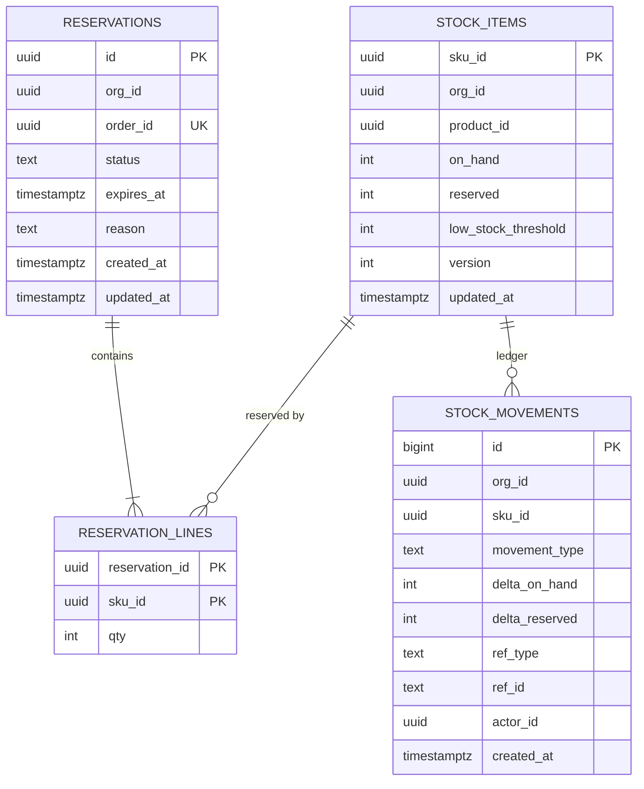

# LLD-07: Inventory, Reservations, and Concurrency

| Field | Value |
| --- | --- |
| Status | Draft v0.1 |
| Milestone | M3 |
| Service | inventory-svc (schema `inventory`) |
| ADRs | 0006, 0011 |

## 1. Scope

This LLD covers:

- authoritative stock;
- reservations (reserve, commit, release, expire, restock);
- concurrency control and deadlock handling;
- admin adjustments;
- availability publication;
- inventory reconciliation (PRD §2.3, FR-CHK-04).

## 2. Invariants

These are enforced by the database, not just by application code:

| ID | Invariant | Enforcement |
| --- | --- | --- |
| INV-1 | `on_hand ≥ 0` | `CHECK` |
| INV-2 | `reserved ≥ 0` | `CHECK` |
| INV-3 | `reserved ≤ on_hand` (never over-allocate) | `CHECK` |
| INV-4 | One reservation per order | `UNIQUE(order_id)` |
| INV-5 | Each stock movement is applied once | `UNIQUE(ref_type, ref_id, movement_type, sku_id)` on the ledger |
| INV-6 | `on_hand` and `reserved` equal the ledger sums | Nightly reconciliation (§9) |

## 3. Data model



- `reservations.status` ∈ `active`, `committed`, `released`, `expired`, `rejected`. Index `(expires_at) WHERE status='active'`.
- `reservation_lines.qty CHECK (qty > 0)`.
- `movement_type` ∈ `reserve`, `release`, `expire`, `commit`, `restock`, `adjust`.
- Stock items are created with `on_hand = 0` by the consumer of `product.updated` for new SKUs. An admin adjustment sets real stock.

## 4. Operations

All operations are idempotent and keyed by `order_id` (or `adjustment_id`). Each runs in **one transaction** at `READ COMMITTED` with `lock_timeout = 1s` and `statement_timeout = 2s`.

### 4.1 Reserve: `POST /internal/v1/reservations`

Request: `{order_id, org_id, lines[{sku_id, qty}], ttl_seconds}`.

```text
BEGIN
  existing = SELECT … FROM reservations WHERE order_id = :order_id
  if existing: COMMIT; return existing outcome (201 same body, or 409 if rejected)   -- idempotent replay
  merge duplicate sku lines; sort lines by sku_id ASC                                  -- deterministic lock order
  rows = SELECT sku_id, on_hand, reserved FROM stock_items
         WHERE org_id = :org_id AND sku_id = ANY(:skus) ORDER BY sku_id FOR UPDATE    -- pessimistic, ordered
  if missing sku or any (on_hand - reserved) < qty:
      ROLLBACK
      record rejection in a separate short tx: INSERT reservations(status='rejected', reason=…) ON CONFLICT DO NOTHING
      return 409 {lines: [{sku_id, requested, available}]}
  UPDATE stock_items SET reserved = reserved + qty, version = version + 1 … (per line)
  INSERT reservations(status='active', expires_at = now() + ttl) ; INSERT reservation_lines
  INSERT stock_movements(type='reserve', delta_reserved=+qty, ref=('order', order_id))
  INSERT outbox inventory.reserved.v1 (+ availability_changed if threshold crossed)
COMMIT → 201 {reservation_id, expires_at}
```

- The `CHECK (reserved ≤ on_hand)` is the final backstop: even a logic bug cannot over-allocate. The violation surfaces as an error and is counted.
- **Recording rejections makes reserve deterministic per order.** A retried reserve for a rejected order returns the same 409, even if stock arrived meanwhile. A new checkout is a new order.

### 4.2 Commit: `POST /internal/v1/reservations/{order_id}:commit` (or command `inventory.commit_requested`)

| Current status | Action |
| --- | --- |
| `active` | Lock stock rows in order. `on_hand -= qty`, `reserved -= qty`. Status → `committed`. Ledger `commit`. Outbox `inventory.committed`. |
| `committed` | No-op; return success (idempotent) |
| `expired` / `released` | 409 `reservation-not-active` (orders-svc goes to its re-reserve path) |

### 4.3 Release: `…:release` (or command `inventory.release_requested`)

| Current status | Action |
| --- | --- |
| `active` | `reserved -= qty`; status → `released`; ledger; outbox `inventory.released` |
| `released` / `expired` / `rejected` / none | No-op success. A release for an unknown order inserts a `released` tombstone, so a late reserve for that order is refused. |
| `committed` | 409 (use restock) |

### 4.4 Restock (command `inventory.restock_requested {order_id, lines}`)

For cancelled or refunded orders after commit: `on_hand += qty`, with ledger `restock` keyed by `('order', order_id)`. INV-5 makes it idempotent. Outbox `inventory.restocked`.

### 4.5 Admin adjustment: `POST /v1/orgs/{orgId}/stock/{skuId}:adjust`

- Request `{adjustment_id, delta | set_on_hand, reason}` with `If-Match: "v{version}"`. Authz: `stock:adjust`.
- **Optimistic lock** on `version`: 412 on mismatch. Admin adjustments are low contention.
- The result must keep `on_hand ≥ reserved`. Otherwise 409 `below-reserved` (`CHECK` backstop).
- Ledger `adjust`, keyed by `adjustment_id`. Emits audit `stock.adjusted` and, if the threshold is crossed, `inventory.availability_changed`.

## 5. Concurrency control and deadlocks

| Concern | Approach |
| --- | --- |
| Oversell under concurrent checkout | Pessimistic row locks (`SELECT … FOR UPDATE`) on the affected SKUs + `CHECK` constraints. Chosen over optimistic retries because checkout contention on popular SKUs is high (PRD §5.1). |
| Deadlocks (multi-SKU orders) | Lock rows in **ascending `sku_id`** order in every operation that touches several SKUs (reserve, commit, release, restock, expire). |
| Residual deadlocks / serialization failures | The `sf-db` retry decorator catches SQLSTATE `40P01` and `40001`, retrying up to 3 times with full jitter (10–100 ms). Counted in `inventory_tx_retries_total{reason}`. |
| Lock waits | `lock_timeout = 1s` → 503 `inventory-busy` (retryable by orders-svc within its deadline). Prevents pile-ups. |
| Hot SKU (flash sale) | All reservations for one SKU serialize on its row. Throughput is bounded by lock hold time (one short transaction). Measured in EXP-9 (§10). |
| Read paths | Availability reads use plain `SELECT` without locks (slightly stale is acceptable). Checkout re-validates under lock. |

## 6. Reservation expiry

- **Default TTL:** 900 s (aligned with the saga deadline, LLD-06 §5.3). It can be configured per store, between 300 and 3600 s.
- **Sweeper** (every replica, every 5 s):

  ```text
  SELECT id FROM reservations WHERE status='active' AND expires_at < now()
  ORDER BY expires_at FOR UPDATE SKIP LOCKED LIMIT 100
  → for each: release logic with status 'expired', ledger 'expire', outbox inventory.reservation_expired.v1
  ```

- **Clock:** expiry is evaluated against **PostgreSQL `now()`**, never pod clocks (clock-skew safety, LLD-13 §6).
- **Safe release:**
  - Expiry and commit race on the reservation row lock. Whichever wins first decides.
  - The loser sees a non-`active` status and follows §4.2/§4.3 semantics.
  - orders-svc handles `reservation_expired` through its re-reserve path.

## 7. Availability publication

- **Shown to customers:** `in_stock = (on_hand − reserved) > 0` and `low_stock = available ≤ low_stock_threshold`. Exact counts are **not** exposed publicly.
- **Event:** `inventory.availability_changed.v1 {org_id, product_id, sku_id, in_stock, low_stock, version}` is emitted **only when a flag flips**. This keeps event volume proportional to state changes, not to orders. Consumed by search-svc (LLD-05 §7.2) and the BFF cache invalidation.

## 8. APIs

| Endpoint | Authz | Notes |
| --- | --- | --- |
| POST `/internal/v1/reservations` | `Internal(inventory:reservations:write)` (svc:orders) | §4.1. Body carries `on_behalf_of` for audit. |
| POST `/internal/v1/reservations/{orderId}:commit` / `:release` | same | §4.2–4.3 |
| GET `/internal/v1/reservations/{orderId}` | `Internal(inventory:reservations:read)` | For reconciliation |
| GET `/internal/v1/reservations?status=active&older_than=` | same | R3 reconciliation |
| GET `/v1/stores/{orgId}/availability?sku_ids=` (≤ 100) | Public, store active | Cached 5 s (LLD-09 §6) |
| GET `/v1/orgs/{orgId}/stock?low_stock=&cursor=` | `stock:read` | |
| POST `/v1/orgs/{orgId}/stock/{skuId}:adjust` | `stock:adjust` | §4.5 |
| GET `/v1/orgs/{orgId}/reservations?status=&cursor=` | `reservation:read` | |
| POST `/v1/orgs/{orgId}/reservations/{id}:release` | `reservation:release` | Manual, audited; refused if the saga is still within its deadline unless `force` is set with a reason |

| Commands consumed | Events published |
| --- | --- |
| `inventory.commit_requested.v1`, `inventory.release_requested.v1`, `inventory.restock_requested.v1` | `inventory.reserved.v1`, `inventory.committed.v1`, `inventory.released.v1`, `inventory.reservation_expired.v1`, `inventory.restocked.v1`, `inventory.availability_changed.v1` |
| `product.updated.v1` (create stock items for new SKUs) | |

## 9. Reconciliation

| Check | Cadence | Action |
| --- | --- | --- |
| Ledger vs current (INV-6) | Nightly + on demand | `SUM(delta_on_hand)`/`SUM(delta_reserved)` per SKU vs `stock_items`. A mismatch is an alert and a report; it is never auto-corrected. |
| `reserved` vs active reservation lines | Nightly | Same |
| Orphan reservations | Driven by orders-svc R3 (LLD-06 §9) | Release |
| Post-restore | After any DB restore (LLD-13 §5) | Run all checks before reopening checkout |

## 10. Experiment EXP-9: hot-SKU contention (optional, M4)

- **Hypothesis:** a single-row SKU lock caps reservation throughput at roughly `1 / lock_hold_time`.
- **Method:** k6 burst of N concurrent checkouts on one SKU with stock S. Measure:
  - throughput;
  - p95/p99;
  - lock wait time (`pg_stat_activity` / `pg_locks` sampling);
  - `lock_timeout` rejections.
- **Alternative to compare:** split stock into K bucket rows per SKU, with reservations picking a random bucket that has availability. This trades complexity and reconciliation cost for throughput.
- **Decision rule:** adopt buckets only if the measured p99 or rejection rate at the target flash-sale load violates the SLO.

## 11. Requirements covered

PRD §2.3 (all bullets); FR-CHK-04; FR-CHK-07 (release and restock); PRD §5.1 (pessimistic vs optimistic locking, deadlock handling); Appendix A (deadlocks, locking).

## 12. Telemetry

| Metric | Labels |
| --- | --- |
| `inventory_reservations_total` | `result` (reserved, rejected_insufficient, replay, busy) |
| `inventory_reservation_duration_seconds` | histogram |
| `inventory_conflicts_total` | `kind` (insufficient, below_reserved, optimistic) |
| `inventory_tx_retries_total` | `reason` (deadlock, serialization) |
| `inventory_lock_timeouts_total` | |
| `inventory_expired_reservations_total` | |
| `inventory_active_reservations` | gauge |
| `inventory_ledger_mismatch_skus` | gauge (from reconciliation) |

## 13. Tests

| Test | Type |
| --- | --- |
| **Oversell:** stock S=50; 200 concurrent reserve calls for qty 1 (distinct orders) → exactly 50 reserved, 150 rejected, `reserved = 50` | Concurrency |
| Mixed multi-SKU orders in opposite orders → no deadlock failures surfaced (retries absorb any) | Concurrency |
| Deadlock injection (bypass ordering in a test hook) → retry decorator recovers | Concurrency |
| Idempotent replay of reserve/commit/release/restock | Integration |
| Release before reserve (tombstone) → the late reserve is refused | Integration |
| Expiry vs commit race (TTL 1 s, commit at the boundary) → exactly one outcome; ledger consistent | Concurrency |
| Adjust below reserved → 409; stale If-Match → 412 | API |
| CHECK constraint backstop: a direct SQL attempt to over-reserve fails | Integration |
| Ledger reconciliation detects an injected mismatch | Integration |
| Cross-tenant: reserve with SKUs from another org → 409/404, no effect | API |
