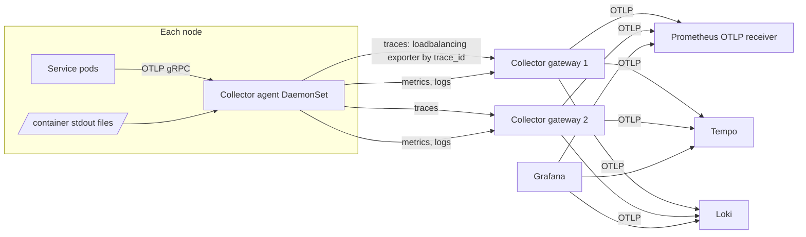

# LLD-10: Observability: OpenTelemetry, Telemetry Pipeline, Dashboards, Alerts, SLOs

| Field | Value |
| --- | --- |
| Status | Draft v0.1 |
| Milestone | M2 (SDK baseline, logs, Jaeger in Compose) → M6 (Collector tiers, backends, dashboards, alerts, SLOs) |
| ADRs | 0013 |

## 1. Scope

This LLD covers:

- instrumentation of every service and the BFF;
- telemetry collection and processing;
- privacy and cardinality controls;
- dashboards, alerts, and SLO definitions (PRD §7).

## 2. Instrumentation

| Layer | Instrumentation | Notes |
| --- | --- | --- |
| FastAPI | `opentelemetry-instrumentation-fastapi` | Excluded URLs: `/healthz`, `/readyz`, `/livez`, `/metrics` |
| HTTP client (httpx) | `opentelemetry-instrumentation-httpx` | Inside the `sf-common` client; propagates W3C context |
| PostgreSQL | `opentelemetry-instrumentation-sqlalchemy` (+ asyncpg) | `db.statement` is sanitized (parameters not recorded) |
| Redis | `opentelemetry-instrumentation-redis` | Command names only; no keys or values in attributes (keys can embed IDs) |
| RabbitMQ | `opentelemetry-instrumentation-aio-pika` + manual envelope propagation (LLD-08 §10) | |
| Manual spans | `checkout`, saga steps, `authz.enforce`, `outbox.relay.batch`, `cache.load`, `reconcile.<job>`, `search.query` | Business attributes are bounded enums |
| Metrics | OTel Metrics API: HTTP server/client semantic-convention histograms + domain metrics (each LLD §Telemetry) | Exponential histograms where the backend supports them; otherwise explicit buckets for latency (5 ms … 10 s) |
| Logs | `structlog` JSON to stdout with OTel context injection (`trace_id`, `span_id`) | Collected by the Collector `filelog` receiver |
| Runtime | `opentelemetry-instrumentation-system-metrics` (process CPU, memory, GC) | |

**Bootstrap:**

- `sf-common.telemetry.init(service_name)` runs at startup. It reads the standard `OTEL_*` environment variables.
- If the exporter endpoint is unreachable, startup continues: telemetry is never a hard dependency (§12).

## 3. Resource attributes and naming

| Attribute | Value |
| --- | --- |
| `service.name` | `bff`, `orders-svc`, … |
| `service.version` | Image tag (git SHA) |
| `service.namespace` | `scaleforge` |
| `deployment.environment.name` | `local`, `ci`, `staging` |
| `k8s.*` | Added by the Collector `k8sattributes` processor |

- Metric names follow OTel semantic conventions where they exist (`http.server.request.duration`). Domain metrics use the `<domain>_<thing>_<unit>` pattern listed in the LLDs.
- Prometheus normalization (OTLP → Prometheus) turns dots into underscores. Dashboards use the normalized names.

## 4. Log schema

| Field | Rule |
| --- | --- |
| `ts` | RFC 3339 UTC, ms precision |
| `level` | debug, info, warning, error, critical |
| `service`, `version`, `env` | From resource |
| `trace_id`, `span_id` | When in a span |
| `correlation_id` | Always (generated if absent) |
| `event` | Stable dotted name, e.g. `checkout.reservation_rejected` |
| `org_id`, `user_id` | Allowed in logs (not in metric labels). `user_id` is the internal UUID, never an email. |
| `error.type`, `error.message` | Sanitized. Stack traces only at error level and only in logs, never in responses. |
| `http.*` | Method, route template (not the raw path with IDs), status, duration |

- **Levels:** info for business events, warning for handled degradation, error for failed requests or jobs.
- **Debug** is off in staging by default and can be enabled per service by a flag.

## 5. Collector topology and pipelines

| Tier | Receivers | Processors (in order) | Exporters |
| --- | --- | --- | --- |
| Agent | `otlp`, `filelog` (container logs, JSON parser, trace-ID extraction) | `memory_limiter` → `k8sattributes` → `resourcedetection` → `attributes/redact` (§6) → `batch` | `loadbalancing` (traces, routing key = trace ID), `otlp` (metrics, logs → gateway) |
| Gateway (2 replicas) | `otlp` | `memory_limiter` → `attributes/redact` (second pass) → `filter` (drop health checks, noisy spans) → `tail_sampling` (traces) → `transform` (cardinality guards) → `batch` | `otlphttp/prometheus`, `otlp/tempo`, `otlphttp/loki` |

**Tail sampling policy:**

1. Keep 100% of traces with errors (`status_code = ERROR`).
2. Keep 100% of traces > 1 s.
3. Keep 100% of traces whose root is `checkout` or contains saga spans.
4. Keep 10% probabilistic for the rest.
5. Keep 100% in `local`/`ci`.

The decision wait is 10 s, which is enough for synchronous paths. Async saga continuations are separate traces linked by span links, and policy 3 keeps them.

M2–M5 (Compose) use a single Collector container exporting to Jaeger all-in-one plus Prometheus.

## 6. Privacy and cardinality (PRD §7.3)

**Never recorded** (SDK hooks + Collector `attributes/redact`, defense in depth):

| Item | Control |
| --- | --- |
| `Authorization`, `Cookie`, `Set-Cookie`, `X-CSRF-Token`, `Idempotency-Key` headers | Header capture is off by default. The allow-list for captured headers is `content-type`, `user-agent` family. The Collector deletes `http.request.header.*` except the allow-list. |
| Tokens, codes, `state` in query strings | `url.query` is dropped for `/auth/*`. Elsewhere, query parameters are redacted except an allow-list (`sort`, `limit`, `category`). |
| SQL parameters | Not captured (sanitized statements) |
| Redis keys/values | Not captured |
| Message bodies | Not captured; only type, ID, and routing key |
| Emails, addresses, payment tokens | Never in attributes or logs. A redaction regex pass in the Collector (`transform`) masks email-like and JWT-like strings as a safety net. |

**Cardinality rules:**

- Metric labels come only from **bounded enums** (route template, status class, outcome, service, queue, cache name, rate class).
- **Forbidden as labels:** user, session, order, org, product IDs, or raw paths.
- The gateway `transform` drops any metric data point whose label values exceed 100 distinct values per series key in a 1-minute window, with a log warning. A CI check scans metric definitions for forbidden label names.
- Trace attributes may carry IDs (needed for debugging), but **not** PII.

**Browser telemetry (optional, M6):**

- OTel Web SDK instruments `fetch` and document load only. Spans are exported to the BFF `/api/telemetry` endpoint, which is rate-limited and size-limited and forwards to the Collector.
- Trace context is propagated only to same-origin requests.
- URL query strings are stripped. No user-entered values are recorded. No authentication material exists in the browser to leak.

## 7. Core metrics (cross-service)

| Signal | Metric | Use |
| --- | --- | --- |
| RED | `http.server.request.duration` (histogram; `http.route`, `http.request.method`, `http.response.status_code` class) | Rate, errors, p50/p95/p99 |
| Dependencies | `http.client.request.duration` (`server.address`, status class); `db_client_operation_duration`; `redis_client_duration_seconds` | Dependency health |
| DB | `db_pool_*` (LLD-09 §2), CNPG exporter (connections, replication lag, deadlocks, cache hit ratio) | Saturation |
| Cache | `cache_requests_total` | Hit rate |
| Messaging | `outbox_*`, `consumer_*`, `queue_depth`, `dlq_depth` (LLD-08 §13) | Backlog, retries, DLQ |
| Business | `checkout_requests_total{outcome}`, `checkout_saga_*`, `inventory_conflicts_total`, `payments_*`, `reconciliation_mismatches_total` | Checkout outcomes |
| Security | `bff_login_total`, `bff_csrf_reject_total`, `authz_decisions_total`, `ratelimit_decisions_total` | Abuse signals |
| Kubernetes | kube-state-metrics: restarts, readiness, HPA replicas; cAdvisor CPU/memory/throttling | Pod health |
| Telemetry pipeline | `otelcol_exporter_send_failed_*`, `otelcol_processor_dropped_*`, `otelcol_receiver_refused_*` | Telemetry loss (PRD §7.1) |

## 8. Dashboards (Grafana, provisioned as code)

| Dashboard | Panels |
| --- | --- |
| Platform overview | Per-service RED, error budget burn, dependency health matrix, active alerts |
| Service detail (templated by service) | RED by route, dependency latency, pool usage, GC/CPU/memory, pod restarts, logs panel filtered by service, exemplar links to traces |
| Checkout | Funnel (requests → accepted → confirmed/cancelled by reason), saga state distribution, time-to-terminal, stuck sagas, payment provider latency and results, reconciliation mismatches |
| Inventory | Reservations/s, conflicts, lock timeouts, deadlock retries, active reservations, expiry rate |
| Database | Connections (server/PgBouncer), pool wait, top queries (from `pg_stat_statements` exporter), replication lag, deadlocks, bloat indicators |
| Cache and rate limits | Hit rate per cache, bypass events, 429s by class, fallback active |
| Messaging | Queue depth, publish/consume rates, retry tiers, DLQ depth, outbox lag, end-to-end event latency |
| Identity and security | Logins by result, MFA/step-up, session validation failures, CSRF rejects, authz denies, policy staleness and revocation latency |
| Kubernetes | Node/pod resources, HPA, readiness, rollouts |
| Telemetry health | Collector queue sizes, export failures, dropped data, sampling rates |

## 9. Alerts (initial; thresholds calibrated from M4 baselines)

| Alert | Condition (sketch) | Severity |
| --- | --- | --- |
| SLO fast burn | Error-budget burn rate > 14.4× over 1 h **and** > 14.4× over 5 m (multi-window) | page |
| SLO slow burn | > 6× over 6 h and 30 m | ticket |
| Checkout success drop | `accepted / total` < baseline − 20% for 10 m (excluding declines and out-of-stock) | page |
| Stuck sagas | `checkout_saga_stuck > 0` for 5 m | page |
| Outbox lag | `outbox_oldest_unpublished_age_seconds > 60` for 5 m | page |
| DLQ not empty | `dlq_depth > 0` for 10 m (audit DLQ: 1 m) | ticket (audit: page) |
| Authz stale | `authz_policy_staleness_seconds > 30` for 2 m | page |
| Session store errors | `bff_session_validation_total{result="store_unavailable"}` rate > 1% for 2 m | page |
| DB saturation | Pool wait p95 > 100 ms for 10 m, or PgBouncer `cl_waiting > 0` for 5 m | ticket |
| Replica lag | > 5 s for 5 m | ticket |
| Reconciliation mismatches | Any `type` in (money_without_order, ledger_mismatch) > 0 | page |
| Pod crash loop | Restarts > 3 in 10 m | ticket |
| Telemetry loss | Export failures > 1% for 15 m | ticket |
| Certificate expiry | < 14 days | ticket |

Every alert links a runbook in `docs/runbooks/<alert>.md`. Implemented so far (Compose, M2): **Outbox lag** and **DLQ not empty**, in `deploy/compose/prometheus/rules/messaging.yml` with promtool tests (`make test-alerts`). `queue_depth`/`dlq_depth` are recording rules over the RabbitMQ plugin's `rabbitmq_detailed_queue_messages`. No Alertmanager yet: alerts are visible at Prometheus `/alerts`; routing by `severity` (page/ticket) lands with E6.3.

## 10. SLOs and error budgets (PRD §7.4, provisional)

| SLO | SLI | Target | Window | Notes |
| --- | --- | --- | --- | --- |
| API availability | Good = non-5xx and non-timeout responses on designated routes ÷ total (429 and 4xx excluded) | ≥ 99.5% | 28 days rolling | Error budget 0.5% ≈ 3.4 h/28 d |
| Lightweight authenticated API latency | Share of requests on the designated list (`/auth/session`, `/me`, cart GET, orders list) under 300 ms | p95 < 300 ms | 28 d | Under the documented workload |
| Cache-eligible product read | Product detail under 250 ms | p95 < 250 ms | 28 d | Warm and cold reported separately |
| Checkout acceptance latency | `POST /checkouts` responses under 2 s | p95 < 2 s | 28 d | Excludes `pm_mock_timeout` scenarios |
| Checkout correctness | Orders reaching a terminal state within 15 min ÷ orders created | ≥ 99.9% | 28 d | Saga health |
| Trace propagation | Share of sampled checkout traces containing BFF, orders, inventory, and payments spans | ≥ 99% | 7 d | Async validated separately via span links |

**Measurement method:** Prometheus recording rules over the histograms. The **load-test environment, workload, duration (≥ 30 min steady state), and warm-up (5 min)** are documented in each report (LLD-14 §6). These are targets to validate, not claims.

**Error-budget policy:** while the 28-day budget is exhausted, only reliability work and fixes ship. The release pipeline checks budget status before canary promotion in staging.

## 11. Sampling, retention, and cost

| Signal | Sampling | Retention | Cost lever |
| --- | --- | --- | --- |
| Traces | Tail: errors/slow/checkout 100%, others 10% | 7 d | Sampling rate; span filtering |
| Metrics | n/a (aggregated) | 15 d | Cardinality guard; scrape and export interval 15 s |
| Logs | Debug off; info sampled for high-volume routes (1/10) if needed | 14 d | Level and sampling; drop health-check logs |

A cost report per workload (PRD §10 Cost) includes telemetry volume: spans/s, series count, logs GB/day.

## 12. Pipeline failure behavior and access control

- SDK exporters use bounded in-memory queues (2048 spans, 30 s export timeout) and **drop on overflow**. They never block request threads.
- The agent applies `memory_limiter` and sends back-pressure to the SDK (which drops). The gateway uses persistent queues (file storage extension) to ride out short backend outages.
- Loss is visible through the `otelcol_*` metrics and SDK self-metrics, on the telemetry health dashboard.
- **Access control:**
  - Grafana uses OIDC login via Keycloak (a separate client) with team-based folder permissions.
  - Prometheus, Tempo, and Loki are not exposed outside the `sf-observability` namespace.
  - NetworkPolicies allow only the Collector and Grafana.

## 13. Requirements covered

PRD §7.1, §7.2, §7.3, §7.4; NFR Observability and Cost; Appendix A (monitoring, logging, distributed tracing, alerts, SLOs, error budgets, observability).

## 14. Tests

| Test | Type |
| --- | --- |
| Trace continuity BFF → orders → inventory/payments → RabbitMQ → consumer (query the trace backend API by `trace_id`) | Integration (CI with Jaeger) |
| Redaction: requests with an Authorization header, cookies, emails, and JWTs in the query → absent from exported spans and logs (in-memory exporter assertion + Collector config test) | Integration |
| Metric label guard: a forbidden label in code fails CI | Static |
| Collector down → services healthy, requests unaffected, drop counters increase | Resilience |
| Alert rules unit-tested with `promtool test rules` | CI |
| Dashboards and alert rules provisioned from the repo (no click-ops) | Deployment |
