# LLD-12: Platform, Packaging, Kubernetes, Release, and CI/CD

| Field | Value |
| --- | --- |
| Status | Draft v0.1 |
| Milestone | M2 (Compose, CI basics) → M5 (Kubernetes, release strategies, full CD) |
| ADRs | 0012, 0014, 0016 |

## 1. Repository layout

The layout comes from ADR-0016:

```
apps/web/                         React + TS + Vite SPA
services/<name>/                  FastAPI service: app/, migrations/, tests/, Dockerfile, pyproject.toml
libs/py/{sf-common,sf-authz,sf-messaging,sf-db}/
contracts/openapi/<service>.yaml  generated + checked in
contracts/events/<type>/v<N>.json
deploy/compose/                   compose.yaml + profiles, Caddyfile, definitions.json (RabbitMQ)
deploy/k8s/base/<service>/        Deployment, Service, HPA, PDB, NetworkPolicy, ServiceAccount, ConfigMap
deploy/k8s/overlays/{local,ci,staging}/
deploy/platform/                  pinned Helm values: cert-manager, envoy-gateway, cnpg, rabbitmq-operator,
                                  keycloak-operator, external-secrets, keda, flagd, observability stack
perf/                             k6 scripts, workload profiles, data generator
chaos/                            Toxiproxy scenarios, Chaos Mesh experiments
docs/
```

**Tooling:**

- `uv` workspaces for Python (lockfile with hashes);
- `pnpm` for web;
- a `Makefile` as the single entry point (`make dev`, `make test`, `make cluster-up`, `make deploy ENV=local`, `make perf SCENARIO=checkout`).

## 2. Container images

| Rule | Detail |
| --- | --- |
| Base | `python:3.13-slim` pinned **by digest**; web served by `nginxinc/nginx-unprivileged` (pinned) |
| Build | Multi-stage. The builder installs locked dependencies with `uv sync --frozen`; the final stage copies the venv and app only. No compilers in the final image. |
| User | Non-root UID 10001; `readOnlyRootFilesystem: true`; writable `/tmp` emptyDir only |
| Process | One `uvicorn` process per container (scale with pods); `--proxy-headers` trusted only from gateway CIDRs |
| Metadata | OCI labels: source, revision, version. SBOM (Syft) attached. Trivy scan gate. |
| Tags | `ghcr.io/<org>/scaleforge/<service>:<git-sha>`. Deployments reference **digests**. |
| Reproducibility | Lockfiles, pinned base digests, `SOURCE_DATE_EPOCH`, and BuildKit cache. Rebuilding the same commit yields the same dependency set. |
| Signing (M5) | cosign keyless (GitHub OIDC). Optional admission verification (Kyverno). |

## 3. Docker Compose (local development and integration)

| Profile | Containers |
| --- | --- |
| `core` | postgres (single, with init script creating schemas and roles), redis-session (AOF), redis-cache, keycloak (+ realm import), rabbitmq (management, `definitions.json`), mailpit, minio |
| `app` | bff, web, all services, mock-payment-provider, migration one-shots (`depends_on: condition: service_completed_successfully`) |
| `obs` | otel-collector, jaeger, prometheus, grafana |
| `test` | toxiproxy (in front of postgres, redis-*, rabbitmq, mock provider) |
| `edge` | Caddy with a local CA (mkcert) at `https://app.scaleforge.localhost`, so `Secure`/`__Host-` cookies behave as in production. Kubernetes uses Envoy Gateway; this difference is documented. |

- Named volumes for postgres, redis-session, rabbitmq, and minio, so data persists across restarts (PRD §11 acceptance).
- Healthchecks on every infrastructure container. App services start after a dependency is healthy.
- `.env.example` is committed; `.env` is git-ignored. No secrets in compose files.

## 4. Kubernetes cluster bootstrap

`make cluster-up` runs these steps, each pinned and idempotent:

1. kind cluster (`deploy/kind/cluster.yaml`: 1 control-plane + 2 workers; extra port mappings 443 → the gateway node port).
2. cert-manager + a local CA `ClusterIssuer`.
3. Gateway API CRDs + Envoy Gateway.
4. CloudNativePG operator → `Cluster` (3 instances in staging, 1–2 locally) + `Pooler` rw/ro + `ScheduledBackup` + Barman Cloud object store (MinIO).
5. RabbitMQ Cluster Operator + Messaging Topology Operator → `RabbitmqCluster` (3 replicas) + topology CRs.
6. Redis: StatefulSets with the official image.
   - redis-session: 3 pods (primary + replicas) + 3 Sentinel pods.
   - redis-cache: 1 pod.
7. Keycloak Operator → `Keycloak` (2 instances) + `KeycloakRealmImport`.
8. MinIO (single node locally).
9. External Secrets Operator (+ OpenBao dev in staging); KEDA; flagd.
10. Observability: OTel Collector (agent DaemonSet + gateway Deployment), Prometheus, Tempo, Loki, Grafana with provisioned dashboards and alerts.
11. Chaos Mesh (local and staging only).

## 5. Application manifests (Kustomize)

Per service, `base/<service>/` contains:

| Resource | Key settings |
| --- | --- |
| Deployment | 2 replicas minimum (T0/T1); `revisionHistoryLimit: 5`; `strategy: RollingUpdate {maxSurge: 25%, maxUnavailable: 0}`; `minReadySeconds: 10`; `topologySpreadConstraints` across nodes (`maxSkew: 1`); securityContext (non-root, drop ALL caps, seccomp RuntimeDefault, read-only root FS) |
| Service | ClusterIP. Payments exposes a separate port `webhooks` (8081) so NetworkPolicy and HTTPRoute can target only the webhook listener. |
| ConfigMap | Non-secret settings |
| ExternalSecret / Secret | DB, Redis, RabbitMQ credentials; Keycloak client secret; encryption keys |
| ServiceAccount | One per workload; `automountServiceAccountToken: false` |
| HPA or KEDA ScaledObject | §8 |
| PodDisruptionBudget | `minAvailable: 1` for 2-replica services; `maxUnavailable: 1` for larger ones |
| NetworkPolicy | §9 |
| Job (migrations) | `migrate-<service>`, run before the rollout by CD (or an Argo CD PreSync hook) |

Overlays set replicas, resources, hostnames, issuers, and feature-flag sources per environment.

## 6. Gateway and routing

| Route (HTTPRoute) | Backend | Policies |
| --- | --- | --- |
| `app.<domain>/` (static) | web | Cache headers for hashed assets; security headers |
| `app.<domain>/auth/*`, `/api/*` | bff | Body limit 1 MiB; request timeout 30 s; per-IP global rate limit (LLD-09 §7.1) |
| `app.<domain>/api/events` | bff | Stream timeout 1 h; no buffering |
| `app.<domain>/upload/*` | minio (presigned POST only) | Body limit 5 MiB |
| `app.<domain>/media/*` | minio (public derived prefix) | Long cache |
| `hooks.<domain>/webhooks/payments/*` | payments-svc:webhooks | Body limit 64 KiB; rate limit; IP allow-list in staging if the provider publishes ranges |
| `id.<domain>/realms/scaleforge/*` | keycloak | Admin paths (`/admin/*`) **not routed** |
| `ops.<domain>/grafana/*` | grafana | Source-IP allow-list + Grafana OIDC |

- TLS certificates come from cert-manager.
- HTTP → HTTPS redirect.
- HSTS is set at the BFF for app responses and at the gateway for others.

## 7. Health probes

| Probe | Endpoint | Semantics | Settings |
| --- | --- | --- | --- |
| Startup | `/livez` | Process up and app initialized. Config validated; for services with authz, the policy is loaded. | `periodSeconds: 2`, `failureThreshold: 30` (60 s) |
| Liveness | `/livez` | Event loop responsive (handler returns without awaiting I/O). **No dependency checks**, so a dependency outage cannot trigger restart storms. | `periodSeconds: 10`, `failureThreshold: 3`, `timeoutSeconds: 2` |
| Readiness | `/readyz` | Can serve traffic: not draining; DB pool reachable (cached 2 s check, 200 ms timeout); authz policy staleness < 300 s; BFF: redis-session reachable. **Optional dependencies (redis-cache, broker, Collector) are excluded**, because they degrade features, not the ability to serve. | `periodSeconds: 5`, `failureThreshold: 2` |

## 8. Resources, autoscaling, and shutdown

**Initial resources** (calibrated by load tests):

| Workload | CPU request | Memory request = limit | CPU limit |
| --- | --- | --- | --- |
| bff | 250m | 384Mi | none (avoid throttling on the latency path; requests guarantee scheduling) |
| T0 services | 200m | 384Mi | none |
| T1/T2 services | 100m | 256Mi | 500m |
| Consumers (when split out) | 100m | 256Mi | 500m |

**Autoscaling:**

| Workload | Scaler | Target | Min/Max |
| --- | --- | --- | --- |
| bff, catalog, search, orders | HPA | CPU 60%. Later: in-flight requests per pod (custom metric via Prometheus Adapter) | 2 / 10 |
| inventory, payments, cart | HPA | CPU 60% | 2 / 6 |
| Queue-heavy consumers (search indexer, notifications, audit) | KEDA RabbitMQ scaler | Queue length 100 per replica | 1 / 6 |

**Graceful shutdown:**

1. SIGTERM → readiness fails immediately.
2. `preStop: sleep 5` lets endpoint removal propagate.
3. Uvicorn stops accepting connections and drains in-flight requests (graceful timeout 20 s).
4. Consumers cancel consumption and finish in-flight messages (ack after commit).
5. The relay finishes its current batch.
6. SSE streams are closed with `retry:` hints.
7. `terminationGracePeriodSeconds: 35`.

## 9. Network policies

- **Default:** deny all ingress and egress in `sf-app`, `sf-data`, and `sf-identity`. Allow DNS egress to kube-dns.
- **Allow-list** (summarized; the full matrix is generated from HLD §9.1):

| From | To |
| --- | --- |
| Gateway (sf-edge) | bff:8080, web:8080, payments-svc:8081, keycloak:8080, minio:9000 |
| bff | All user-facing services :8080; keycloak; redis-session; redis-cache; rabbitmq; otel-agent |
| orders-svc | cart, catalog, inventory, payments :8080 |
| payments-svc | mock-payment-provider |
| authz-svc | orgs-svc |
| orgs-svc | users-svc |
| users-svc, authz-svc | keycloak (admin API) |
| notifications-svc | users-svc; SMTP (mailpit) |
| All app services | pooler-rw/ro:5432; rabbitmq:5671/5672; keycloak (JWKS/token); otel-agent:4317; redis-cache (where used) |
| Services with a direct DB need (relay, leaders, migrations) | cnpg `-rw`:5432 |
| mock-payment-provider | Gateway (webhook callbacks), nothing else |

NetworkPolicy tests (§12) assert that denied paths fail, for example web → postgres and catalog → payments.

## 10. Configuration and secrets

- **Config:** environment from ConfigMaps, validated at startup by typed settings. `--check-config` mode runs in CD before rollout.
- **Secrets:** mounted files from External Secrets (staging) or generated Secrets (local); see LLD-11 §5. Never baked into images; never in Git.
- **Kubernetes RBAC:** CD uses a deploy ServiceAccount limited to the app namespaces.

## 11. Release strategies and feature flags (PRD §9.3)

| Strategy | Mechanism | Promotion / rollback criteria |
| --- | --- | --- |
| Rolling (default) | Deployment RollingUpdate; maxUnavailable 0 | Automatic halt if new pods fail readiness. `kubectl rollout undo` or revert the image digest in the overlay. |
| Canary (staging demo) | `<svc>-stable` and `<svc>-canary` Deployments; HTTPRoute `backendRefs` weights 95/5 → 75/25 → 0/100. Optional Argo Rollouts with the Gateway API plugin. | Each step holds 10 min. Promote if the canary 5xx rate ≤ stable + 0.5 pp and p95 ≤ 1.2 × stable (Prometheus by `service.version`), and the error budget is not exhausted. Otherwise weight → 0. |
| Blue-green (staging demo) | `<svc>-blue` / `<svc>-green`. Green receives preview traffic via a header-matched HTTPRoute (`X-Preview: green`, ops IP allow-list). Smoke tests run, then the main route is switched. | Smoke tests pass, then switch. Keep blue for 30 min; switching back is one route change. |

- **Database compatibility:** every release must work with the previous and next schema (expand/contract, LLD-09 §1), so rollback never requires a DB rollback. Destructive "contract" migrations ship at least one release after the code stops using the old shape.
- **Feature flags:**
  - OpenFeature SDK (Python, web) with the flagd provider. Flags are defined in Git (`deploy/k8s/overlays/<env>/flags.json`) and synced to flagd.
  - Flag types: release (new saga steps, SSE), ops kill switch (cache, Bloom filter, browser telemetry), and experiment.
  - Flag changes in staging go through PR. Emergency kill switches are applied by an operator, recorded in the Kubernetes audit log, and written to the audit trail by the ops console.

## 12. CI/CD pipeline (GitHub Actions)

```mermaid
flowchart LR
  A[PR] --> L[Lint + typecheck<br/>ruff, mypy, eslint, tsc]
  L --> U[Unit tests<br/>pytest, vitest]
  U --> C[Contract checks<br/>OpenAPI diff, event schema compat]
  C --> B[Build images<br/>SBOM, Trivy, gitleaks, Semgrep, pip/npm audit]
  B --> I[Integration tests<br/>testcontainers / compose]
  I --> K[Ephemeral kind deploy<br/>migrations, smoke, Playwright subset,<br/>security suites, NetworkPolicy tests]
  K --> M{merge to main}
  M --> P[Publish + sign images<br/>digests]
  P --> S[Staging deploy<br/>GitOps or approved job]
  S --> SM[Post-deploy smoke<br/>canary analysis]
  SM -- fail --> RB[Auto rollback]
```



| Gate | Fails the build on |
| --- | --- |
| Lint and types | Any error |
| Unit | Any failure; coverage below 80% for domain modules (pricing, state machines, authz) |
| Contracts | Breaking OpenAPI/event change without a version bump |
| Security scans | Critical/high vulnerabilities without a waiver; secrets detected |
| Manifests | kubeconform schema errors; kube-linter policy violations (no root, no `latest`, probes present, resources set) |
| Ephemeral deploy | Failed rollout, smoke, E2E subset, or security suite |

- **Nightly:** full E2E, resilience subset (Toxiproxy), ZAP baseline, k6 smoke-load (5 min), and dependency-update PRs (Renovate).
- Path filters run only the affected services on PRs. Main runs everything.

## 13. Requirements covered

PRD §9.1, §9.2, §9.3 (all bullets); NFR Portability; SEC-08, SEC-12, SEC-14; Appendix A (Docker, Kubernetes, service discovery, load balancing, reverse proxy, API gateway, feature flags, blue-green, canary, rolling, health checks).

## 14. Tests

| Test | Type |
| --- | --- |
| Rolling update under a k6 load: 0 failed requests, p95 within 20% of baseline | Deployment |
| Kill a pod (`kubectl delete pod`, and node drain) → no traffic to the terminating pod; replacement ready; no 5xx beyond in-flight | Deployment (FS-6) |
| Readiness excludes optional dependencies: stop RabbitMQ → pods stay ready | Deployment |
| Invalid config → pod fails at startup; rollout halts; the old ReplicaSet keeps serving | Deployment |
| Resource limits: memory stress → OOMKilled → restart; the HPA reacts to a CPU load | Deployment |
| NetworkPolicy deny/allow matrix | Deployment |
| Canary and blue-green demos with scripted promotion and rollback | Release |
